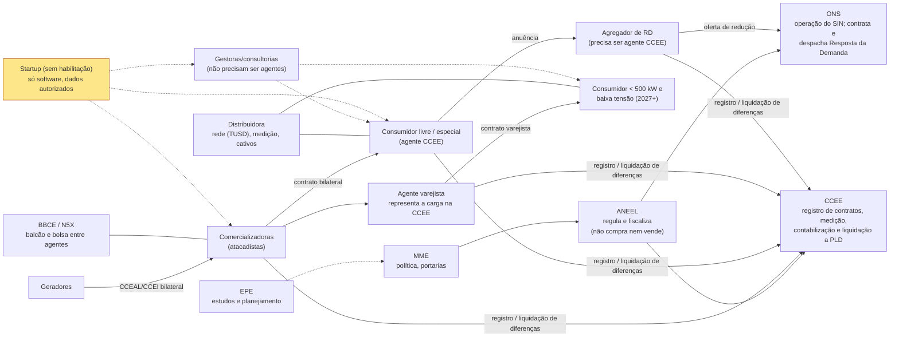
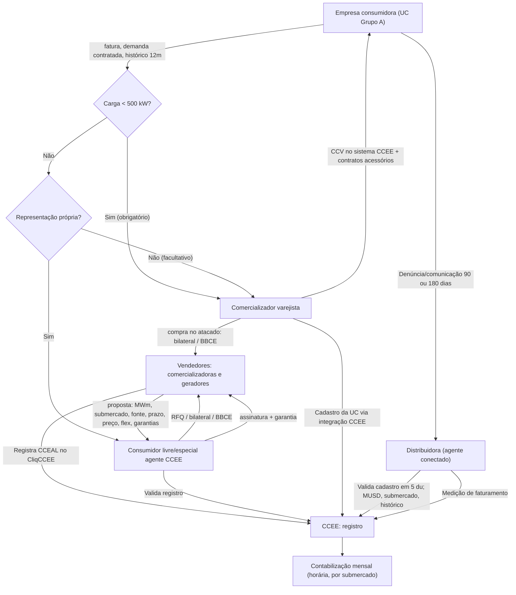
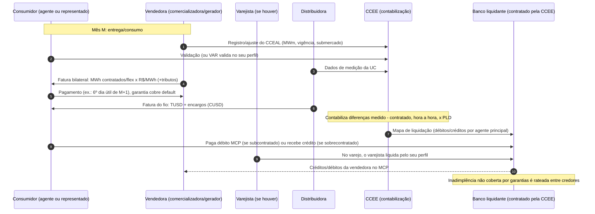
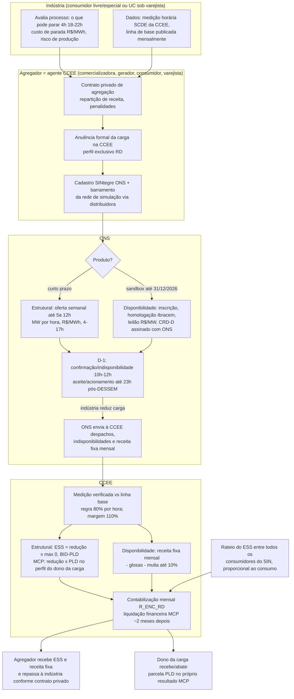

# 01 — Mercado: cadeia de valor, fluxos e papéis regulatórios

> **Status:** consolidado em 27/11/2026 a partir de três frentes (ACL, Resposta da Demanda, Open Energy) (ver `docs/DECISOES.md` D-002, D-003, D-009). Conteúdo produzido por agentes de pesquisa e conferido por amostragem nas afirmações críticas (D-007).
>
> **Convenção de referências:** cada parte veio de uma frente de pesquisa independente; os identificadores têm prefixo da frente (`ACL-R1`, `RD-R3`, `CLI-R5`, `CON-R2`, `OE-R7`, `H5-R1`). A lista completa está em [`REFERENCIAS.md`](REFERENCIAS.md). Rótulos: `CONFIRMADO`, `INFERÊNCIA`, `HIPÓTESE`, `NÃO VERIFICADO`. Data de consulta de todas as fontes: 27/11/2026.

## Síntese para a decisão

### Mapa de atores

### Fatos que condicionam qualquer modelo de negócio (todos com fonte nas Partes A–C)

1. **Elegibilidade:** todo o Grupo A pode estar no ACL desde 01/01/2024; abaixo de 500 kW, só via varejista. Baixa tensão: 25/11/2027 (indústria e comércio) e 25/11/2028 (demais), sempre via varejista, dependendo de regulamentação da ANEEL ainda não publicada. `CONFIRMADO` (ACL-R*, OE-R*)
2. **Onde está o crescimento:** 81% das migrações de 2025 foram via varejista e 93% tinham carga ≤ 0,5 MW. Esse é exatamente o público do **comparador oficial gratuito da CCEE** (REN 1.175/2026: até 04/11/2027; APIs com consentimento até 04/11/2028). `INFERÊNCIA` (números) / `CONFIRMADO` (REN)
3. **Contrato ≠ liquidação:** o preço do contrato é pago bilateralmente; pela CCEE passam apenas as diferenças a PLD. Uma plataforma de software não precisa (nem pode, sem habilitação) tocar nesse fluxo. `CONFIRMADO`
4. **Atacado já tem infraestrutura:** BBCE (R$ 88,8 bi em 2025; só agentes autorizados) e N5X. Um marketplace genérico seria camada redundante. `CONFIRMADO`
5. **RD é pequena, regulada e provisória:** 344 MW contratados em 2026 (12 ofertas), receita total do mercado da ordem de R$ 10–50 mi/ano; produto Disponibilidade em sandbox até 31/12/2026; só agente CCEE pode agregar; varejista agrega a própria carteira. `CONFIRMADO` (regras) / `INFERÊNCIA` (tamanho)
6. **Não existe mercado bilateral líquido de "flexibilidade"** fora da RD regulada. `INFERÊNCIA` (busca negativa)
7. **Crise de crédito de 2026:** recuperações judiciais de comercializadoras (Tradener, Electra, Elétron, IBS, 2W), CCEE migrando para monitoramento prudencial; risco de contraparte passou a ser atributo central da compra. `CONFIRMADO` (fatos) — ver hipótese H5 em `05` e `06`.
8. **Dados acessíveis sem habilitação:** dados abertos da CCEE; arquivos fornecidos pelo cliente; 12 meses de medição que o titular pode pedir à CCEE indicando terceiro (PdC 1.8). Plataforma de Integração da CCEE é restrita a agentes. Dados recebidos via Open Energy **não podem ser repassados** a terceiros. `CONFIRMADO`

### Glossário

Os glossários detalhados estão na Parte A, §10 (ACL) e ao longo da Parte B (RD). Termos-chave: **ACL** (Ambiente de Contratação Livre), **ACR** (regulado), **CCEAL/CCEI** (contratos de compra e venda no ACL), **MWm** (MW médio = energia/horas do período; não é potência instantânea), **PLD** (Preço de Liquidação das Diferenças, horário, por submercado), **MCP** (Mercado de Curto Prazo), **ESS** (Encargo de Serviços do Sistema, paga a RD), **ERCAP** (encargo de reserva de capacidade), **SUI** (Suprimento de Última Instância), **varejista** (agente que representa cargas na CCEE), **agregador** (agente que oferta RD de várias cargas), **sazonalização/modulação** (distribuição do volume contratado em meses/horas), **SMF/SCDE** (sistema de medição para faturamento / coleta de dados de energia).

## Parte A — Compra e venda de energia no ACL

> **Escopo:** seção 2.1-A do `PLANO.md`. Data de referência e de consulta de todas as fontes: **27/11/2026**.
> **Legenda de status:** `CONFIRMADO` (lido em fonte primária ou em texto normativo/documento oficial), `INFERÊNCIA` (dedução razoável a partir de fontes citadas, ou fonte secundária séria sem conferência no original), `HIPÓTESE` (suposição a validar), `NÃO VERIFICADO` (não foi possível checar; registrar impacto).
> **Limitações de acesso:** o portal `ccee.org.br` respondeu **403** a `curl` (ex.: InfoMercado mensal de abr/2026), mas alguns PDFs da CCEE puderam ser obtidos pela ferramenta de fetch e tiveram o texto extraído localmente (Regras "Contratos" v2026.5.1, Regras "Liquidação" v2026.1.0, PdC 1.8, documento de PL mínimo do varejista 2026). `bbce.com.br/mercado-livre/` respondeu 403, mas o PDF do Contrato Padrão BBCE v11 foi baixado. Números agregados de mercado (nº de consumidores, migrações) vieram de **notícias que citam a CCEE**, sem conferência no InfoMercado original, e por isso estão marcados como `INFERÊNCIA`.
> **Este documento não é parecer jurídico.**

---

### 0. Resumo executivo (10 linhas)

1. Hoje (27/11/2026), **todo consumidor do Grupo A** (média/alta tensão) pode comprar no ACL. Isso vale desde 01/01/2024 (Portaria MME 50/2022). Quem tem carga **< 500 kW** precisa ser **representado por agente varejista** na CCEE. `CONFIRMADO`
2. A **baixa tensão (< 2,3 kV)** já tem base legal (Lei 15.269/2025) e datas no Decreto 13.097/2026: **25/11/2027** para industriais e comerciais e **25/11/2028** para os demais. Esses consumidores serão representados por varejista. A ANEEL ainda não regulamentou o Grupo B. `CONFIRMADO`
3. Os contratos (CCEAL/CCEI) são negociados livremente, sem interferência da CCEE. Todos têm de ser **registrados na CCEE**, em **MW médio por vigência**, com sazonalização e modulação. Sem modulação validada no prazo, o sistema modula de forma *flat*. `CONFIRMADO`
4. O **dinheiro do contrato** vai direto do comprador ao vendedor, por fatura bilateral (no contrato padrão BBCE, vencimento no 6º dia útil do mês seguinte). Pela CCEE passam só **as diferenças** entre o que foi contratado e o que foi medido, valoradas a **PLD**, por meio de um banco liquidante. `CONFIRMADO`
5. Limites do PLD em 2026: mínimo R$ 57,31/MWh, máximo estrutural R$ 785,27/MWh e máximo horário R$ 1.611,04/MWh (DSP ANEEL 3.850/2025) [ACL-R20]. `INFERÊNCIA` (fonte secundária que cita a CCEE)
6. Mercado: cerca de **85 mil** unidades/participantes no ACL e cerca de **43%** do consumo nacional. Foram **~21,7 mil migrações em 2025** (81% via varejista; 93% com carga ≤ 0,5 MW). Em 2026 as migrações **desaceleraram** (1T26: 4.827, −36,5% a/a). `INFERÊNCIA`
7. **Crise de crédito:** pelo menos 6 comercializadoras pediram recuperação judicial em 2026. A CCEE aplica "operação balanceada" e prepara um **monitoramento prudencial**. Risco de contraparte e garantias são centrais em qualquer intermediação. `INFERÊNCIA`
8. **Fim do desconto na TUSD/TUST** (parcela consumo) para quem migrar a partir da Lei 15.269/2025. A ANEEL abriu consulta (29/10 a 14/12/2026). A atratividade do "consumidor especial/incentivado" cai para novos entrantes. `CONFIRMADO` (lei) / `INFERÊNCIA` (efeito)
9. Dados para cotar: **fatura + demanda contratada + 12 meses de consumo** bastam para uma cotação indicativa. Curva horária e dados da CCEE exigem **titular/representante legal**. A CCEE já entrega 12 meses de medição a quem o titular indicar, em até 5 dias úteis (PdC 1.8). `CONFIRMADO`
10. **REN 1.174/2026** (migração em 90 dias para AS/A4 no modelo simplificado, salvaguardas contra distribuidora coligada) e **REN 1.175/2026** (Open Energy: comparador da CCEE em 12 meses, APIs com consentimento em 24 meses) mudam o espaço para RFQ e comparadores privados. `CONFIRMADO` (ANEEL) / `INFERÊNCIA` (números das RENs)

---

### 1. Quem pode comprar e vender no ACL (regras vigentes em 27/11/2026)

#### 1.1 Base legal e quem participa

| Item | Regra vigente | Fonte | Status |
|---|---|---|---|
| Quem opera no ACL | Concessionários, permissionários e autorizados de geração, comercializadores, importadores e **consumidores livres ou especiais**. Os contratos são livremente negociados (CCEAL; quando a fonte é incentivada, CCEI). | CCEE, Regras de Comercialização "Contratos" v2026.5.1 [ACL-R1] | CONFIRMADO |
| Registro obrigatório | "Todos os contratos celebrados no ACL devem ser registrados na CCEE" (art. 56 do Decreto 5.163/2004 e Convenção de Comercialização). | [ACL-R1] | CONFIRMADO |
| CCEE | Pessoa jurídica de direito privado, sem fins lucrativos, sob regulação e fiscalização da ANEEL. Os membros incluem os consumidores dos arts. 15 e 16 da Lei 9.074/1995. Pode desligar membros, e o desligamento de um consumidor suspende o fornecimento a todas as suas unidades modeladas. A Lei 15.269/2025 a renomeou para "Câmara de Comercialização de **Energia**". | Lei 10.848/2004, art. 4º e 4º-D [ACL-R2] | CONFIRMADO |
| Comercialização varejista | Autorizada no art. 4º-A da Lei 10.848/2004: agentes da CCEE representam consumidores que não precisam aderir à CCEE, conforme regulação da ANEEL. Se a representação termina e não há suprimento alternativo, todas as unidades podem ter o fornecimento suspenso. | [ACL-R2] | CONFIRMADO |

#### 1.2 Consumidores do Grupo A (média/alta tensão)

- **Desde 01/01/2024**, todo consumidor do Grupo A "poderá optar pela compra de energia elétrica a qualquer concessionário, permissionário ou autorizado" do SIN. Os de **carga individual inferior a 500 kW** "serão representados por agente varejista perante a CCEE". Portaria Normativa 50/GM/MME, de 27/09/2022 (DOU 28/09/2022) [ACL-R3]. `CONFIRMADO` (texto extraído do PDF oficial do MME).
- Para esse público, segundo a Procuradoria Federal junto à ANEEL, "a comercialização varejista não é uma alternativa entre outras, mas a única via de acesso ao mercado livre" (Parecer 218/2026/PFANEEL, 03/09/2026) [ACL-R4]. `CONFIRMADO`
- Consumidor **≥ 500 kW**: pode virar agente da CCEE (consumidor livre ou especial, com representação própria, a chamada modelagem "não varejista") **ou** usar um varejista. O modelo simplificado é **facultativo** para quem não é obrigado à representação varejista (PdC 1.8, premissa 3.1.1) [ACL-R5]. `CONFIRMADO`
- **Livre vs especial (distinção histórica):** o "especial" (≥ 500 kW pelos critérios da Lei 9.427/1996, art. 26 §5º) comprava energia de fonte incentivada e recebia desconto na TUSD/TUST. Com a Portaria 50/2022, qualquer consumidor do Grupo A pode comprar energia convencional. `INFERÊNCIA`: definições vistas em glossários ANEEL/CCEE nos resultados de busca, mas o texto consolidado da Portaria MME 465/2019 não foi relido.
- **Fim do desconto "no fio" para novos migrantes:** a Lei 15.269/2025 incluiu o §14 no art. 26 da Lei 9.427/1996. Ele veda a redução tarifária (§§1º, 1º-A, 1º-B) "com incidência na parcela consumo" para quem **exercer a opção** de migrar a partir da vigência da lei, ou pedir **ampliação** do montante de uso (nesse caso, o desconto fica preservado sobre o montante já contratado) [ACL-R6]. `CONFIRMADO` (texto legal). A ANEEL aprovou em 27/10/2026 uma consulta pública para regulamentar o tema (contribuições de 29/10 a 14/12/2026). O "marco temporal" ainda está em discussão [ACL-R7]. `INFERÊNCIA` (Agência iNFRA). **Impacto:** a vantagem econômica da energia incentivada para novos consumidores especiais diminui. O desenho de produto e a cotação precisam tratar o desconto como **legado**, não como regra geral.

#### 1.3 Baixa tensão (Grupo B): o que está em vigor hoje

| Marco | Conteúdo | Fonte | Status |
|---|---|---|---|
| Lei 15.269, de 24/11/2025 (DOU 25/11/2025) | Inclui o §17 no art. 15 da Lei 9.074/1995: abertura para < 2,3 kV em **até 24 meses** (industriais e comerciais) e **até 36 meses** (demais). Depende de requisitos prévios: plano de comunicação, regulação do **Supridor de Última Instância (SUI)** e outros. Cria o art. 15-C (SUI autorizado e fiscalizado pela ANEEL, com déficit involuntário rateado no ACL por encargo). | Planalto [ACL-R6] | CONFIRMADO |
| Decreto 13.097, de 12/08/2026 (DOU 13/08/2026) | Livre escolha a partir de **25/11/2027** (industriais e comerciais < 2,3 kV) e **25/11/2028** (demais, inclusive residenciais). Representação **obrigatória por agente varejista**, com um único varejista por UC. Aviso de migração à distribuidora com **90 dias** (a ANEEL pode criar rito simplificado mais curto). Retorno ao ACR com **1 ano** de aviso. A troca de medidor **não** é condição para migrar. SUI exclusivo das distribuidoras até 31/12/2030. Plataforma de comparação de ofertas pela CCEE (art. 10). Benefícios do ACR (TSEE etc.) não se aplicam no ACL. | Planalto [ACL-R8] | CONFIRMADO |
| Decisão ANEEL de 27/10/2026 | Aperfeiçoa as regras do **Grupo A** e institui o Open Energy. O **Grupo B** fica para "processo específico da Agenda Regulatória 2026-2027". | ANEEL [ACL-R9] | CONFIRMADO |

**Conclusão de vigência:** em 27/11/2026, **nenhum consumidor de baixa tensão pode migrar ainda**. A data mais próxima é 25/11/2027, e ela depende de regulamentação da ANEEL que ainda está pendente. `CONFIRMADO` (datas) / `INFERÊNCIA` (dependência regulatória ainda não resolvida, porque não foi encontrada resolução da ANEEL para o Grupo B).

#### 1.4 Regras de migração do Grupo A após 27/10/2026

Fonte: ANEEL, notícia de 27/10/2026 [ACL-R9] (`CONFIRMADO`); REN 1.174/2026, assinada em 27/10/2026 e publicada no DOU em 04/11/2026, segundo a Atlas Público [ACL-R10] (`INFERÊNCIA` quanto ao número e às datas).

- A migração pode começar por **manifestação formal à distribuidora**, sem encerrar antes o contrato regulado. No **modelo simplificado**, também pode começar pela contratação do **varejista**, que comunica a distribuidora **pelo sistema da CCEE**.
- Prazo: cai de **180 para 90 dias** para a maior parte das unidades AS e A4 no modelo simplificado. As demais continuam com 180 dias.
- A distribuidora tem 5 dias úteis para analisar o pedido. A recusa por inviabilidade técnica exige visita e relatório. Exigências técnicas não emergenciais não podem travar o processo [ACL-R10].
- **Separação entre distribuidora e comercializadora do mesmo grupo:** ficam vedados publicidade conjunta, uso da imagem da distribuidora e compartilhamento de infraestrutura e pessoal. As regras de marca valem em 180 dias. A vedação a novos compartilhamentos vale imediatamente [ACL-R9].
- Há previsão de sandbox para **fatura unificada emitida pelo comercializador** [ACL-R10]. `INFERÊNCIA`

#### 1.5 Quem pode vender: comercializadoras, atacado e varejo

| Tipo | O que faz | Requisitos encontrados | Status |
|---|---|---|---|
| **Comercializador (atacado)** | Autorizado pela ANEEL (REN 1.011/2022). É agente da CCEE, compra e vende CCEAL com geradores, outras comercializadoras e consumidores agentes. | Capital social integralizado mínimo de **R$ 2 milhões** (data-base mai/2022, corrigido pelo IPCA; R$ 2.028.578 em 2023, segundo a Abraceel). Prova na obtenção e anualmente [ACL-R11]. **Classificação (REN 1.014/2022):** o *Tipo 1* tem PL acima do mínimo e não tem limite de registro; o *Tipo 2* fica limitado a **30 MWm/mês** de registro e não pode atuar no varejo. Em 2026 eram **317** do Tipo 1 (contra 290) e **121** do Tipo 2 com demonstrações entregues [ACL-R12]. | INFERÊNCIA (fontes secundárias: Abraceel/Lefosse/Cenário Energia) |
| **Comercializador (ou gerador) varejista** | Habilitado pela CCEE como varejista (PdC 1.6). **Representa** o consumidor perante a CCEE: assume a modelagem, a contabilização e a liquidação em nome do consumidor, que **não acessa** o sistema da CCEE no modelo simplificado [ACL-R5]. | **PL mínimo de R$ 11.598.664,00 em 2026** (atualizado em jan/2026 pelo IPCA), além do limite operacional mínimo e de outros requisitos do PdC 1.6 e da REN 1.011/2022 [ACL-R13]. Contrato padronizado: **CCV** (Contrato para Comercialização Varejista), gerado e assinado eletronicamente no sistema da CCEE [ACL-R5]. Novo **Capítulo IV-A da REN 1.011/2022**: solução de controvérsias em 3 etapas (representante, Consumidor.gov.br, ANEEL/agência estadual) e **adesão obrigatória ao Consumidor.gov.br** [ACL-R4]. | CONFIRMADO (PL e CCV) / INFERÊNCIA (Cap. IV-A aprovado na decisão de 27/10/2026; o texto final não foi lido) |

- **Número total de comercializadoras e varejistas habilitados:** `NÃO VERIFICADO`. A lista oficial fica no site da CCEE, que estava inacessível. A soma de Tipo 1 e Tipo 2 com demonstrações (438) é **INFERÊNCIA**, não um censo. **Impacto:** para dimensionar o lado vendedor de um marketplace, é preciso baixar a lista de agentes e de varejistas no portal da CCEE (manualmente ou por outro canal).
- A CCEE tem **16.120 agentes associados** (todas as categorias), segundo o Relatório de Sustentabilidade 2025 citado pela Cenário Energia (22/05/2026) [ACL-R14]. `INFERÊNCIA`

---

### 2. Como se formam propostas e cotações

| Canal | Descrição | Evidência | Status |
|---|---|---|---|
| **Bilateral direto** | Negociação entre comprador (consumidor agente ou varejista) e vendedor (gerador ou comercializadora). Preço, prazo, volume e garantias são livres. | [ACL-R1] ("livre negociação entre os agentes… sem a interferência da CCEE") | CONFIRMADO |
| **Representação varejista** | O consumidor < 500 kW (e, a partir de 2027/2028, o de BT) assina o CCV com o varejista. O "produto" é a representação mais o fornecimento, em geral com preço por MWh e sem que o consumidor gerencie a CCEE. | [ACL-R3], [ACL-R5] | CONFIRMADO |
| **Balcão/plataforma BBCE** | Negociação "em tela" (EHUB) com produtos padronizados (sazonalização, modulação e flexibilidade *flat*) ou por "BBCE Boleta Eletrônica" (termos ajustáveis). Usa o **Contrato Padrão BBCE v11** e tem serviço opcional de **liquidação financeira** com instituição parceira. | Contrato Padrão BBCE v11 [ACL-R15] | CONFIRMADO |
| Volumes BBCE 2026 | Fev/2026: R$ 6,5 bi e ~19,5 TWh. Out/2026: R$ 5,8 bi (as matérias dizem "29 GWh", provável erro de unidade para TWh). O estoque de derivativos chegou a R$ 10 bi e 56 TWh (até ago/2026). | Cenário Energia [ACL-R16][ACL-R17] | INFERÊNCIA (a unidade de out/2026 é inconsistente; não usar sem conferir na BBCE) |
| **RFQ, brokers, telefone, leilões privados** | Prática de mercado amplamente relatada: consumidor ou gestora faz "tomada de preços" com várias comercializadoras, e há corretoras e leilões de compra promovidos por grandes consumidores. | **Nenhuma fonte primária encontrada** sobre formato, comissões ou participação de mercado | NÃO VERIFICADO / HIPÓTESE. **Impacto:** a hipótese H1 depende disso. Validar em entrevistas (gestoras, comercializadoras, compradores industriais) antes de modelar receita. |
| **Relacionamento, limite de crédito e garantias** | A vendedora só registra a energia mediante a garantia pactuada (fiança corporativa ou bancária, seguro garantia, "registro contra pagamento" ou outras). O contrato prevê *cross default*. | [ACL-R15] cláusula 15 e condições comerciais | CONFIRMADO (formato contratual); INFERÊNCIA (que limites de crédito por contraparte condicionam quem recebe cotação) |

**Contexto de 2026 (crise de comercializadoras):** pelo menos seis comercializadoras pediram recuperação judicial (citadas: Tradener, Electra, Elétron Energy, IBS Energy, 2W Ecobank). A Gold Energia teve contratos rescindidos. As causas apontadas são PLD elevado, baixa liquidez de longo prazo e alavancagem. A CCEE aplica o "regime de operação balanceada" (verificação prévia de registros) e pode desligar agentes. Eixos, 09/07/2026 [ACL-R18]. `INFERÊNCIA`. Em 19/05/2026, a ANEEL **isentou consumidores < 9 MWm** do monitoramento prudencial até a conclusão da CP 33/2025 [ACL-R19]. `INFERÊNCIA`. **Impacto para H1/H4:** a qualidade de crédito da contraparte é um atributo de produto tão importante quanto o preço. Uma plataforma que mostre só o preço é incompleta.

---

### 3. Produtos contratados

#### 3.1 Atributos (com fontes)

| Atributo | Definição e prática | Fonte | Status |
|---|---|---|---|
| **Quantidade** | Registrada na CCEE em **MW médio (MWm) por vigência**. A contabilização é mensal e o período de comercialização é horário. Energia (MWh) = MWm × horas do período. | [ACL-R1] | CONFIRMADO |
| **Sazonalização** | Distribuição do volume anual pelos meses. No ACL, é feita pelo próprio agente conforme o acordado. Na BBCE: limites inferior e superior em %. Se a compradora não informar, vale a sazonalização *flat*. | [ACL-R1], [ACL-R15] cl. 4.1 | CONFIRMADO |
| **Modulação** | Distribuição do volume mensal pelas horas. Se não for feita ou validada no prazo, a CCEE modula *flat* (volume ÷ horas). Há **modulação vinculada** à medição de carga, de geração ou ao perfil do MRE. | [ACL-R1] | CONFIRMADO |
| **Flexibilidade** | Banda de variação do volume mensal em relação ao consumo (limites % no contrato). O contrato BBCE prevê "Flexibilidade *flat*" se a compradora não informar a medição. Faixas "típicas" (ex.: ±10%): fonte secundária apenas. | [ACL-R15] cl. 4.3; Canal Solar (sem data clara) | CONFIRMADO (cláusula) / NÃO VERIFICADO (faixas típicas) |
| **Submercado / ponto de entrega** | Entrega no centro de gravidade do submercado (SE/CO, S, NE, N). Se a energia for consumida em outro submercado, a diferença de preço entre submercados fica com a compradora (no contrato BBCE). | [ACL-R15] cl. 3.6 e 3.8.2 | CONFIRMADO |
| **Fonte / tipo de energia** | Convencional ou incentivada (CCEI). No contrato BBCE há campo de **% de desconto na TUSD/TUST**. Fontes incentivadas, segundo a CCEE: renováveis ≤ 30 MW, PCHs e CGHs. | [ACL-R1], [ACL-R15] | CONFIRMADO |
| **Prazo** | Do curto prazo (mês seguinte, trimestre) a vários anos. Na BBCE há produtos mensais, trimestrais e anuais. | [ACL-R16][ACL-R17] | CONFIRMADO (existência de produtos) |
| **Preço** | Fixo em R$/MWh ou **"PLD + spread"** (média do PLD do mês mais ágio, positivo ou negativo). | [ACL-R15] cl. 5.1.2 | CONFIRMADO |
| **Reajuste** | IPCA ou IGP-M, mês cheio ou *pro rata die*, com data-base definida, ou sem reajuste. | [ACL-R15] | CONFIRMADO |
| **Tributos** | O contrato BBCE v11 prevê preços **líquidos de tributos** para suprimento a partir de 2027, com IBS/CBS acrescidos conforme a transição da reforma tributária (EC 132/2023, LC 214/2025). | [ACL-R15] cl. 5.1.4 e 5.3 | CONFIRMADO (cláusula); efeitos fiscais a validar com especialista |
| **Garantias** | Fiança corporativa ou bancária, seguro garantia, "registro contra pagamento" (sem garantia: a energia só é registrada após o pagamento) e outras. | [ACL-R15] | CONFIRMADO |
| **Encargos** | Até o centro de gravidade, riscos e encargos (inclusive EER, ESS e contribuição associativa liquidados na CCEE) são da vendedora; depois dele, da compradora. | [ACL-R15] cl. 3.6 | CONFIRMADO (no contrato padrão BBCE; outros contratos podem divergir) |
| **Pagamento** | Fatura mensal por MWh. Na tela EHUB, vencimento no **6º dia útil do mês seguinte** à entrega (MS), com fatura enviada pelo menos 3 dias úteis antes. Pagamento direto ou via liquidação BBCE. | [ACL-R15] cl. 5.2 e 5.8 | CONFIRMADO |

#### 3.2 Preços de referência (somente com fonte; não são cotação)

| Referência | Valor | Fonte | Status |
|---|---|---|---|
| Longo prazo (4 anos seguintes), convencional | R$ 147/MWh (jan/2024) → **R$ 233/MWh (mar/2026)** | Abraceel via Eixos, 01/04/2026 [ACL-R21] | INFERÊNCIA |
| Trimestral | R$ 317/MWh (2026) | idem | INFERÊNCIA |
| BBCE, convencional SE: dez/2026 e 4T26 | R$ 132,21/MWh e R$ 112,48/MWh (out/2026) | Cenário Energia, 11/11/2026 [ACL-R17] | INFERÊNCIA |
| BBCE anual 2027 | ~R$ 247,72/MWh (semana de meados de 2026; data exata não confirmada) | Canal Solar via busca | NÃO VERIFICADO (data) |
| PLD médio | R$ 129/MWh (2024) → R$ 236/MWh (2026), segundo a Abraceel | Eixos, 09/07/2026 [ACL-R18] | INFERÊNCIA |
| **Margens e *spreads* de comercializadoras/varejistas; comissões de brokers** | — | **Nenhuma fonte encontrada** | NÃO VERIFICADO. **Impacto:** não é possível estimar *take rate* de H1 nem disposição a pagar com base documental. Precisa de entrevistas. |

---

### 4. Do fechamento à liquidação

#### 4.1 Passo a passo

1. **Qualificação e cotação:** dados da UC, perfil de consumo, crédito e garantias (ver §6). `INFERÊNCIA`
2. **Fechamento e assinatura:** o contrato bilateral (ou o Contrato Padrão BBCE, ou o CCV no varejo) é assinado eletronicamente. A data de celebração é a da última assinatura [ACL-R15]. No varejo, o CCV é gerado no sistema da CCEE e assinado com assinatura eletrônica avançada pelo varejista e pelo representante legal da UC [ACL-R5]. `CONFIRMADO`
3. **Migração da UC (se ainda for cativa):** denúncia ou comunicação à distribuidora, com 90 ou 180 dias de antecedência. A distribuidora valida o cadastro (submercado, MUSD, histórico de consumo em MWm dos últimos 12 meses, eventual pagamento por encerramento antecipado do CCER) em **até 5 dias úteis**. A aprovação dá eficácia ao CCV. Processos validados até **M−12du** valem para o mês M [ACL-R5][ACL-R10]. `CONFIRMADO`
4. **Modelagem na CCEE:** um consumidor agente (não varejista) adere à CCEE e tem a medição modelada. No varejo, a UC entra no **perfil do varejista**, que indica se o perfil é incentivado [ACL-R5]. `CONFIRMADO` (varejo); `INFERÊNCIA` (detalhes da adesão própria, como taxa associativa e SMF, não verificados nos PdCs desta vez)
5. **Registro do CCEAL:** a **vendedora registra** no sistema da CCEE (CliqCCEE), com tipo, partes, vigência, submercado e montantes em MWm. A **compradora valida**. Depois a CCEE confere as informações. Pode haver **ajuste** e **validação do ajuste** (por exemplo, para a flexibilidade apurada após a medição) [ACL-R1][ACL-R15][ACL-R22]. `CONFIRMADO`
6. **Medição:** a medição de faturamento da UC (pela distribuidora ou pelo agente de medição) é enviada à CCEE. No modelo simplificado, os dados são trocados por **integração sistêmica** com a CCEE [ACL-R5]. `CONFIRMADO` (integração); `INFERÊNCIA` (responsáveis exatos por tipo de UC)
7. **Contabilização (mensal):** a CCEE confronta, **hora a hora e por submercado**, os contratos registrados com a medição (consumo mais perdas alocadas) e calcula a posição de cada perfil de agente no **MCP**, valorada ao **PLD**. Na mesma etapa entram encargos (ESS, EER) e penalidades por insuficiência de lastro ou de cobertura do consumo [ACL-R1][ACL-R23]. `CONFIRMADO` (princípio); `INFERÊNCIA` (lista exaustiva de componentes)
8. **Liquidação financeira (MCP):** os resultados por perfil viram o valor a liquidar do **agente principal** (com ajustes judiciais), pago e recebido via **instituição bancária contratada pela CCEE**. Uma inadimplência não coberta por garantias é **rateada entre os credores**, na proporção dos créditos líquidos [ACL-R23]. O intervalo entre a medição e a liquidação pode chegar a **~60 dias**. ANEEL e CCEE estudam contabilização diária e **liquidação semanal** (proposta técnica da CCEE até dez/2026 e CP da ANEEL em 2027) [ACL-R24]. `CONFIRMADO` (regra) / `INFERÊNCIA` (prazos)
9. **Penalidades e lastro:** a CCEE apura penalidades por insuficiência de lastro de venda e de cobertura contratual do consumo, com base nos 12 meses anteriores (manual de penalidades de 2025). Não foi confirmado se o critério de 100% em 12 meses se aplica de forma idêntica ao consumo. `INFERÊNCIA` / `NÃO VERIFICADO` (forma exata para consumidores)

#### 4.2 Faturamento bilateral × liquidação CCEE

| Aspecto | Faturamento contratual bilateral | Liquidação na CCEE (MCP) |
|---|---|---|
| Quem paga a quem | Compradora → vendedora, direto (ou via serviço BBCE) | Agentes devedores → banco liquidante → agentes credores |
| Base | Volume contratado ou flexibilizado (MWh) × preço do contrato (R$/MWh) mais tributos | **Diferenças** (MWh) entre o registrado e o medido, por hora e submercado, × **PLD**, mais encargos e penalidades |
| Preço | Livre (fixo ou PLD + spread) | PLD regulado: piso, teto estrutural e teto horário definidos pela ANEEL; cálculo pela CCEE |
| Periodicidade | Mensal (ex.: vencimento no 6º dia útil do MS) | Mensal, com dezenas de dias de defasagem; reforma para ciclo semanal em estudo |
| Risco de crédito | Bilateral, mitigado por garantias contratuais | Mutualizado: garantias aportadas na CCEE e rateio da inadimplência entre credores |
| Consumidor representado por varejista | Paga o varejista conforme o CCV e os contratos acessórios | Não participa diretamente: o varejista responde no seu perfil |
| Distribuidora | Fatura separada: TUSD (uso do fio, CUSD) e encargos; a energia sai da fatura dela | Não liquida a energia do consumidor livre (no ACR é agente com contratos próprios) |

Fontes: [ACL-R1][ACL-R15][ACL-R23][ACL-R24][ACL-R25]. Status: `CONFIRMADO` para as regras e cláusulas citadas. A linha "Distribuidora" é `INFERÊNCIA` (estrutura de faturas não conferida em norma nesta rodada; ver o sandbox de fatura unificada em [ACL-R10]).

#### 4.3 Diagrama do fluxo comercial

#### 4.4 Diagrama do fluxo financeiro e da liquidação

---

### 5. Papéis institucionais (sem tratar ANEEL ou ONS como compradores)

| Instituição | Papel no ACL | Não faz | Fonte | Status |
|---|---|---|---|---|
| **MME** | Política e poder concedente. Define por portaria o limite de carga para a opção (Portaria 50/2022) e é a referência dos decretos de abertura. | Não negocia energia nem liquida | [ACL-R3], [ACL-R8] | CONFIRMADO |
| **ANEEL** | Regula e fiscaliza a comercialização (Lei 9.427/1996, art. 2º e 3º, XVII). Autoriza comercializadoras (REN 1.011/2022). Regula o varejo (Lei 10.848, art. 4º-A). Aprova as Regras e os PdCs. Fixa os limites do PLD. Pode impor salvaguardas concorrenciais. | **Não é contraparte** de contratos bilaterais e não "negocia" com comercializadoras | [ACL-R4], [ACL-R2], [ACL-R22] | CONFIRMADO |
| **CCEE** | Registra contratos, faz a contabilização e a liquidação do MCP, calcula o PLD, administra garantias, penalidades e monitoramento, habilita varejistas, opera o modelo simplificado e terá o comparador e o diretório do Open Energy. | Não define preços bilaterais ("sem a interferência da CCEE") | [ACL-R1], [ACL-R2], [ACL-R5], [ACL-R26] | CONFIRMADO |
| **ONS** | Operação física e despacho do SIN. Fornece insumos de operação usados na formação de preço. | **Não compra nem vende** energia no ACL; o fornecimento físico não é objeto dos contratos | [ACL-R15] cl. 3.7 (o fornecimento físico depende de determinações do ONS e de outros órgãos) | CONFIRMADO (cláusula) / INFERÊNCIA (detalhe dos insumos ao PLD) |
| **EPE** | Planejamento energético e estudos (PDE, projeções), que servem de referência de mercado. | Sem papel transacional | — (não consultado nesta rodada) | INFERÊNCIA |
| **Distribuidora** | Dona da rede: cobra TUSD do consumidor livre (CUSD), recebe a denúncia e valida a migração, informa medição, MUSD e histórico. Será SUI exclusivo até 2030 na baixa tensão. A coligada comercializadora sofre restrições de marca e compartilhamento. | Não vende a energia do consumidor livre (o ACR é outro ambiente) | [ACL-R5], [ACL-R8], [ACL-R9], [ACL-R10] | CONFIRMADO |
| **BBCE** | Plataforma privada de negociação e registro de transações (EHUB/Boleta), contrato padrão e serviço opcional de liquidação financeira bilateral. | Não substitui o registro na CCEE: a vendedora registra no CliqCCEE | [ACL-R15] | CONFIRMADO |

---

### 6. Dados de consumo: o que basta para cotar e o que exige titularidade

| Nível de dado | Conteúdo | Para que serve | Quem pode obter | Status |
|---|---|---|---|---|
| **N0: fatura da distribuidora** (PDF enviado pelo cliente) | Subgrupo (A4, AS…), modalidade tarifária, **demanda contratada (kW)**, consumo (kWh) na ponta e fora da ponta, histórico de 12 meses impresso, distribuidora (que define o submercado) | **Cotação indicativa:** converter em MWm, estimar fator de carga, sazonalidade e elegibilidade (< ou ≥ 500 kW) | Qualquer pessoa que receba a fatura **voluntariamente do cliente** (exige base legal LGPD e consentimento para tratar) | INFERÊNCIA (campos usuais; conferir com amostras reais) |
| **N1: dados cadastrais padronizados para migração** | Submercado, MUSD, **histórico de consumo em MWm (12 meses)**, eventual encerramento antecipado do CCER | Viabilizar a migração no modelo simplificado | A distribuidora informa ao **varejista** no sistema da CCEE | CONFIRMADO [ACL-R5] |
| **N2: dados padronizados na CCEE** | (i) Medição dos últimos 12 meses, (ii) histórico de representação varejista, (iii) histórico de suspensões | Cotação firme, análise de risco e *due diligence* | Pedido do **representante legal da UC**, que pode indicar terceiros (agentes ou não). A CCEE entrega em **até 5 dias úteis** | CONFIRMADO [ACL-R5] premissa 3.8 |
| **N3: curva de carga horária ou de 15 min** | Memória de massa do medidor | Modulação e precificação fina (perfil × PLD horário), flexibilidade | Titular da UC via distribuidora ou CCEE (se já for modelada), ou medição própria. Exige **autorização do titular** | INFERÊNCIA |
| **N4: Open Energy** (REN 1.175/2026) | Cadastro, histórico de faturamento e pagamentos e produtos contratados, de varejistas e distribuidoras. Consumo e medição **não** aparecem na lista padronizada lida. Consentimento só eletrônico, com prazos de 30d/90d/180d/1a/indeterminado, revogável. Proibido em contrato de adesão ou com aceite pré-marcado | Integração programática futura | Instituições **receptoras registradas e homologadas na CCEE**. Acesso padronizado do consumidor em 12 meses e **APIs em 24 meses** | INFERÊNCIA [ACL-R26] (lex.com.br). ANEEL confirma 12 e 24 meses [ACL-R9] (CONFIRMADO) |

**Regra prática:** a cotação **indicativa** se faz com N0 (dados do próprio cliente). A cotação **firme** e o fechamento exigem N1 a N3, e esses dependem de **titular ou representante legal** (procuração/representação) ou de o vendedor ser o varejista contratado. Uma plataforma que não seja agente da CCEE só acessa N2 se o titular a **indicar** no pedido à CCEE. `INFERÊNCIA` baseada em [ACL-R5].

---

### 7. Tamanho do mercado

| Indicador | Valor | Data-base | Fonte | Status |
|---|---|---|---|---|
| Participantes/UCs no ACL | **~85 mil** (85.450 consumidores registrados em dez/2025, segundo a Canal Solar citando a CCEE). Abraceel: 83.425 | dez/2025 | Agência Gov/MME, 19/01/2026 [ACL-R27]; Canal Solar, 17/02/2026 [ACL-R28]; TAGD, 2026 [ACL-R29] | INFERÊNCIA (divergência entre CCEE e Abraceel) |
| Participação no consumo nacional | **~43%** | nov/2025 | Agência Gov [ACL-R27] | INFERÊNCIA |
| Consumo do ACL (consumidores) | 28.476 MWm (dez/2025) | dez/2025 | Canal Solar [ACL-R28] | INFERÊNCIA |
| Migrações em 2024 | **26.834** | 2024 | Agência iNFRA, 19/02/2026 [ACL-R30] | INFERÊNCIA |
| Migrações em 2025 | **21.707** (CCEE). Abraceel: 18.928 | 2025 | [ACL-R30], [ACL-R28], [ACL-R29] | INFERÊNCIA (divergência) |
| Migrações via varejista em 2025 | **81%** (17.495). **93%** das migrações com carga ≤ 0,5 MW | 2025 | [ACL-R28] | INFERÊNCIA |
| Migrações no 1T26 | **4.827** (−36,5% a/a), mais de 70% via modelo simplificado | 1T26 | TAGD/MegaWhat [ACL-R29] | INFERÊNCIA |
| Migrações em ago/2026 | **811** (492 via varejista, 470 no modelo simplificado) | ago/2026 | Agência iNFRA, 05/10/2026 [ACL-R31] | INFERÊNCIA |
| Projeção para 2026 | ~10 mil novas UCs (ANEEL, segundo a busca) | 2026 | sem fonte primária lida | NÃO VERIFICADO |
| Consumidores livres vs especiais (contagem separada) | — | — | não encontrado | NÃO VERIFICADO. **Impacto:** não dá para separar o mercado "incentivado legado" do convencional. Pedir InfoMercado (planilha) |
| Nº de comercializadoras | 317 do Tipo 1 + 121 do Tipo 2 com demonstrações (2026) | 2026 | Cenário Energia [ACL-R12] | INFERÊNCIA (não é censo) |
| Nº de varejistas habilitados | — | — | lista na CCEE inacessível | NÃO VERIFICADO |
| Liquidação MCP em 2025 | > R$ 25 bi; média de 117 mil contratos registrados por mês | 2025 | Cenário Energia [ACL-R14] | INFERÊNCIA |
| Liquidação MCP fev/2026 | R$ 4,49 bi (adimplência de 92,8%) | fev/2026 | Cenário Energia (busca) | INFERÊNCIA |

**Leitura:** o crescimento recente está concentrado em **UCs pequenas (≤ 0,5 MW) via varejista e modelo simplificado**. Esse segmento tem ticket baixo e é justamente o alvo do comparador oficial. Em 2026, a entrada de novos consumidores caiu com a alta de preços e a crise das comercializadoras. `INFERÊNCIA`

---

### 8. Exemplo numérico completo (ilustrativo, rotulado)

> **Todas as entradas de preço e PLD são HIPÓTESES ilustrativas**, ancoradas apenas na ordem de grandeza das referências do §3.2. Não são cotações. Tributos, perdas de rede alocadas, encargos (ESS/EER) e TUSD estão excluídos, salvo menção.

**Caso:** indústria em São Paulo (submercado SE/CO), subgrupo A4, **demanda contratada de 3.000 kW** (potência), consumo médio de **2,0 MWm** (energia), ou seja, fator de carga ≈ 2,0 / 3,0 = **0,67**. Como a carga é ≥ 500 kW, a representação varejista não é obrigatória: a indústria pode ser agente da CCEE (consumidor livre) ou usar um varejista. Ela fecha com uma comercializadora:

| Parâmetro | Valor | Rótulo |
|---|---|---|
| Montante | 2,0 MWm, *flat*, jan a dez/2027 | HIPÓTESE |
| Preço | R$ 250,00/MWh, energia convencional, SE/CO, reajuste anual pelo IPCA | HIPÓTESE (perto da faixa R$ 233 a 248/MWh de [ACL-R21]/BBCE) |
| Flexibilidade mensal | −10% / +10% sobre o volume sazonalizado | HIPÓTESE |
| Garantia | Fiança bancária de 3 meses de faturamento | HIPÓTESE |
| PLD médio do mês (SE/CO) | R$ 200,00/MWh | HIPÓTESE (dentro dos limites de 2026: R$ 57,31 a 785,27/MWh) |

**Passo 1: volume contratado de um mês de 30 dias (720 h)**
- Energia contratada = 2,0 MW médios × 720 h = **1.440 MWh**
- Banda de flexibilidade = 1.440 × 0,90 = **1.296 MWh** até 1.440 × 1,10 = **1.584 MWh**

**Passo 2, Cenário A: consumo medido de 1.500 MWh (dentro da banda)**
- A vendedora **ajusta** o registro para 1.500 MWh, e a compradora valida o ajuste.
- Fatura bilateral = 1.500 MWh × R$ 250/MWh = **R$ 375.000,00** (sem tributos)
- Exposição no MCP ≈ **0 MWh**, numa simplificação mensal. Na prática a contabilização é **horária**: se a modulação for *flat* e o consumo não for, sobram diferenças horárias liquidadas a PLD horário, mesmo com o total mensal igual. Por isso a modulação "conforme carga" tem valor.

**Passo 3, Cenário B: consumo medido de 1.650 MWh (acima da banda)**
- Registro limitado ao teto: 1.584 MWh, e fatura bilateral = 1.584 × 250 = **R$ 396.000,00**
- Déficit = 1.650 − 1.584 = **66 MWh**, contabilizado como débito no MCP a PLD: 66 × R$ 200 = **R$ 13.200,00**, pagos pela indústria à CCEE/banco liquidante se ela for agente (ou pelo varejista, se representada).
- Custo total de energia do mês = R$ 409.200,00 → **R$ 248,00/MWh** médio. Neste mês o PLD ficou **abaixo** do preço do contrato; se o PLD estivesse no teto estrutural (R$ 785,27/MWh), o débito seria 66 × 785,27 = R$ 51.827,82.
- Exposição repetida também pode gerar **penalidade por insuficiência de cobertura**, apurada sobre janela móvel de 12 meses (forma exata NÃO VERIFICADA, §4.1).

**Passo 4, Cenário C: consumo medido de 1.200 MWh (abaixo da banda)**
- A indústria paga o piso da banda: 1.296 × 250 = **R$ 324.000,00**
- Sobra = 1.296 − 1.200 = **96 MWh**, liquidada como **crédito** no MCP: 96 × R$ 200 = R$ 19.200,00. O custo líquido de energia fica em R$ 304.800,00.

**Passo 5: valor anual do contrato (para dimensionar garantia e comissão)**
- Energia anual = 2,0 MW × 8.760 h = **17.520 MWh**. Valor nominal = 17.520 × 250 = **R$ 4.380.000,00/ano**.
- Garantia de 3 meses ≈ 3 × 1.440 × 250 = **R$ 1.080.000,00** (meses de 30 dias, aproximado).
- *Sensibilidade de intermediação (HIPÓTESE, sem fonte de mercado):* uma comissão de R$ 1,00/MWh renderia R$ 17.520/ano neste contrato. R$ 0,50/MWh renderia R$ 8.760/ano. Para UCs varejistas de ~0,1 MWm, a receita seria ~20× menor (876 MWh/ano). **Comissões reais: NÃO VERIFICADO.**

**Passo 6: o que não entra na fatura da comercializadora**
- A fatura da distribuidora (TUSD sobre a demanda contratada de 3.000 kW e sobre a energia, mais encargos) continua separada. O desconto de TUSD de fonte incentivada **não** se aplica à parcela consumo para quem migrar após a Lei 15.269/2025 (§1.2).

---

### 9. Implicações preliminares para H1 e H4 (insumo, não decisão)

- **H1 (marketplace/RFQ):** a BBCE já cobre negociação padronizada, contrato padrão, boleta e liquidação bilateral entre agentes. Um RFQ só agrega valor **antes** dessa etapa: na qualificação do consumidor final (dados N0 a N2), na comparação de propostas não padronizadas (flexibilidade, modulação, garantia, crédito da contraparte) e na migração. O consumidor < 500 kW e o de BT (a partir de 2027/2028) **só** compram via varejista, então o RFQ para esses públicos é uma disputa entre varejistas, e esse é o espaço que o **comparador oficial da CCEE** vai ocupar (prazo de 12 meses). `INFERÊNCIA`
- **H4 (ferramenta de cotação para empresas):** o PdC 1.8 (premissa 3.8) já permite ao titular indicar terceiros para receber 12 meses de medição da CCEE. O Open Energy trará APIs em ~24 meses. As salvaguardas contra a distribuidora coligada criam demanda por canais independentes. Em contrapartida, as migrações caíram em 2026 e o ticket do segmento que cresce é pequeno. `INFERÊNCIA`

---

### 10. Glossário

- **ACL:** Ambiente de Contratação Livre; contratos bilaterais livremente negociados e registrados na CCEE.
- **ACR:** Ambiente de Contratação Regulada; distribuidoras compram em leilões (CCEAR) e o consumidor cativo paga tarifa.
- **Agente varejista (comercializador/gerador varejista):** agente da CCEE habilitado a **representar** consumidores perante a CCEE (Lei 10.848, art. 4º-A; PdC 1.6/1.8).
- **BBCE / EHUB / Boleta:** plataforma privada de negociação de energia; "tela" (produto padronizado) e "boleta eletrônica" (termos ajustáveis).
- **CCEAL / CCEI:** contrato de comercialização no ACL / contrato de energia incentivada.
- **CCER:** contrato de compra de energia regulada do consumidor cativo com a distribuidora.
- **CCV:** Contrato para Comercialização Varejista (adesão, gerado no sistema da CCEE).
- **CliqCCEE:** sistema da CCEE onde contratos são registrados e validados.
- **Consumidor livre / especial:** consumidor que exerceu a opção dos arts. 15/16 da Lei 9.074/1995 / consumidor que comprava energia incentivada pelo art. 26 §5º da Lei 9.427/1996 (critério histórico de ≥ 500 kW).
- **Contabilização:** cálculo, pela CCEE, das posições de cada agente (contratos × medição) no MCP.
- **CUSD / MUSD / TUSD:** contrato, montante (kW) e tarifa de uso do sistema de distribuição.
- **Flexibilidade:** banda percentual em que o volume faturado acompanha o consumo medido.
- **kW/MW vs kWh/MWh vs MWm:** potência / energia / energia média por hora no período (1 MWm em 720 h = 720 MWh).
- **Liquidação financeira:** pagamentos e recebimentos dos resultados da contabilização, via banco contratado pela CCEE.
- **MCP:** Mercado de Curto Prazo, onde se liquidam as diferenças a PLD.
- **Modulação / Sazonalização:** distribuição do volume mensal pelas horas / do volume anual pelos meses.
- **Modelo simplificado (varejo):** rito de migração e representação em que varejista e distribuidora interagem por integração com a CCEE, e a UC não acessa o sistema.
- **Open Energy:** regime da ANEEL (REN 1.175/2026, segundo fonte secundária) de compartilhamento padronizado de dados do consumidor com consentimento.
- **PLD:** Preço de Liquidação das Diferenças; horário, por submercado, entre piso e tetos definidos pela ANEEL.
- **Registro contra pagamento:** modalidade sem garantia em que a vendedora só registra a energia após o pagamento.
- **SUI:** Supridor de Última Instância (Lei 15.269/2025; Decreto 13.097/2026).
- **Submercado:** divisão SE/CO, S, NE, N para contabilização e preço.

---

### 11. Lacunas e pendências

| # | Pendência | Impacto | Próximo passo |
|---|---|---|---|
| L1 | InfoMercado oficial (planilhas) não acessado por 403: números de consumidores livres/especiais, varejistas e comercializadoras vêm de imprensa e divergem entre CCEE e Abraceel | Dimensionamento de TAM/SAM e do lado vendedor de H1 é impreciso | Baixar manualmente no navegador as planilhas do InfoMercado e a lista de agentes e varejistas habilitados |
| L2 | Texto integral das REN 1.174/2026 e 1.175/2026 não lido no DOU/ANEEL (números vieram de Atlas Público e lex.com.br) | Prazos exatos do comparador e das APIs, e escopo de dados (consumo/medição no Open Energy?) | Ler as RENs no portal de legislação da ANEEL/DOU |
| L3 | Prática real de RFQ, brokers e leilões privados; comissões, spreads e margens | **Sem isso, a receita de H1/H4 é especulativa** | Entrevistas com 5 a 10 compradores, gestoras e comercializadoras |
| L4 | Calendário vigente de registro, ajuste, contabilização e liquidação (MS+x du) e regras de garantias e penalidade de consumo | Precisão do fluxo financeiro e da UX de alertas | Ler PdCs de Contratos, Contabilização, Garantias e Penalidades (versões 2026) |
| L5 | Resultado da CP de fim dos descontos TUSD/TUST (prazo até 14/12/2026) e da CP 33/2025 (monitoramento prudencial) | Regras de elegibilidade e de crédito ainda podem mudar | Acompanhar decisões da ANEEL em dez/2026 e 2027 |
| L6 | Regulamentação ANEEL do Grupo B (Agenda 2026-2027), do SUI e da relação do varejista com a BT | Momento e tamanho da janela de BT em 2027/2028 | Acompanhar a Agenda Regulatória |
| L7 | Faixas "típicas" de flexibilidade e sazonalização e prazos médios de contrato | Parametrização de comparação de propostas | Coletar propostas reais (com consentimento) e o InfoMercado (prazos médios de CCEAL) |
| L8 | Papéis de ONS e EPE descritos por conhecimento consolidado, sem releitura das leis (Lei 9.648/1998; Lei 10.847/2004) | Baixo (não altera a conclusão de que não são contrapartes) | Conferir no Planalto se for citar literalmente |
| L9 | Regras de adesão do consumidor "não varejista" à CCEE (custos, SMF, garantias) | Custo de entrada que o cliente avalia, e argumento para o varejo | Ler PdC 1.1/1.2 e a página de adesão da CCEE |

---

## Parte B — Resposta da Demanda e agregação de flexibilidade

> Data de referência e de consulta de todas as fontes: **27/11/2026**.
> Escopo: somente a seção 2.1-B do `PLANO.md`. Toda afirmação material traz uma referência `[Rn]` (tabela no fim) e um status: **CONFIRMADO** (lido na fonte primária ou em documento oficial), **INFERÊNCIA** (dedução minha a partir de dados confirmados), **HIPÓTESE** (suposição a validar), **NÃO VERIFICADO** (fonte secundária única, fonte inacessível ou conflito entre fontes).
> Unidades: MW = potência; MWh = energia; R$/MWh = preço de energia (programa estrutural); R$/MW = preço de disponibilidade **para todo o período contratado** (produto Disponibilidade). Os dois preços não são comparáveis sem conversão explícita.

---

### 0. Resumo executivo

1. **Existem hoje dois produtos de RD, e só eles.** (a) O **Programa Estrutural** (REN ANEEL 1.040/2022, que alterou a REN 1.030/2022). É permanente. O agente faz ofertas semanais de redução (mínimo de 5 MW por hora, de 4 a 17 h, preço em R$/MWh) e o ONS aceita ou não em D-1. Paga-se apenas por acionamento entregue. (b) O **Produto Disponibilidade**, em *sandbox* regulatório (REA 12.600/2022, prorrogada pela REA 15.457/2024 **até 31/12/2026**). É contratado em leilão do ONS (pay-as-bid, R$/MW para o período) e paga receita fixa mensal mais uma parcela variável ao PLD. **CONFIRMADO** [RD-R1][RD-R2][RD-R5][RD-R7][RD-R8].
2. **Volumes reais são pequenos.** No Produto Disponibilidade foram contratados **93 MW (2024)**, **229 MW (2025)** e **344 MW (2026, set–dez)**, todos com receita fixa. No 1º mecanismo, a receita original foi de R$ 5,72 mi e o valor **liquidado** foi de R$ 5,04 mi após R$ 0,68 mi de penalidades. No estrutural, entre nov/2023 e ago/2025, foram **734 ofertas aprovadas** de 2.493, de **cerca de 62 empresas**, a preços de 99 a 2.000 R$/MWh. Em 2024 o montante acionado foi de 42.325 MWh. **CONFIRMADO** [RD-R5][RD-R24]. A EPE estima que a capacidade contratada equivale a ~0,3% do pico [RD-R12].
3. **Quem paga:** consumidores do SIN, via **Encargos de Serviços do Sistema (ESS)**, rateados pelo consumo. No estrutural, o ESS paga apenas **max(0; preço ofertado − PLD) × redução**. A parcela "PLD × redução" só se realiza se o dono da carga tiver sobra contratual liquidada no MCP. **CONFIRMADO** [RD-R7][RD-R8]. A Lei 15.269/2025 criou a base para um **novo mecanismo competitivo custeado pelo ERCAP** (art. 3º-E da Lei 10.848/2004). A regulamentação ANEEL ainda não existe, e a alocação do ERCAP está em consulta no MME (Portaria MME 931/2026). **CONFIRMADO** (lei e consulta) [RD-R21][RD-R22]; regulamentação **NÃO VERIFICADO** (não encontrada).
4. **Quem pode agregar:** apenas um **agente da CCEE** (consumidor, comercializador, gerador ou varejista), adimplente, com perfil de agregador e anuência formal das cargas. Cargas de varejo no modelo simplificado participam **obrigatoriamente via o próprio varejista, sem possibilidade de troca**. **CONFIRMADO** [RD-R7][RD-R3]. Uma startup que não seja agente da CCEE **não pode ofertar nem agregar**.
5. **Não há mercado bilateral líquido de "flexibilidade" fora da RD regulada.** Não encontrei base legal específica, produto padronizado, plataforma nem dados de liquidez. O que existe é: (i) RD implícita via PLD horário, para quem tem contrato e reduz consumo; (ii) cláusulas de flexibilidade de volume nos contratos ACL; (iii) sinais tarifários de ponta da distribuidora. **INFERÊNCIA** a partir de busca negativa e da estrutura de liquidação [RD-R7].
6. **Incerteza regulatória alta para 2027.** O sandbox expira em 31/12/2026. A MME lista como "prevista" a "definição sobre regulação definitiva" [RD-R23]. Em 02/09/2026, o CMSE determinou aprimoramentos "já para 2027" [RD-R19]. A EPE propôs em set/2026 nova linha de base ("maior 5 de 10" com ajuste), remuneração em duas partes com CVU declarado e contratos de 3 meses a 5 anos ou mais [RD-R12][RD-R14]. Em 22/09/2026 a ANEEL **não aprovou** a inclusão da RD nos modelos de preço e deu 90 dias para ONS/CCEE melhorarem a transparência (Despacho 3.695/2026) [RD-R20]. **Não encontrei CP aberta da ANEEL específica de RD em 2026** (NÃO VERIFICADO).
7. **Implicação para o negócio:** o mercado pagante total (receita bruta de **todos** os participantes) é da ordem de **R$ 10–50 milhões/ano** (INFERÊNCIA, §8). Os compradores (ONS, e indiretamente os consumidores via ESS) são únicos e regulados. O número de agregadores ativos é de um dígito pelo que encontrei. A AXIA oferece sua plataforma de agregação **gratuita por 12 meses** [RD-R28]. Para H2 e H3, isso define um teto de receita muito baixo (ver resposta final).

---

### 1. Linha do tempo regulatória (o que valeu e o que vale)

| Período | Instrumento | Situação em 27/11/2026 | Status |
|---|---|---|---|
| nov/2017–set/2022 | Programa Piloto, REN 792/2017. Ampliado pela REN 911/2020 (todos os submercados, agregador permitido). Portaria MME 460/2020 isentou a RD do rateio de inadimplência | Encerrado | CONFIRMADO [RD-R2][RD-R6] |
| set/2021–abr/2022 | RVD, Portaria MME 22/2021 (crise hídrica) | Encerrado | CONFIRMADO [RD-R2][RD-R6] |
| 26/07/2022 | REN 1.030/2022 (consolidação). Revogou a REN 792 | Vigente (base) | CONFIRMADO [RD-R5] |
| 30/08/2022 | **REN 1.040/2022**: cria o Título do **Programa Estrutural** a partir de 01/10/2022 e prevê ARR após 2 anos | **Vigente** | CONFIRMADO [RD-R8][RD-R5] |
| 30/08/2022 | **REA 12.600/2022**: sandbox do Produto Disponibilidade, inicialmente até 30/09/2024 | **Vigente até 31/12/2026** | CONFIRMADO [RD-R5] |
| out/2022–dez/2023 | Programa estrutural "provisório". Regras de Comercialização definitivas desde jan/2024 | — | CONFIRMADO [RD-R2] |
| CP ANEEL 36/2023 (21/09–06/11/2023) | Representar a RD na cadeia de modelos (DESSEM) a partir de 2024 | **Não implementado.** Em 22/09/2026 a ANEEL decidiu não aprovar "por ora" (Despacho 3.695/2026, DOU 24/09/2026) | CONFIRMADO (decisão) [RD-R20]; CP 36/2023 via fonte secundária [RD-R36] |
| 10/09/2024 | REA 15.457/2024: prorroga o sandbox até 31/12/2026 | Vigente | CONFIRMADO [RD-R5] |
| 15/10/2024 | 1º mecanismo: 93 MW, nov/24–jan/25 | Liquidado | CONFIRMADO [RD-R5] |
| 15–16/07/2025 | 2º mecanismo: 229 MW, set/25–jan/26 | Executado; liquidação total **não verificada** | CONFIRMADO (contratação) [RD-R5] |
| 24/11/2025 | **Lei 15.269/2025**, art. 9º: insere o art. 3º-E na Lei 10.848/2004 (mecanismo competitivo para "resposta do consumo" custeado pelo ERCAP; excedente acima do PLD pago pelo encargo) | Lei vigente; **regulamentação ANEEL não localizada** | CONFIRMADO (texto) [RD-R21] |
| jan/2026 | Regras de Comercialização CCEE, Módulo 25 RD, v2026.1.0 | Vigente | CONFIRMADO [RD-R7] |
| 28/04/2026 | Procedimento de Comercialização Submódulo 9.1 RD, rev. 1.0 (adequação à REN 1.080/2023, Despacho 1.432/2026) | Vigente, segundo snippet | NÃO VERIFICADO (snippet de busca; PDF CCEE bloqueado) |
| 2026 | Regras que permitem agregar consumidores **abaixo de 500 kW de um varejista** ("finalizada") | Vigente | CONFIRMADO (relatório MME) [RD-R23] |
| 15/07/2026 | 3º mecanismo: 344 MW, set–dez/2026 | Em execução | CONFIRMADO [RD-R1][RD-R4][RD-R16][RD-R17] |
| 24/08/2026 | MME abre consulta (Portaria MME 931/2026) sobre o rateio do ERCAP. Inclui cobrir via ERCAP "mecanismos competitivos estruturados pela ANEEL" de resposta do consumo | Em consulta; não vigente | CONFIRMADO (notícia MME) [RD-R22] |
| 02/09/2026 | CMSE (323ª reunião): continuidade e aprimoramento da RD para 2027. ANEEL deve apresentar cronograma | Determinação | CONFIRMADO via imprensa [RD-R19] (ata oficial não lida) |
| 18/09/2026 | EPE, NT EPE-DEA-DEE-SEE-SGR-NT-01-2026: potencial de 8,8 GW e recomendações | Estudo (não normativo) | CONFIRMADO [RD-R12][RD-R13] |
| 22/09/2026 | ANEEL, Despacho 3.695/2026: não inclui a RD nos modelos por ora; 90 dias para ONS/CCEE ampliarem a transparência (vence ~21/12/2026) | Vigente | CONFIRMADO via imprensa [RD-R20] |
| 31/12/2026 | **Fim do sandbox do Produto Disponibilidade** | Sucessor **não identificado** | CONFIRMADO (prazo) [RD-R5][RD-R23]; sucessão NÃO VERIFICADO |

---

### 2. Produto 1: Programa Estrutural (curto prazo, D-1). Vigente

| Parâmetro | Regra vigente | Fonte / status |
|---|---|---|
| Elegíveis | Consumidores livres, parcialmente livres (até a parcela livre), especiais, autoprodutores e consumidores do art. 5º da Lei 13.182/2015. Devem estar conectados à rede de supervisão do ONS ou fornecer dados de monitoramento. Também cargas modeladas sob varejista | CONFIRMADO [RD-R7][RD-R8] |
| Pré-requisitos | Cadastro habilitado na CCEE, **adimplência com CCEE e ONS** e cadastro no SINtegre (ONS) | CONFIRMADO [RD-R1][RD-R6] |
| Oferta mínima | **5 MW em cada hora** do produto, constante, com granularidade de 1 MW. Agregados podem somar frações (ex.: 2,5 + 2,5 MW) | CONFIRMADO [RD-R6][RD-R7][RD-R8] |
| Duração | **4 a 17 horas** contínuas, dentro da grade horária mensal do ONS por submercado | CONFIRMADO [RD-R6][RD-R7] |
| Periodicidade | Ofertas **semanais**, até quinta-feira 12h, para a semana operativa seguinte (sábado a sexta). Várias ofertas por dia são permitidas, sem sobreposição de horas para a mesma UC | CONFIRMADO [RD-R6][RD-R5] |
| Antecedência | Confirmação do agente em D-1 até 12h. Aceite do ONS em D-1 até 23h (programação diária, etapa pós-DESSEM). O "aceite automático, com recusa só se necessário" foi aceito pelo ONS e estava "em implementação" em 2025 | CONFIRMADO [RD-R6][RD-R5]; implementação NÃO VERIFICADO |
| Critério de despacho | O ONS avalia volume, localização (barramento da rede de simulação) e condições eletroenergéticas, e minimiza o custo total da operação considerando os preços das ofertas. A RD **não entra** no DESSEM/formação de preço (Despacho 3.695/2026) | CONFIRMADO [RD-R6][RD-R8][RD-R20] |
| Preço | Livre, em **R$/MWh**. Faixa observada entre 99 e 2.000 R$/MWh (nov/2023–ago/2025) | CONFIRMADO [RD-R5] |
| Remuneração | **Só por acionamento entregue.** ESS = Σ_h redução_h × **max(0; BID − PLD_h)**. A parcela redução × PLD é "liquidada no MCP" e **depende da posição do dono da carga no MCP** (sobra contratual) | CONFIRMADO [RD-R7] (fórmulas 13.2 e 14) |
| Deslocamento | Permitido fora da grade de redução, em horas divulgadas pelo ONS. Consumo acima da **margem superior de 110% da linha base** em horas proibidas é abatido da redução, de forma *flat* | CONFIRMADO [RD-R7][RD-R4] |
| Linha de base | Média horária simples dos dias úteis do último mês completo (sábados: dois últimos meses). Exclui feriados e dias com oferta. É publicada mensalmente pela CCEE e vale para o mês seguinte, com **defasagem de até ~2 meses**. Agregador: soma das linhas de base individuais | CONFIRMADO [RD-R7][RD-R5][RD-R4] |
| Tolerância de entrega | Em cada hora, redução < **80%** do despachado = não atendimento: sem remuneração naquela hora e conta para suspensão | CONFIRMADO [RD-R7] |
| Suspensão | **7 ou mais** descumprimentos no mês levam a **3 meses** de suspensão (página ONS; o número máximo está nos Procedimentos de Rede). Há também suspensão automática por inadimplência | CONFIRMADO [RD-R1][RD-R2][RD-R7] |
| Penalidade financeira | Não há multa. A perda é a remuneração da hora não entregue | CONFIRMADO [RD-R1][RD-R8] |

**Volumes do estrutural (liquidação ou acionamento real, não anúncio):**

| Indicador | Valor | Tipo | Fonte |
|---|---|---|---|
| Ofertas aprovadas / analisadas (nov/2023–18/08/2025) | 734 / 2.493 | Acionamento ONS | CONFIRMADO [RD-R5] |
| Empresas ofertantes (mesmo período) | ~62 | — | CONFIRMADO [RD-R5] |
| Tamanho das ofertas aceitas | 5 a 120 MW | — | CONFIRMADO [RD-R5] |
| Setores | Metalurgia 58,2%; minerais não metálicos 17,5%; químicos 16,0%; madeira, papel e celulose 7,1% | — | CONFIRMADO [RD-R5] |
| Montante acionado em 2024 | **42.325 MWh** ("62 MWm") | Apresentação CCEE ao CMSE | CONFIRMADO [RD-R24] |
| Redução média em 2024 (até a contabilização de ago/24) | "237 MW médios"; 69 dias com acionamento | Notícia CCEE. **Conflita** com o "62 MWm" do CMSE (métricas diferentes) | NÃO VERIFICADO (conflito) [RD-R25] |
| Recorde horário (estrutural + disponibilidade) | 295 MW em 12/11/2024 | Despacho | CONFIRMADO [RD-R5] |
| Set/2024 | 55 MWm a R$ 922/MWh médio, R$ 4,24 mi via ESS | Contabilização | NÃO VERIFICADO (snippet de busca da ata CMSE) |
| Jan/2025 | 126 MWm a R$ 788/MWh médio, R$ 2,08 mi via ESS, 4 UCs, 2 dias | Dados preliminares CCEE | CONFIRMADO [RD-R24] |
| Jun/2025 e Set/2025 | R$ 0 via encargos RD | Contabilizado | NÃO VERIFICADO (snippet; páginas CCEE sem o número) |
| Nov/2025 | **R$ 900,95** (sic) via encargos RD | Cálculo CCEE | CONFIRMADO [RD-R26] |

INFERÊNCIA: o estrutural depende muito da conjuntura. Em meses de PLD alto ou de ponta apertada, paga alguns milhões de reais; em meses folgados, ~zero. Não encontrei total anual oficial liquidado de 2024 ou 2025 (lacuna L1).

---

### 3. Produto 2: Disponibilidade (sandbox, mecanismo competitivo). Vigente até 31/12/2026

#### 3.1 Regras do 3º mecanismo (Edital RD-D/001/2026)

| Parâmetro | Regra | Status |
|---|---|---|
| Comprador / contraparte | **ONS**, único comprador. Contrato padrão CRD-D, sem negociação de cláusulas | CONFIRMADO [RD-R3] |
| Vigência | 01/09/2026 a 31/12/2026 (**83 dias úteis**) | CONFIRMADO [RD-R3][RD-R4] |
| Produto | Dias úteis, **18h–22h (4 h)**, todos os subsistemas, **2 acionamentos/mês** (mínimo = máximo), 8 no total. Os acionamentos são **obrigatoriamente usados** | CONFIRMADO [RD-R3][RD-R4][RD-R5] |
| Lote | **5 a 100 MW** inteiros, por oferta. Uma oferta por UC por mecanismo. As UCs ficam fixas durante a vigência | CONFIRMADO [RD-R3][RD-R4] |
| Preço | **R$/MW para todo o período**. Receita total = MW × R$/MW, rateada por mês proporcionalmente aos dias úteis | CONFIRMADO [RD-R4] |
| Preço-teto | **R$ 55.000/MW** (2024: R$ 70.000/MW; 2025: R$ 200.000/MW para 6 acion./mês e R$ 160.000/MW para 4 acion./mês, ambos para 5 meses) | CONFIRMADO [RD-R3][RD-R4][RD-R5] |
| Formato | Leilão de compra, fase aberta + fase fechada, pay-as-bid, preço de reserva oculto. Sem montantes parciais da oferta marginal. Desempate favorece recursos não fósseis | CONFIRMADO [RD-R3] |
| Antecedência | Declaração de indisponibilidade em D-1 até 10h. Acionamento pelo ONS em D-1 até 23h | CONFIRMADO [RD-R4][RD-R5] |
| Prioridade | A Disponibilidade é despachada antes do estrutural. Esgotados os acionamentos do mês, a carga pode ofertar no estrutural | CONFIRMADO [RD-R5][RD-R4] |
| Remuneração | **Receita fixa** (lance) + **parcela variável ao PLD**, que depende de a carga ter contratos ou garantia física sobrando no MCP e **não é objeto do CRD-D** | CONFIRMADO [RD-R3] |
| Penalidades | Indisponibilidade declarada: fator exponencial sobre a receita mensal (ex.: 6 h de 114 h, penalidade de 5,4%). Não entrega: redução proporcional, horária, **sem tolerância**. Multa além da glosa **limitada a 10% da receita fixa mensal** no sandbox. Inadimplência conta como indisponibilidade | CONFIRMADO [RD-R4][RD-R5] |
| Suspensão | Fica fora do mecanismo seguinte quem não entregou **nenhuma** hora dos acionamentos | CONFIRMADO [RD-R3][RD-R4] |
| Habilitação extra | Homologação de conformidade legal e financeira pelo **Ibracem**, representante do ONS (taxa de R$ 100, até 5 dias úteis), e certificado ICP-Brasil para assinar | CONFIRMADO [RD-R3][RD-R4] |
| Pagamento | Contabilização e liquidação mensal na CCEE, como **ESS** rateado entre todos os agentes com consumo no SIN. Sujeito ao rateio de inadimplência do MCP | CONFIRMADO [RD-R5] |

#### 3.2 Resultados reais por mecanismo

| Mecanismo | MW | Vencedores | Preços (R$/MW, período) | Dias úteis | Receita (R$) | Status financeiro |
|---|---|---|---|---|---|---|
| 1º (15/10/2024), nov/24–jan/25, 4 acion./mês | **93** | 4 (Gerdau Aços Longos 40; Rima 25; Gerdau Ouro Branco 20; Maringá Ferro Liga 8), todos SE-CO, metalurgia | 59.904 a 64.296; média 61.522,37 (≈ R$ 992,30/MW·dia útil) | 62 | Original **5.721.611**; penalidades 684.888 (11,97%); **líquida 5.036.723** | **Liquidado.** 4,65 GWh reduzidos; 91,26% do contratado (limitado ao contrato). CONFIRMADO [RD-R5] |
| 2º (15–16/07/2025), set/25–jan/26, 4 ou 6 acion./mês | **229** | 6 (Ferbasa 100 NE; Liasa 75; Gerdau OB 20; Serena Geração 16 NE; Fiven 10; Maringá 8) | 124.890 a 150.000 (≈ R$ 1.300/MW·dia útil) | 107 | Soma MW × preço ≈ **31,86 mi** (bruta, antes de penalidades) | Contratação CONFIRMADO [RD-R5]. Receita = INFERÊNCIA (soma da tabela). Liquidação final NÃO VERIFICADO. Estimativas CCEE de ESS da disponibilidade de ~R$ 5,6 mi (nov/25) e ~R$ 6,25 mi (dez/25) NÃO VERIFICADO (snippet InfoPLD) |
| 3º (15/07/2026), set–dez/26, 2 acion./mês | **344** (12 ofertas) | Maiores, segundo a imprensa: Ferbasa/"Febrasa" 100 (NE), Minasligas 56, Gerdau Aços Longos 40. Metalurgia ~86%. Associadas da Abrace ~70% | **23.375 a 39.000**; deságio médio 49,23% sobre R$ 55.000 | 83 | Se o deságio médio for simples: ~27.900 R$/MW × 344 ≈ **R$ 9,6 mi** | Contratação CONFIRMADO [RD-R1][RD-R16][RD-R17]. Lista e preços por agente: fonte secundária única, NÃO VERIFICADO. Receita = INFERÊNCIA. Divisão regional diverge (61/35/4 vs 67/29/4) |

Observação: um artigo de opinião [RD-R32] cita "R$ 70.000/MW-mês" e "Liasa 175 MW". Ambos **contradizem** o relatório oficial (R$ 70.000/MW para os 3 meses inteiros; Liasa 75 MW). É exemplo de por que fontes secundárias foram rebaixadas.

#### 3.3 Conversão para comparar (INFERÊNCIA, cálculo meu)

| Mecanismo | R$/MW·mês | Horas máximas acionáveis | R$ por MWh efetivamente reduzido (só a receita fixa) |
|---|---|---|---|
| 1º | 61.522 / 3 ≈ **20.500** | 12 × 4 h = 48 h | 61.522 / 48 ≈ **1.282** (se 100% entregue) |
| 2º (6 acion.) | ~140.000 / 5 ≈ **28.000** | 30 × 4 h = 120 h | ≈ **1.170** |
| 3º | ~27.900 / 4 ≈ **7.000** | 8 × 4 h = 32 h | ≈ **870** |

A remuneração por disponibilidade, convertida, fica na mesma ordem dos lances do estrutural (R$ 800–1.000/MWh). A diferença é a **previsibilidade**: a receita fixa é garantida mesmo que o sistema "não precise", porque os acionamentos são obrigatórios.

---

### 4. Agregação: quem pode, como e com quais restrições

| Tema | Regra | Status |
|---|---|---|
| Quem pode ser agregador | **Agente da CCEE** nas categorias consumidor, comercializador ou gerador, inclusive varejista, **adimplente**. Cria um **perfil exclusivo de RD** na CCEE | CONFIRMADO [RD-R7][RD-R8][RD-R3] |
| Consentimento | Comprovação de **anuência** dos detentores das cargas, formalizada na CCEE (Procedimento de Comercialização). A CCEE informa os agregadores ao ONS semanalmente, às quintas | CONFIRMADO [RD-R7][RD-R4][RD-R6] |
| Autorrepresentado com várias UCs (matriz e filiais) | Também precisa criar perfil de agregador. Uma única UC autorrepresentada está dispensada | CONFIRMADO [RD-R1][RD-R3] |
| Responsabilidade | O agregador responde pelas consequências financeiras **das ofertas**. Sua representação vale só para a RD, sem afetar a comercialização da carga | CONFIRMADO [RD-R7] |
| Fluxo de dinheiro | O **ESS vai para o perfil do agregador**. A parcela MCP (redução × PLD) é **zero no perfil do agregador** e fica no perfil do **dono da carga**, proporcionalmente (PART_C_AGR_RD) | CONFIRMADO [RD-R7] |
| Suspensão | Atinge o agregador inteiro, independentemente de qual carga falhou | CONFIRMADO [RD-R7] |
| Troca de cargas | Na Disponibilidade é **vedado** alterar UCs após o prazo do edital. A saída de uma UC agregada pode fazer o agregador perder a receita fixa | CONFIRMADO [RD-R3] |
| Varejo (modelo simplificado) | Participação **"necessariamente via Varejista"**, que vira o "agregador natural", **sem possibilidade de troca**. As UCs formam uma carga virtual por distribuidora | CONFIRMADO [RD-R7] |
| Pequenas cargas | Desde 2026 as regras permitem agregar consumidores **< 500 kW** de um varejista | CONFIRMADO [RD-R23] |
| Mínimo de 5 MW | Mantido pelo ONS (natureza atacadista). Pleitos de 1 MW (2024) e de flexibilização pela Abraceel (20/05/2026) não foram acatados no 3º edital | CONFIRMADO [RD-R5][RD-R31][RD-R3] |
| Agregadores ativos | AXIA: "três ofertas agregadas até agora", uma de 15 MW no estrutural, até R$ 991/MWh. Primeira agregada: 80 MW de uma UC da Anglo American. A AXIA oferece plataforma "a partir de 1 MW", **grátis por 12 meses**. A Enel Comercializadora se apresenta como agregadora (página sem conteúdo legível). **Não existe contagem oficial de agregadores** | CONFIRMADO (AXIA) [RD-R28][RD-R29][RD-R30]; contagem: lacuna L3 |

INFERÊNCIA: a "1 MW" da AXIA quer dizer que a AXIA, como agregadora, junta cargas pequenas até chegar a 5 MW por oferta. O mínimo do ONS continua sendo 5 MW.

---

### 5. Fluxo completo indústria → agregador → ONS → CCEE → pagamento

Os detalhes do diagrama estão nas fontes [RD-R3][RD-R4][RD-R6][RD-R7]. O "contrato privado de agregação" e o "repasse" **não têm modelo regulado**: são bilaterais (INFERÊNCIA; não encontrei minuta padrão nem regra sobre repartição, lacuna L4). A defasagem até o pagamento resulta da contabilização mensal da CCEE mais o ciclo de liquidação do MCP: INFERÊNCIA a partir de [RD-R7] e dos comunicados "MS+12du / MS+21du" [RD-R27].

---

### 6. Exemplos numéricos (rotulados)

#### Exemplo A: Disponibilidade, 3º mecanismo (HIPÓTESE de lance; regras CONFIRMADAS)
- Carga: **20 MW** de redução, SE-CO, lance de **R$ 30.000/MW** (dentro da faixa vencedora de 23.375–39.000 [RD-R17]; teto de 55.000 [RD-R3]).
- Receita total = 20 MW × R$ 30.000/MW = **R$ 600.000** para 01/09–31/12/2026 (83 dias úteis) [fórmula RD-R4].
- Receita mensal, por exemplo em outubro com ~21 dias úteis (HIPÓTESE de calendário): 600.000 × 21/83 ≈ **R$ 151.800**.
- Energia a reduzir: 8 acionamentos × 4 h × 20 MW = **640 MWh** no período, o que dá R$ 600.000 / 640 MWh ≈ **R$ 937/MWh** equivalente.
- Risco: entregar 80% numa hora não gera margem de tolerância. A redução da receita é proporcional e horária, e há multa de até 10% da receita mensal [RD-R4]. No 1º mecanismo, a perda média foi de **11,97%** [RD-R5].
- Parcela variável: +640 MWh × PLD **somente** se a indústria tiver energia contratada sobrando no MCP. Com PLD de R$ 300/MWh (HIPÓTESE), seriam ~R$ 192 mil, que **ficam no perfil do dono da carga**, não no do agregador [RD-R7].

#### Exemplo B: Estrutural, um acionamento (HIPÓTESE de preço e PLD)
- Oferta: 10 MW × 4 h = **40 MWh**, BID de **R$ 900/MWh** (faixa observada 99–2.000 [RD-R5]); PLD horário de R$ 300/MWh (HIPÓTESE; em 2026 o PLD varia entre R$ 57,31 e R$ 1.611,04/MWh no teto horário [RD-R33], NÃO VERIFICADO na fonte ANEEL).
- ESS = 40 × max(0; 900 − 300) = **R$ 24.000** [fórmula RD-R7].
- MCP = 40 × 300 = **R$ 12.000**, se houver sobra contratual. Total econômico: R$ 36.000 = R$ 900/MWh.
- Se o PLD subir para R$ 900, o ESS vale **zero** e todo o valor vem do MCP. Para um agregador remunerado só pelo ESS, a receita pode desaparecer justamente quando o sistema está apertado (INFERÊNCIA a partir de [RD-R7]).
- Anualização (HIPÓTESE): 15 acionamentos/ano dão ~R$ 360 mil de ESS + R$ 180 mil de MCP por 10 MW.

---

### 7. Disponibilidade vs. acionamento, e riscos de não entrega

| Dimensão | Estrutural (por acionamento) | Disponibilidade (receita fixa) |
|---|---|---|
| Previsibilidade da receita | Baixa: depende de o ONS aceitar e do PLD | Alta no período, mas só existe com leilão anual, e o sandbox acaba em 31/12/2026 |
| Custo de oportunidade | Escolhido semana a semana | Compromisso firme por 4–5 meses, com acionamentos obrigatórios em dias consecutivos possíveis |
| Penalidade | Só perde a hora; suspensão por 3 meses com ≥ 7 falhas | Glosa exponencial + multa até 10% da receita mensal; exclusão do próximo mecanismo se falhar tudo |
| Risco de linha de base | Linha de base com 2 meses de defasagem; quem tem consumo sazonal é penalizado ou favorecido | O mesmo problema, agravado porque o lance é dado sem conhecer a linha de base dos meses de entrega (ABRACE) [RD-R5] |
| Risco de crédito | Inadimplência na CCEE ou ONS suspende o agente | Inadimplência = dias de indisponibilidade |
| Risco de liquidação | Recebe dentro do MCP, sujeito ao rateio de inadimplência | Igual [RD-R5] |
| Risco de agregador | Falha de uma carga suspende o portfólio inteiro | Não pode trocar cargas; saída de UC pode zerar a receita fixa |

Fontes: [RD-R1][RD-R3][RD-R4][RD-R5][RD-R7]; a síntese é minha (INFERÊNCIA).

---

### 8. Tamanho real do mercado pagante (INFERÊNCIA, com fórmulas)

- **Disponibilidade:** R$ 5,0 mi (2024/25, liquidado) + ~R$ 31,9 mi (2025/26, bruto) + ~R$ 9,6 mi (2026, bruto), cerca de **R$ 46 mi em ~3 anos**, ou ~R$ 15 mi/ano em média, muito volátil (o preço-teto caiu de 200k para 55k R$/MW).
- **Estrutural:** 42.325 MWh acionados em 2024 [RD-R24] × preço médio ~R$ 800–900/MWh [RD-R24] ≈ **R$ 34–38 mi de valor econômico bruto** (ESS + MCP). A parcela ESS é menor, porque desconta o PLD. Os meses mostram de R$ 0 a ~R$ 4 mi. **Total oficial não localizado** (L1).
- **Total de receita para participantes:** **R$ 10–50 mi/ano**. Uma fatia de intermediação de 10–20% (HIPÓTESE: margem típica de agregador, não verificada) daria **R$ 1–10 mi/ano para todos os intermediários juntos**.
- **Receita por MW** para a indústria: ~R$ 7.000/MW·mês (2026) a R$ 28.000/MW·mês (2025) na Disponibilidade, só durante a vigência. No estrutural, ~R$ 3.600 por MW por acionamento de 4 h a R$ 900/MWh.
- **Potencial vs. real:** EPE, 8,8 GW (faixa de 5,9 a 13,1 GW), contra 344 MW contratados, cerca de 26 vezes menos. A própria EPE diz que o potencial "não representa capacidade imediatamente disponível" [RD-R12][RD-R14].

---

### 9. Negociação bilateral de "flexibilidade" fora da RD regulada

| Pergunta | Achado | Status |
|---|---|---|
| Há base legal específica para vender "redução de carga" bilateralmente a uma comercializadora? | Não encontrei. A Lei 15.269/2025 fala em contratar reserva "na forma de potência **ou de flexibilidade**" e em mecanismo competitivo da ANEEL. Ambos são mecanismos **centralizados**, não bilaterais [RD-R21] | INFERÊNCIA (busca negativa) |
| Há plataforma ou bolsa com produto padronizado de flexibilidade? | Não encontrei | NÃO VERIFICADO (ausência de evidência) |
| O que existe na prática | (i) **RD implícita**: com PLD horário, o consumidor com contrato que reduz consumo liquida a sobra ao PLD no MCP, sem precisar do ONS. É legal e já embutido na liquidação [RD-R7]. (ii) **Cláusulas de flexibilidade** de volume e sazonalização nos contratos ACL, que são parte do contrato de energia e não um produto de RD. (iii) **Sinal tarifário** de ponta da distribuidora (TUSD/demanda), regime distinto | INFERÊNCIA |
| Compradores, liquidez | Nenhum comprador identificado fora do ONS | NÃO VERIFICADO |
| Conclusão | **Não presumir** um mercado de ofertas de flexibilidade que se possa casar automaticamente | — |

---

### 10. Aprimoramentos propostos e o que está em consulta

**EPE (NT-01-2026, set/2026) [RD-R12][RD-R13][RD-R14][RD-R15]**, status CONFIRMADO via página EPE e imprensa; PDF não lido diretamente:
- Linha de base **"maior 5 de 10"**, com ajuste aditivo pelo consumo do dia (limite de ±20%), janela de 2 h antes do evento e cálculo **individual por instalação** antes de somar no agregador. Para cogeração, duas medições separadas.
- Remuneração em **duas partes**: fixa por disponibilidade + variável por acionamento, com **CVU declarado** pelo participante. A RD entraria na ordem de mérito e no CMO.
- Contratos de **~3 meses** (sazonais, como bagaço) e de **5 anos ou mais** (para financiar investimentos em flexibilidade), estes contando na necessidade de potência dos LRCAP.
- Produtos de 1–4 h, 2–20 acionamentos/mês, aviso de 15 min a 24 h, recuperação mínima de até 15 h, rampas de até 3 h. Ajuste do preço-teto.

**ONS/CCEE (relatório do sandbox) [RD-R5]:** produto com 1 acionamento semanal; nova linha de base com histórico recente (debatida em CP da ANEEL); remuneração fixa para um número mínimo de acionamentos + adicional incremental; participação de armazenamento autônomo (SAE); APIs e dados abertos, inclusive para varejistas; liquidação da RD separada do MCP (competência do MME); "triagem prévia de elegibilidade com base no histórico de consumo".

**Em consulta ou deliberação (2025–2026):**
- **MME, Portaria 931/2026 (24/08/2026):** rateio do ERCAP pelo consumo na janela de maior demanda líquida (até 4 h em dias úteis) e cobertura, via ERCAP, de mecanismos competitivos de RD da ANEEL. CONFIRMADO [RD-R22]. Prazo e número da CP: fontes divergem (NÃO VERIFICADO).
- **ANEEL, Despacho 3.695/2026 (22/09/2026):** nega por ora a inclusão nos modelos, pede cronograma e dá 90 dias para transparência. CONFIRMADO [RD-R20].
- **CMSE (02/09/2026):** ANEEL deve apresentar cronograma para revisar linha de base, produtos, prazos, remuneração e acompanhamento. CONFIRMADO via imprensa [RD-R19].
- **ANEEL, CP específica de RD em 2025–2026:** **não localizada**. A CP 33/2025 aparece em busca sem tema confirmado, e a CP 9/2025 trata de Regras de Comercialização do Título II-A da REN 1.030, com conteúdo de RD não confirmado. NÃO VERIFICADO (L5).

---

### 11. Lacunas e impacto

| # | Lacuna | Impacto na decisão | Como fechar |
|---|---|---|---|
| L1 | Total anual oficial liquidado (R$) e MWh do estrutural em 2024, 2025 e 2026 | O TAM fica com incerteza de ±50% | Dados Abertos CCEE (datasets de encargos RD, ms+21du). O portal bloqueia acesso automatizado (403) |
| L2 | Liquidação final do 2º mecanismo (penalidades) e lista oficial ONS do 3º | Erro em R$/MW realizado | Relatório semestral ONS/CCEE à ANEEL; página de resultados do ONS |
| L3 | Número de agregadores com perfil na CCEE e quantos ofertaram | Define quantos compradores H3 teria | Pedido à CCEE (LAI) ou entrevista com ONS/ABRACEEL |
| L4 | Termos reais de repartição agregador↔indústria (%, garantias) | Define a receita por MW de um intermediário | Entrevistas com AXIA, Enel, comercializadoras e indústrias Abrace |
| L5 | Existência de CP ANEEL 2026 sobre RD ou ARR da REN 1.040 | Regras de 2027 desconhecidas | Portal de participação da ANEEL, pauta da Diretoria |
| L6 | Sucessor do sandbox após 31/12/2026 (nova REA, ou mecanismo ERCAP do art. 3º-E) | **Crítico**: o produto com receita fixa pode não existir em 2027 | Acompanhar o cronograma ANEEL exigido pelo CMSE |
| L7 | Texto integral da REN 1.040 e da REA 12.600 no cedoc (403) | Baixo: os conteúdos foram confirmados por fontes oficiais derivadas (ONS/CCEE) e pelo lex.com.br | Baixar manualmente |
| L8 | PDF da NT EPE 01-2026 não lido diretamente | Médio: detalhes de produto vieram da imprensa | Ler o PDF |
| L9 | Limites de PLD 2026 só por imprensa | Baixo | REH ANEEL de dez/2025 |

---

## Parte C — Open Energy, comparador CCEE e abertura da baixa tensão

#### 1.1 Comunicado da ANEEL de 27/10/2026 (leitura do original)

Fonte: [OE-R1]. Publicado em 27/10/2026, 18h51. A decisão saiu em reunião extraordinária da diretoria. Status geral: **CONFIRMADO**.

- **Definição.** Permite ao consumidor acessar, de forma padronizada, "dados de consumo, faturamento e medição" e, com consentimento prévio, compartilhá-los com outras instituições. O uso é gratuito, e as regras observam a LGPD.
  - **Atenção:** o comunicado fala em "medição", mas o texto da REN restringe o escopo padronizado a dados cadastrais, faturamento e pagamentos (ver §1.2). Para fins de produto, **vale o texto da REN** (**INFERÊNCIA**).
- **Prazos:**
  - 12 meses: página do Open Energy, acesso padronizado aos próprios dados e plataforma de comparação;
  - 24 meses: APIs com consentimento.
- **Consentimento.** O consumidor escolhe com quem compartilha e por quanto tempo, pode revogar e pode consultar quem acessou seus dados.
- **Comparador.** Fica a cargo da CCEE e é acessado pela página da ANEEL. As ofertas são apresentadas **voluntariamente** pelos comercializadores e devem seguir o Código de Defesa do Consumidor.
- **Origem.** Consulta Pública nº 7/2025: 1.515 contribuições de 71 participantes, cerca de 60% aceitas total ou parcialmente.
- **Baixa tensão (Grupo B).** Será tratada em "processo regulatório específico da Agenda Regulatória 2026-2027".
- **Prazo de migração.** Fontes secundárias dizem que a mesma deliberação reduziu de 180 para 90 dias o prazo de migração simplificada de A4/AS [OE-R17]. Isso não apareceu na leitura do comunicado (**NÃO VERIFICADO** na primária).

#### 1.2 REN ANEEL nº 1.175/2026: conteúdo relevante

**Fontes:**
- reprodução do DOU em Atlas Público, que traz metadados de publicação de 04/11/2026, Seção 1, ed. 207, p. 91 [OE-R2];
- reprodução em Lex [OE-R3].

A URL do CEDOC da ANEEL e as páginas da CCEE retornaram 403 para acesso automatizado. Status: **CONFIRMADO em reprodução do DOU**. Antes de citar em contrato, recomenda-se conferir no DOU oficial (in.gov.br).

| Tema | Dispositivo | Conteúdo | Status |
|---|---|---|---|
| Modalidades | art. 1º §1º | (I) acesso do consumidor aos próprios dados por interface padronizada; (II) acesso compartilhado mediante consentimento, por integração de sistemas via API | CONFIRMADO |
| Definições | art. 2º | Consentimento é "manifestação livre, informada, prévia e inequívoca de vontade, feita por meio eletrônico". O texto define instituição transmissora, instituição receptora e diretório | CONFIRMADO |
| Participantes obrigatórios | art. 5º | CCEE, agentes de comercialização **varejista** e distribuidoras (concessão ou permissão federal). Varejista e distribuidora atuam obrigatoriamente como **transmissores** | CONFIRMADO |
| Receptora voluntária | art. 5º §3º | Exige registro e **homologação na CCEE** e termo de participação. Acesso só com consentimento. A receptora responde por sigilo e segurança. **Vedado repassar os dados a terceiros.** Deve eliminar os dados após a revogação. **Não paga** pela participação | CONFIRMADO |
| Dados (varejista) | art. 6º | Cadastrais, histórico de faturamento e pagamentos, informações sobre produtos contratados | CONFIRMADO |
| Dados (distribuidora) | art. 6º | Cadastrais, histórico de faturamento e pagamentos | CONFIRMADO |
| Janela e latência | art. 6º §§3º–5º | Últimos 12 meses, mais o último dado disponível com a data em que foi obtido. O último faturamento deve estar disponível em até **5 dias úteis** da emissão | CONFIRMADO |
| Formato | art. 6º §§1º–2º | Formato interoperável. O dicionário de dados fica no **Manual de Instruções do Open Energy** (ANEEL) | CONFIRMADO; conteúdo do Manual NÃO VERIFICADO |
| Ampliação | art. 6º §§6º–7º | Outros dados só "mediante requisição". A ANEEL pode ampliar o escopo pelo Manual, após participação social | CONFIRMADO |
| Acesso próprio | art. 7º | Login e senha na página principal da transmissora, transferência imediata, protocolo a cada acesso, interface responsiva | CONFIRMADO [OE-R3] |
| Prazos do consentimento | arts. 9º–13 | 30 dias, 90 dias, 180 dias, 1 ano ou indeterminado. Termo modelo da ANEEL. Vedado consentimento por adesão, por opção pré-marcada ou presumido. Cada consentimento tem protocolo. A transmissora guarda o registro por ≥ 5 anos e tem o ônus da prova. Consentimento novo é exigido ao fim do prazo, quando o contrato acaba ou quando muda a titularidade | CONFIRMADO [OE-R3] |
| Pedido pela receptora | art. 14 | A receptora que atende o consumidor pode pedir o consentimento, inclusive por redirecionamento para o ambiente de outra instituição | CONFIRMADO |
| Revogação | arts. 15–16 | A qualquer momento. A transmissora notifica a receptora via API e plataforma. A receptora elimina os dados em até **5 dias úteis**, salvo conservação prevista na LGPD. A revogação é automática ao fim do prazo | CONFIRMADO [OE-R3] |
| Papel da CCEE | arts. 8º, 10, 11, 19 | Diretório central, endereços e certificados, plataforma de integração, desenho e documentação das APIs, capacitação, monitoramento e **plataforma comparativa** de produtos e preços dos varejistas, acessada pela página da ANEEL | CONFIRMADO |
| Incidentes | art. 18 | Comunicar ANPD e titular, e reportar à CCEE e à ANEEL | CONFIRMADO [OE-R3] |
| Custos | arts. 4º, 20 | Gratuito para o consumidor. Cada instituição arca com a própria implementação | CONFIRMADO [OE-R3] |
| Sanções | arts. 17, 23 | A ANEEL ou a CCEE podem suspender ou encerrar compartilhamento em caso de fraude ou incidente. Penalidades da REN 846/2019 | CONFIRMADO [OE-R3] |
| Prazos | art. 22 | 12 meses: acesso próprio, ações da CCEE (art. 19 I–II) e página comparativa (com aprovação prévia da ANEEL). 24 meses: APIs | CONFIRMADO |
| Vigência | art. 24 | Na data de publicação (04/11/2026) | CONFIRMADO |

**Antecedentes regulatórios** citados pela CCEE [OE-R5]:
- REN 1.081/2023: 1ª fase da CP 28/2023;
- REN 1.110/2024: 2ª fase da CP 28/2023, com diretrizes sobre compartilhamento de dados e o PdC Submódulo 1.8;
- CP 07/2025, que deu origem à REN 1.175.

Status: **CONFIRMADO** como citação da CCEE. O texto das RENs 1.081 e 1.110 não foi lido.

**Despacho 4.143/2026** (27/10/2026), segundo [OE-R4]:
- aprova a 1ª versão do Manual de Instruções;
- dá à CCEE 15 dias para propor a plataforma de comparação;
- dá à CCEE 30 dias para propor ajustes de Regras e Procedimentos (suspensão, religação, titularidade).

Status: **NÃO VERIFICADO** (fonte secundária: newsletter de jornalista do setor). O Manual em si não foi localizado. Por isso, o dicionário de dados, os padrões de API (OAuth, FAPI, mTLS etc.) e os campos exatos continuam **NÃO VERIFICADO**. **Não planejar endpoints antes de ler o Manual.**

#### 1.3 Arquitetura prevista pela CCEE (apresentação de 16/07/2026)

Fonte: "O desenho do Open Energy brasileiro: impactos e próximos passos", CCEE, 16/07/2026 [OE-R5]. O texto foi extraído do PDF. Status: **CONFIRMADO** como desenho proposto, que é **anterior à REN final** e pode ter mudado.

- **Participação voluntária** citada no slide: "Demais agentes da CCEE" e "Interessados em geral: fintechs, consultorias, etc."
- **No slide da minuta, o dado do varejista era "histórico de consumo e de pagamentos".** Na REN final, o texto passou a ser "histórico de faturamento e de pagamentos" (**INFERÊNCIA**: a redação mudou, e consumo mensal provavelmente vem embutido na fatura).
- **Processos documentados:**
  - credenciamento (obrigatório e voluntário);
  - gestão de consentimento e revogação;
  - sandbox;
  - APIs e telas para o consumidor;
  - atendimento;
  - relatórios à ANEEL;
  - monitoramento e não conformidades.
- **Manuais previstos:**
  - Manual Operacional;
  - Manual de integração do diretório central e APIs de governança (protocolo, formato, versionamento, **sandbox**, limites operacionais);
  - Manual de especificações das APIs de dados.

  Nenhum desses manuais foi localizado publicamente (**NÃO VERIFICADO**).
- **Fluxo de consentimento proposto:** o consumidor autoriza; a CCEE formaliza o consentimento com um **token de transação** e o **registro do hash dos dados** no Diretório Central; a receptora pede os dados à transmissora; a transmissora envia. Há partes síncronas e assíncronas (ver diagrama no §3).
- **Roadmap indicativo da fase de APIs:**
  - 12 meses de análise e projeto;
  - 3 meses de preparação de ambientes;
  - 8 meses de criação e homologação das APIs;
  - 3 meses de pentest e testes de performance;
  - "9 meses — CCEE oferece suporte aos varejistas/distribuidoras e disponibiliza APIs para testes em ambiente sandbox";
  - início da operação em produção no horizonte de 2028 (**CONFIRMADO** como indicativo).

#### 1.4 Plataforma de comparação de produtos e preços da CCEE

| Aspecto | Achado | Status | Fonte |
|---|---|---|---|
| Base legal | Lei 9.074/1995 art. 15 §17 II "d" (incluído pela Lei 15.269/2025): "produto padrão e do respectivo preço de referência, de modo a facilitar a comparação entre ofertas". Decreto 13.097/2026 art. 10: a CCEE deve disponibilizar "plataforma centralizada que permita a comparação de ofertas de produtos e de preços" | CONFIRMADO | [OE-R6][OE-R7] |
| Regulamentação | REN 1.175 art. 19 V e §§1º–2º: comparativo de produtos e preços **dos comercializadores varejistas**. O consumidor pode se cadastrar ou se descadastrar para receber ofertas. Acesso pela página da ANEEL | CONFIRMADO | [OE-R2][OE-R3] |
| Escopo de ofertantes | Varejistas, com ofertas **voluntárias**, sujeitas ao CDC. O Decreto obriga os varejistas a divulgar modelos de contrato, preço de referência e condições do produto padrão (art. 2º §4º) | CONFIRMADO | [OE-R1][OE-R7] |
| Públicos | Consumidores elegíveis ao varejo: Grupo A com carga < 500 kW, que já precisa de varejista (PdC 1.8 [OE-R10]), e consumidores de BT a partir de 25/11/2027 e 25/11/2028 | INFERÊNCIA | [OE-R7][OE-R10] |
| Grandes consumidores | Grupo A que contrata bilateralmente via atacadista fica **fora** do escopo literal, que se limita a "varejistas" | INFERÊNCIA | [OE-R2] |
| Prazo | ≤ 12 meses da publicação (≤ 04/11/2027), com aprovação prévia da ANEEL. Pelo Despacho 4.143, a CCEE teria 15 dias para enviar a proposta | CONFIRMADO / NÃO VERIFICADO (despacho) | [OE-R2][OE-R4] |
| Situação em 27/11/2026 | **Anunciada e regulamentada, não operacional.** Não foi encontrada URL pública do comparador | CONFIRMADO (ausência de evidência) | busca em 27/11/2026 |
| Integração por API do comparador | Não há previsão encontrada de API pública de ofertas | NÃO VERIFICADO | — |
| Afirmação de "ferramenta gratuita e independente com preços fixos e dinâmicos" | Só aparece em blog jurídico; não consta do texto da REN lido | NÃO VERIFICADO | [OE-R18] |

#### 1.5 Abertura do mercado para a baixa tensão

| Item | Conteúdo | Status | Fonte |
|---|---|---|---|
| Lei | **Lei 15.269, de 24/11/2025**, que incluiu §17 no art. 15 da Lei 9.074/1995. Prazos: (a) até 24 meses da entrada em vigor do dispositivo para consumidores industriais e comerciais; (b) até 36 meses para os demais. O art. 24 IV diz que o art. 2º vigora na publicação | CONFIRMADO | [OE-R6] |
| Pré-condições da lei | Plano de comunicação, regulamentação do **Supridor de Última Instância (SUI)**, produto padrão e preço de referência (§17 II) | CONFIRMADO | [OE-R6] |
| Decreto | **Decreto 13.097, de 12/08/2026**, art. 1º: **25/11/2027** para industriais e comerciais; **25/11/2028** para os demais | CONFIRMADO | [OE-R7] |
| Representação | O consumidor de BT é representado por **agente varejista** perante a CCEE, com um único varejista por unidade (art. 2º) | CONFIRMADO | [OE-R7] |
| Medição | A migração pode ocorrer **sem substituir o medidor existente**. A troca por medidor inteligente é opcional e paga pelo consumidor (art. 3º §2º) | CONFIRMADO | [OE-R7] |
| Aviso de migração e retorno | Mínimo de 90 dias para migrar (a ANEEL pode criar rito simplificado mais curto). Retorno ao ACR com aviso de 1 ano, reduzível (arts. 3º e 5º) | CONFIRMADO | [OE-R7] |
| Dados | Art. 9º §2º: compartilhamento de dados pessoais só "mediante o prévio consentimento do usuário" ou com outra base legal da LGPD | CONFIRMADO | [OE-R7] |
| Regulamentação ANEEL | Ainda pendente, em processo da Agenda Regulatória 2026-2027 | CONFIRMADO | [OE-R1] |

**Consequência para o comparador** (**INFERÊNCIA**): sem troca de medidor, a maioria dos consumidores de BT terá apenas leitura mensal. Para essa massa de consumidores, o dado relevante para cotação é a **fatura**, e a comparação tende a ser por **produto padrão**. Isso favorece o comparador oficial e reduz o valor de análise sofisticada de curva no varejo BT. O espaço analítico fica no Grupo A, onde há medição com memória de massa.

#### 1.6 Conclusão da Parte A: um comparador privado seria redundante?

- **Redundante** (**INFERÊNCIA** forte): uma vitrine de preços de varejo para BT e Grupo A < 500 kW. Ela competiria com a plataforma oficial, que é gratuita, tem acesso pela página da ANEEL e recebe ofertas obrigatórias de produto padrão. Também competiria com os próprios varejistas, que fazem aquisição de clientes diretamente.
- **Onde ainda há espaço** (**HIPÓTESE** a validar em entrevistas):
  1. **Análise de viabilidade de migração** com dados reais: fatura, TUSD e demanda contratada, curva quando houver, encargos, SUI e risco. O comparador oficial mostra preço de energia, não o custo total nem o risco de exposição.
  2. **Grupo A ≥ 500 kW e consumidores atacadistas**: RFQ estruturado com várias comercializadoras, com perfil, sazonalização, flexibilidade contratual e garantias. Esse caso fica fora do escopo literal do comparador (§1.4).
  3. **Ingestão e normalização** de faturas, CSV de memória de massa e, após 2028, APIs do Open Energy, como serviço para consultorias e gestoras.
  4. **Monitoramento pós-contratação**: consumo × contrato, sazonalização, alertas de exposição ao PLD, conferência de faturas.
  5. **Ponte para RD** (H3), que exige curva de carga. O Open Energy não resolve isso no escopo padronizado atual.
- **Restrição estrutural:** uma startup *receptora* não pode repassar dados a terceiros (art. 5º §3º III). Modelos viáveis (**HIPÓTESE**; validar com advogado):
  - (i) a ferramenta trabalha **para o consumidor**, que é o usuário e decide o que enviar a quem, por ação própria;
  - (ii) SaaS para uma comercializadora ou varejista, em que **a comercializadora é a receptora** e a startup atua como operadora de dados (LGPD art. 5º VII), sem titularidade dos dados;
  - (iii) uso dos dados que o consumidor baixou pela modalidade I e enviou voluntariamente. Nesse caso, o tratamento fica sujeito à LGPD e ao contrato, e não ao termo de receptora; mesmo assim, é preciso checar se essa via contornaria o espírito da vedação.

---

## Referências

Ver `REFERENCIAS.md`, seções ACL, RD e OE.
