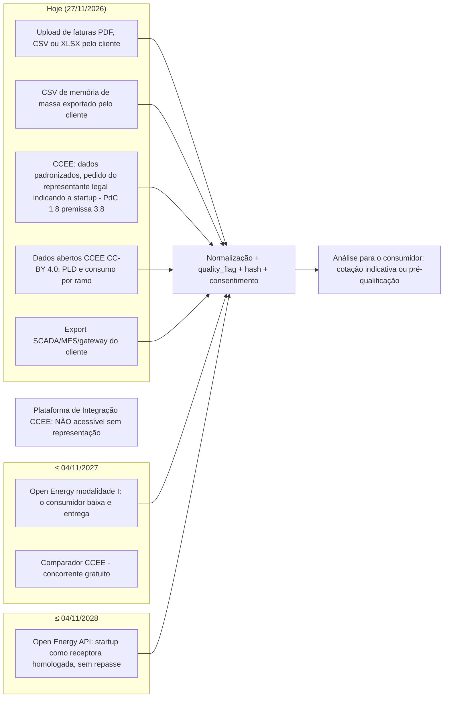

# 04 — Dados e integrações: disponibilidade real

> **Status:** consolidado em 27/11/2026 a partir de a frente Open Energy + dados (a parte regulatória do Open Energy está em `01-MERCADO.md`, Parte C) (ver `docs/DECISOES.md` D-002, D-003, D-009). Conteúdo produzido por agentes de pesquisa e conferido por amostragem nas afirmações críticas (D-007).
>
> **Convenção de referências:** cada parte veio de uma frente de pesquisa independente; os identificadores têm prefixo da frente (`ACL-R1`, `RD-R3`, `CLI-R5`, `CON-R2`, `OE-R7`, `H5-R1`). A lista completa está em [`REFERENCIAS.md`](REFERENCIAS.md). Rótulos: `CONFIRMADO`, `INFERÊNCIA`, `HIPÓTESE`, `NÃO VERIFICADO`. Data de consulta de todas as fontes: 27/11/2026.


> Insumo de pesquisa para `PLANO.md` §2.1-C, §2.3 (linha "Plataforma de comparação CCEE/Open Energy") e §2.4.
> Data de referência e de consulta de todas as fontes: **27/11/2026**. Códigos `[Rn]` remetem à tabela de referências (§6).
> Legenda: **CONFIRMADO** = lido em fonte primária ou em reprodução fiel do ato oficial. **INFERÊNCIA** = dedução direta de fonte confirmada. **HIPÓTESE** = precisa ser validada. **NÃO VERIFICADO** = não foi possível ler a fonte, ou só há fonte secundária.
> Este documento não é parecer jurídico. Os pontos marcados "validar com advogado" continuam pendentes.

---

## 0. Resumo executivo

1. **O ato normativo é a REN ANEEL nº 1.175, de 27/10/2026**, que "dispõe sobre a implementação do Open Energy". Foi publicada no DOU de **04/11/2026** (Seção 1, ed. 207, p. 91) e vigora desde a publicação. Junto com ela saiu o **Despacho nº 4.143/2026**, que aprova a 1ª versão do *Manual de Instruções do Open Energy*. Status: REN **CONFIRMADO** [OE-R1][OE-R2][OE-R3]; despacho **NÃO VERIFICADO** em fonte primária, só em fonte secundária [OE-R4].
2. **Cronograma oficial (art. 22), contado da publicação em 04/11/2026:**
   - em até 12 meses (**≤ 04/11/2027**): o consumidor acessa os próprios dados por interface padronizada, e a CCEE entrega a página comparativa de produtos e preços, que depende de aprovação prévia da ANEEL;
   - em até 24 meses (**≤ 04/11/2028**): compartilhamento com terceiros por API, mediante consentimento.

   Os prazos são **CONFIRMADO** [OE-R1][OE-R2]. As datas-limite são conta aritmética (**INFERÊNCIA**).
3. **Nada disso está operacional em 27/11/2026.** Nenhuma fonte mostra comparador, interface padronizada ou API de Open Energy em produção. O roadmap da CCEE prevê sandbox e só depois produção das APIs, entre 2027 e 2028. Status: **CONFIRMADO** que não há evidência de operação; o roadmap é indicativo [OE-R5].
4. **O escopo padronizado de dados é estreito.**
   - Distribuidora: dados cadastrais e histórico de faturamento e pagamentos.
   - Varejista: os mesmos dados, mais informações sobre os produtos contratados.
   - Janela: 12 meses, mais o último dado disponível.

   A REN **não menciona curva de carga nem memória de massa** (**CONFIRMADO** [OE-R2]). Outros dados dependem de requisição ou de ampliação futura do Manual (art. 6º §§6º–7º).
5. **Quem participa:**
   - Obrigatórios: CCEE (diretório central e plataforma), varejistas e distribuidoras. Varejistas e distribuidoras são obrigatoriamente *transmissoras* de dados.
   - Voluntários: **qualquer outra instituição** pode ser *receptora*, mediante registro, homologação e termo de participação com a CCEE, sem pagar pela participação.
   - **Restrição central:** a receptora não pode compartilhar nem repassar a terceiros os dados que acessar (art. 5º §3º III).

   Status: **CONFIRMADO** [OE-R2]. Isso inviabiliza, pela via do Open Energy, um modelo em que a startup coleta dados do consumidor e os entrega a comercializadoras (**INFERÊNCIA**, validar com advogado).
6. **Comparador público.** A Lei 15.269/2025, o Decreto 13.097/2026 e a REN 1.175 exigem que a CCEE ofereça uma plataforma centralizada e gratuita de comparação de ofertas de **varejistas**, além de "produto padrão" com "preço de referência" (**CONFIRMADO** [OE-R6][OE-R7][OE-R2]). Um comparador privado genérico de preços de varejo **seria redundante** e enfrentaria um concorrente gratuito e oficial (**INFERÊNCIA**). Continua havendo espaço em:
   - análise de viabilidade com dados reais (fatura, TUSD, curva);
   - consumidores do Grupo A fora do varejo (≥ 500 kW, contratação bilateral);
   - RFQ estruturado com várias comercializadoras;
   - gestão de contrato, sazonalização e flexibilidade;
   - automação de ingestão de dados (todos **HIPÓTESE**).
7. **Abertura da baixa tensão.** A Lei 15.269/2025 (art. 15 §17 da Lei 9.074/1995) fixa até 24 meses para consumidores industriais e comerciais e até 36 meses para os demais. O Decreto 13.097/2026 fixa as datas: **25/11/2027** para industriais e comerciais de BT e **25/11/2028** para os demais. Status: **CONFIRMADO** [OE-R6][OE-R7]. A ANEEL ainda vai regulamentar o tema em processo próprio da Agenda Regulatória 2026-2027 (**CONFIRMADO** [OE-R1]). As datas coincidem quase exatamente com as duas fases do Open Energy (**INFERÊNCIA**).
8. **Plataforma de Integração da CCEE.** Existe, está documentada e é operacional: web services SOAP e REST para medição em 5 minutos, contratos, PLD, DRI, webhooks e outros. O acesso é restrito a **agentes e consultorias com representação total de clientes aderidos à CCEE**, com certificado digital e SSL mútuo (**CONFIRMADO** [OE-R8][OE-R9]). **Uma startup sem esse vínculo não tem acesso.**
9. **Caminhos de dados que existem hoje sem habilitação na CCEE:**
   - dados públicos da CCEE (CC-BY 4.0, CSV, API CKAN; inclui PLD horário e consumo horário por perfil de agente e ramo) [OE-R11];
   - upload de faturas, CSV ou XLSX pelo próprio cliente;
   - pedido de "dados padronizados" à CCEE pelo representante legal da UC, que pode indicar terceiros, agentes ou não, para recebê-los, inclusive **dados de medição dos últimos 12 meses**, em até 5 dias úteis (PdC Submódulo 1.8, premissa 3.8; **CONFIRMADO** [OE-R10]);
   - telemetria própria do cliente (SCADA, gateway, saída de usuário do medidor), que depende de **HIPÓTESE** por cliente.
10. **GreenAnt/TYR.** Não há evidência de API pública documentada. A GreenAnt foi adquirida pela TYR Energia em fevereiro de 2026, e as notícias dizem que as soluções passam a ser exclusivas da TYR (**NÃO VERIFICADO** em fonte primária [OE-R15][OE-R16]). **BBCE Connect** existe desde 01/07/2023, em módulos, com faturamento separado. Não há preço público e as páginas oficiais deram 403 (**NÃO VERIFICADO** [OE-R13][OE-R14]).

---

## 2. Parte B — §2.4: disponibilidade real de dados e integrações

### 2.1 Mapa de fontes de dados

| Fonte | O que contém | Granularidade e latência | Quem é dono ou custodiante | Como uma startup sem habilitação obtém | Status |
|---|---|---|---|---|---|
| **Fatura da distribuidora (PDF)** | Consumo ativo mensal (ponta e fora de ponta no Grupo A verde/azul), demanda medida e contratada, ultrapassagem, reativo, bandeira, tarifas TUSD/TE, tributos | Mensal; disponível dias após a leitura | Distribuidora emite; dados do cliente | Upload pelo cliente; OCR ou parsing por leiaute de cada distribuidora | INFERÊNCIA (prática conhecida; leiautes não catalogados aqui) |
| **Open Energy, modalidade I (acesso próprio)** | Cadastro, faturamento e pagamentos, 12 meses, em formato interoperável | Último faturamento ≤ 5 dias úteis da emissão | Transmissora custodia; consumidor é titular | Consumidor baixa e entrega à startup | CONFIRMADO o direito; **disponível só até 04/11/2027** |
| **Open Energy, modalidade II (API)** | Mesmo escopo | Por API; frequência a definir no Manual | Idem | Startup como **receptora voluntária** homologada pela CCEE, com consentimento; vedado repasse | CONFIRMADO a regra; **disponível só até 04/11/2028**; especificação NÃO VERIFICADO |
| **CCEE "dados padronizados" (PdC 1.8, premissa 3.8)** | (i) dados de medição dos últimos 12 meses disponíveis; (ii) histórico de representação varejista; (iii) histórico de suspensão | Lote; entrega em ≤ 5 dias úteis do pedido | CCEE custodia; pedido pelo **representante legal da UC** | O representante legal indica a startup como destinatária ("agentes ou não") | CONFIRMADO [OE-R10]. INFERÊNCIA: o submódulo trata do modelo simplificado; não está confirmado se a premissa vale para todas as UCs. Formato e granularidade da entrega: NÃO VERIFICADO |
| **Medição na CCEE (SCDE / Plataforma de Integração)** | Medidas consolidadas, finais e faltantes; medidas de 5 em 5 minutos por medidor; pontos de medição | 5 minutos. No varejo simplificado, a distribuidora envia diariamente, até MS+7 du | CCEE custodia; agente de medição (distribuidora) envia | **Sem acesso**: exige agente ou consultoria com representação total, certificado e cadastro | CONFIRMADO [OE-R8][OE-R9][OE-R10] |
| **Memória de massa do medidor (SMF)** | Registros de energia ativa e reativa em intervalos (tipicamente 5 ou 15 minutos) | Intervalar; coleta pela distribuidora | O sistema de medição de faturamento segue PRODIST Módulo 5. A distribuidora é o agente de medição que coleta e consiste os dados (PdC 1.8 premissas 3.27–3.30). O dado é do consumidor (titular) | Exportação pelo cliente: portais de grandes clientes de distribuidoras, relatórios do gestor ou consultoria, ou pedido à CCEE (linha acima) | INFERÊNCIA. A titularidade e os custos de adequação do SMF no ACL precisam de leitura do PRODIST Módulo 5 e da REN 1.000 (NÃO VERIFICADO) |
| **Saída de usuário do medidor, gateway ou submedição** | Pulsos ou protocolo serial com consumo em quase tempo real | Segundos a minutos | Equipamento do cliente (gateway) ligado a medidor da distribuidora | Hardware de terceiros (por exemplo, gateways como o GreenAnt GASM-GS, que guarda 30 dias offline [OE-R15]). Requer acordo com o cliente e, às vezes, com a distribuidora | HIPÓTESE por cliente |
| **SCADA / MES / ERP / BMS** | Estado de cargas, produção, setpoints, potência por processo | Segundos a horas | Cliente | Exportação CSV, conector OPC-UA/Modbus ou API do ERP; projeto por cliente | HIPÓTESE (depende de cada cliente; custo de integração alto) |
| **Dados abertos da CCEE** | 205 conjuntos (137 da organização CCEE): PLD_HORARIO, PLD_MEDIA_DIARIA e SEMANAL, CONSUMO_HORARIO_PERFIL_AGENTE (por agente, ativo de carga, **ramo de atividade** e distribuidora), CONSUMO_HORARIO_SUBMERCADO, VAREJISTA_SUBCLASSE, MVE e outros | Horária ou mensal; latência por conjunto (NÃO VERIFICADO) | CCEE; licença **CC-BY 4.0**, CSV e API CKAN | Livre, com atribuição. **Atenção:** `curl` direto recebeu "Acesso bloqueado" pela política de segurança da CCEE em 27/11/2026; a navegação funcionou. Será preciso negociar ou respeitar a política de acesso automatizado | CONFIRMADO [OE-R11] |
| **Linha de base de RD (CCEE)** | A CCEE divulga no site a linha de base dos potenciais participantes (dias úteis e sábados), válida para o mês seguinte; com agregador, a linha é por UC agregada | Mensal | CCEE | Publicação no site; identificação e formato NÃO VERIFICADO | INFERÊNCIA (lido só em trecho de busca do Submódulo 9.1 v1.0, vigência 28/04/2026) [OE-R12] |
| **BBCE (EHUB / Connect API)** | Negócios próprios, boletas, histórico e negócios de mercado anonimizados (Market Data); negociação via API (Trading) | Intradiária | BBCE | Contrato comercial com a BBCE; condições e preço não públicos | NÃO VERIFICADO (páginas com 403; só fonte de 2023) [OE-R13][OE-R14] |
| **GreenAnt / TYR+** | Monitoramento, desagregação, gestão de energia | — | TYR Energia (adquiriu a GreenAnt em fevereiro de 2026) | Não há API pública documentada; segundo notícias, as soluções ficam exclusivas da TYR | NÃO VERIFICADO [OE-R16] |

### 2.2 Plataforma de Integração da CCEE (detalhe)

**Página oficial** [OE-R8], lida em 27/11/2026:
- conecta os sistemas dos agentes aos da CCEE;
- **quem pode usar:** "agentes e consultorias com representação total de seus clientes aderidos à CCEE";
- requisitos: **certificado digital** (link para o ITI, ou seja, ICP-Brasil) e cadastro no SGP;
- documentação no Postman e no GitHub `devccee`.

Status: **CONFIRMADO**.

**Autenticação** [OE-R9]: SSL mútuo com a chave privada do certificado cadastrado (PFX/P12/JKS), host `*.ccee.org.br` (**CONFIRMADO**). Material da CCEE indicado em busca menciona credenciais com certificado e também JWT, em XML e JSON; o certificado deve ser do tipo servidor web SSL e é renovado anualmente (**NÃO VERIFICADO**: só trecho de busca).

**Serviços** listados na coleção Postman pública [OE-R9]. O repositório foi criado em 31/08/2020 e o último *push* foi em 07/07/2023, então a coleção pode estar desatualizada. Status: **CONFIRMADO** que os serviços constam da coleção.

| Grupo | Serviços (recurso na coleção) |
|---|---|
| Ativos | AtivoMedicaoBSv2, ModelagemAtivoBSv2, ParcelaAtivoBSv2, parcelas de carga e usina, topologias |
| Cadastros | ParticipanteMercadoBSv2, PerfilParticipanteMercadoBSv2 |
| Contratos | ImportarArquivoBSv1 (registro e validação de contratos em XML), ResultadoProcessamentoBSv1, ContratoBSv2 (listar e obter ACL/ACR), MontanteEnergiaBSv2 (médios, modulados, anual, mensal, ano contratual, obrigação de entrega) |
| DRI | Eventos contábeis, acrônimos, resultados (semanal, mensal, horário), relatórios |
| Medição | ListarMedidaBSv1 (consolidadas, faltantes, finais), **MedidaCincoMinutosBSv2**, ColetaMedicaoBSv2 (envio de coleta), SituacaoColetaMedicaoBSv2 |
| Webhook | Eventos disponíveis, preferências, resultados de notificação |
| PLD | PLDBSv1 (horário e semanal) |
| Pontos de medição | Por agente relacionado e por código |

Busca indicou limite de 60 chamadas por hora em `obterSituacaoColetaMedicao` (**NÃO VERIFICADO**).

**Conclusões:**
- Uma startup não habilitada **não pode** usar a Plataforma de Integração (**CONFIRMADO** pela regra de acesso).
- Poderia, em tese, cadastrar-se como consultoria com representação total de clientes. Isso exige procuração e cadastro na CCEE e implica responsabilidades (**HIPÓTESE**; verificar no Procedimento de Comercialização de cadastro e representação).
- O PLD está disponível sem esse vínculo pelos dados abertos.

### 2.3 Dados abertos da CCEE

Fonte: Portal de Dados Abertos [OE-R11] (**CONFIRMADO**):
- 205 conjuntos, CSV (e 2 em GZIP), licença CC-BY-4.0, API CKAN;
- conjuntos úteis: `PLD_HORARIO`, `PLD_MEDIA_DIARIA`, `PLD_MEDIA_SEMANAL`, `CONSUMO_HORARIO_PERFIL_AGENTE` (consumo bruto, ajustado e no ponto de conexão, por agente, ativo de carga, ramo de atividade e distribuidora), `CONSUMO_HORARIO_SUBMERCADO`, `CONSUMO_MENSAL_PERFIL_AGENTE`, `VAREJISTA_SUBCLASSE`, `PENALIDADE_CONSUMO_HORARIO`.

**Pendências:**
- "InfoMercado" não foi localizado por nome no portal (**NÃO VERIFICADO**);
- frequência de atualização, timezone e se agentes aparecem por nome ou código (**NÃO VERIFICADO**).

**Usos para a startup** (**INFERÊNCIA**):
- perfis horários típicos por ramo de atividade para estimar curva quando o cliente só tem fatura;
- PLD horário para simular exposição;
- benchmarking.

Mesmo sendo agregados por agente, há riscos: o consumo por agente identifica empresas, e isso não é dado pessoal, mas pode ser dado comercialmente sensível. Respeitar a atribuição exigida pela licença.

### 2.4 GreenAnt / TYR e equivalentes

- **API pública documentada:** **não encontrada**. A busca por documentação de desenvolvedor só retornou o manual do gateway GASM-GS (rev. 1.0, julho de 2021), que envia dados à nuvem da GreenAnt, mostra os dados em painel web e guarda 30 dias offline [OE-R15].
- **Aquisição:** a TYR Energia adquiriu a GreenAnt em fevereiro de 2026, e as soluções seriam de uso exclusivo da TYR. A carteira citada é de 180 empresas e mais de 4.000 pontos de medição [OE-R16]. Status: **NÃO VERIFICADO** em fonte primária. É também INFERÊNCIA que a GreenAnt passa a ser uma **concorrente verticalizada**, e não uma integração neutra.
- **Regra para o MVP:** tratar qualquer fornecedor de medição como **importação de CSV autorizada pelo cliente**, até existir contrato. Não planejar endpoints.

### 2.5 BBCE Connect API

- **Página oficial:** `https://www.bbce.com.br/bbce-connect-api/` retornou **403** em 27/11/2026, assim como o PDF de comunicado [OE-R13][OE-R14].
- **Comunicado de junho de 2023**, conteúdo visto só por trecho de busca:
  - lançamento em **01/07/2023**;
  - seis módulos: Essentials, Post Trading, Trading (negociação via API), Risk, Market Data (negócios próprios, boletas, histórico próprio e negócios da BBCE **sem identificação de contraparte**) e Full;
  - clientes que já usavam APIs migraram automaticamente para o Full;
  - "faturas emitidas separadamente".

  Status: **NÃO VERIFICADO**.
- **Quem pode usar:** **INFERÊNCIA**: clientes ou participantes da BBCE, em geral comercializadoras e agentes do ACL.
- **Custo:** **não publicado**.
- **Regra do PLANO (§1.7):** não executar ordens. Para o MVP, a BBCE é **substituto e concorrente**, e não um insumo. Market Data só com contrato.

### 2.6 Campos mínimos

**Classes de origem:**
- **M** — mensurável: vem de medidor, fatura ou sistema;
- **D** — declarado pelo cliente;
- **I** — inferido por modelo;
- **V** — verificado por terceiro: distribuidora, CCEE, Open Energy ou cartório.

**Convenções** (**HIPÓTESE** de projeto):
- armazenar instantes em **UTC** (ISO-8601 com `Z`) e também o rótulo local `America/Sao_Paulo`;
- o Brasil não tem horário de verão desde 2019;
- os dados da CCEE e da medição seguem o horário de Brasília, o que precisa ser **verificado no dicionário de cada fonte**;
- intervalos sempre como `[início, fim)` com duração explícita (5 min, 15 min, 1 h);
- energia em kWh ou MWh e potência em kW, sempre com unidade no campo;
- toda série com `source`, `source_ref` (arquivo, protocolo ou ID de consentimento), `ingested_at`, `quality_flag` (medido, estimado, ajustado, ausente) e `hash` do arquivo bruto.

#### (a) Cotação ACL

| Campo | Classe | Fonte preferencial | Granularidade | Latência aceitável | Ausência / qualidade | Trilha de auditoria |
|---|---|---|---|---|---|---|
| CNPJ do titular, razão social, código da UC/instalação | V (D na entrada) | Fatura, cadastro do Open Energy, Receita | Por UC | — | Bloqueante | Documento-fonte e data |
| Distribuidora, submercado | V | Fatura; submercado derivado da distribuidora | Por UC | — | Bloqueante | Regra de mapeamento versionada |
| Grupo e subgrupo tarifário (A4, AS, A3…; B no futuro), modalidade (verde/azul) | V | Fatura | Por UC | — | Bloqueante | Página e campo da fatura |
| Demanda contratada (kW, ponta e fora de ponta) | V | Fatura, CUSD | Mensal | — | Bloqueante para Grupo A | Idem |
| Consumo ativo mensal ponta/fora de ponta (kWh), 12 meses | M/V | Fatura, Open Energy (≤ 12 meses) | Mensal | Até 5 dias úteis após a emissão (Open Energy) | Menos de 12 meses: completar com perfil setorial (I), marcado | Arquivo e hash por mês |
| Demanda medida (kW) mensal | M/V | Fatura | Mensal | Idem | Opcional para varejo | Idem |
| Curva de carga (kWh por intervalo) | M | Memória de massa, CCEE dados padronizados, gateway | 5 ou 15 min, ou 1 h | D+1 a M+7 du | Lacunas < 2%: interpolar e marcar; maiores: reprovar a curva e usar perfil (I) | Arquivo bruto, contagem de lacunas, método de preenchimento |
| Perfil horário estimado | I | `CONSUMO_HORARIO_PERFIL_AGENTE` por ramo, escalado pela fatura | 1 h | — | — | Versão do modelo e do conjunto da CCEE |
| Tarifas TUSD/TE e encargos vigentes | V | Fatura, homologação tarifária da ANEEL | Por ciclo tarifário | — | Bloqueante para o cálculo de economia | Resolução homologatória citada |
| Situação ACR/ACL atual, varejista atual, fim do contrato | D/V | Cliente; histórico de representação (CCEE dados padronizados) | Evento | — | Se ausente: "não informado" | Documento ou protocolo |
| Prazo desejado, início do suprimento, flexibilidade (±%), sazonalização, fonte (incentivada/convencional) | D | Cliente | Por pedido | — | Usar padrão explícito e informado | Versão do formulário e usuário |
| Tolerância a risco, preferência preço fixo × PLD+spread | D | Cliente | Por pedido | — | Padrão conservador | Idem |
| Capacidade de garantia, rating ou indicador de crédito | D/V | Cliente, bureau (com base legal) | Por pedido | — | Bloqueante para a proposta firme; não para a indicativa | Consentimento ou base, data |
| Geração própria ou GD na UC | D/V | Fatura (compensação), cliente | Mensal | — | Afeta o líquido; se ausente, perguntar | Idem |
| PLD horário de referência | V | Dados abertos da CCEE | 1 h | D+1 | Bloqueante para simulação | Versão do CSV e hash |

#### (b) Qualificação de flexibilidade / RD

| Campo | Classe | Fonte preferencial | Granularidade | Latência | Ausência / qualidade | Trilha de auditoria |
|---|---|---|---|---|---|---|
| Identificação da UC, ponto de medição, agente CCEE (se houver) | V | CCEE, fatura | Por UC | — | Sem condição de agente: registrar como "precisa de agregador" (Submódulo 9.1 exige UC agregada agente da CCEE [OE-R12], NÃO VERIFICADO na íntegra) | Protocolo |
| Curva de carga histórica ≥ 12 meses | M | Memória de massa, CCEE | **5 min** (granularidade da CCEE) ou 15 min | M+7 du | Sem curva, **não qualifica**: resultado "indicativo" no máximo | Arquivo bruto e hash |
| Linha de base oficial (dia útil e sábado) | V | Publicação da CCEE (Submódulo 9.1) | Mensal, com perfil intradiário | Mensal | Se não publicada: estimar (I) e marcar como não oficial | URL e data de publicação |
| Linha de base estimada pela startup | I | Curva + método documentado | Igual à curva | — | — | Versão do método e parâmetros |
| Cargas flexíveis: descrição, potência (kW), duração máxima, antecedência mínima, frequência máxima, período de recuperação | D | Cliente (engenharia ou operação) | Por carga | — | Bloqueante | Usuário, data, versão |
| Evidência de flexibilidade: eventos passados de redução, dados SCADA/MES | M | SCADA, MES, submedição | 1 s a 15 min | Variável | Sem evidência: o declarado continua só declarado | Export bruto e hash |
| Custo de oportunidade (R$/MWh não consumido ou R$/evento) | D | Cliente | Por carga | — | Pode faltar; marcar | Idem |
| Restrições de segurança e produção, janelas proibidas | D | Cliente | Calendário | — | Bloqueante | Idem |
| Telemetria em tempo quase real disponível? (sim/não, protocolo) | D/M | Cliente, inspeção | — | — | Necessário para operação, não para pré-qualificação | Laudo |
| Representação atual (varejista ou agregador), restrições contratuais | D/V | Cliente, contrato | Evento | — | Bloqueante para a recomendação | Documento |
| Potencial estimado de redução (kW e MWh, por janela) | I | Curva + declarado | Por janela | — | Sempre com intervalo de confiança | Versão do modelo |

**Regras de produto** (**HIPÓTESE**):
- nenhum campo **I** pode ser apresentado a terceiros como **M** ou **V**;
- toda exportação leva `quality_flag` por campo;
- o relatório distingue "qualificação indicativa" (com D/I) de "qualificação com evidência" (com M/V).

### 2.7 Considerações de LGPD (não é parecer)

- **Dados de empresas.** CNPJ, consumo da UC de pessoa jurídica e faturas de PJ **não são dados pessoais** pela definição do art. 5º I da LGPD ("pessoa natural identificada ou identificável") [OE-R19]. Podem ser, ainda assim, informação comercial sensível e devem ser protegidos por contrato e NDA (**INFERÊNCIA**).
- **Dados pessoais presentes mesmo em B2B:**
  - nome, CPF e e-mail de representantes legais e usuários (o PdC 1.8 exige o CPF do representante [OE-R10]);
  - empresários individuais e MEI, cujo CNPJ identifica a pessoa;
  - consumidores de BT pessoa física a partir de 25/11/2028.

  Curvas de carga de residências ou pequenos estabelecimentos podem revelar hábitos (**INFERÊNCIA**).
- **Bases legais possíveis** (art. 7º [OE-R19]), que devem ser escolhidas e documentadas por finalidade:
  - **consentimento** (I): exigido pela REN 1.175 para o compartilhamento via Open Energy, e o Decreto 13.097 art. 9º §2º também prevê o consentimento ou outra base da LGPD [OE-R7];
  - **execução de contrato** ou procedimentos preliminares a pedido do titular (V): por exemplo, o cliente que pede uma cotação;
  - **legítimo interesse** (IX): por exemplo, segurança e prevenção a fraude, com teste de balanceamento e registro (art. 37);
  - **cumprimento de obrigação legal ou regulatória** (II): por exemplo, guarda de registros exigida pela REN, se a startup for receptora.
- **Requisitos que se sobrepõem:**
  - LGPD: revogação a qualquer tempo (art. 8º §5º), portabilidade (art. 18 V), registro de operações (art. 37), segurança (art. 46), comunicação de incidente à ANPD e ao titular (art. 48);
  - REN 1.175 como receptora: eliminar os dados em ≤ 5 dias úteis após a revogação, **vedar o repasse**, reportar incidentes também à CCEE e à ANEEL.
- **Papéis** (**HIPÓTESE**):
  - quando o consumidor usa a ferramenta, a startup é **controladora** dos dados de usuários e representantes;
  - quando presta SaaS a uma comercializadora sobre os clientes dela, a startup é **operadora**.

  Definir isso em contrato (DPA) e no RIPD, se houver risco elevado.

---

## 3. Diagrama: consentimento e fluxo de dados

O fluxo do Open Energy segue o desenho da CCEE de 16/07/2026 [OE-R5] e a REN 1.175 [OE-R2]. Os nomes de endpoints **não existem** publicamente; o diagrama é conceitual.

```mermaid
sequenceDiagram
    autonumber
    actor C as Consumidor (titular da UC)
    participant S as Startup (receptora voluntária homologada)
    participant DC as CCEE - Diretório Central
    participant T as Transmissora (distribuidora ou varejista)
    participant CO as Comercializadora

    Note over S,DC: Pré-requisito: registro, homologação e termo de participação na CCEE (art. 5º §3º)
    C->>S: Pede análise ou cotação
    S->>C: Pede consentimento (art. 14), com redirecionamento
    C->>T: Autentica e consente: finalidade e prazo (30, 90, 180 dias, 1 ano ou indeterminado)
    T->>DC: Formaliza o consentimento (token de transação, protocolo, hash)
    DC-->>S: Notifica a autorização
    S->>T: Pede dados via API (mTLS ou certificados do diretório; padrão NÃO VERIFICADO)
    T-->>S: Cadastro, faturamento e pagamentos (12 meses)
    S->>C: Análise, simulação, comparação
    Note over S,CO: Vedado à receptora repassar dados a terceiros (art. 5º §3º III)
    C-->>CO: O próprio consumidor decide contatar ou enviar dados (fora do Open Energy)
    C->>T: Revoga (a qualquer tempo) ou o prazo expira
    T->>S: Notifica a revogação (API e plataforma)
    S->>S: Elimina os dados em ≤ 5 dias úteis (salvo conservação prevista na LGPD)
```

Caminhos de dados para uma startup **sem** habilitação, hoje e após cada marco:



---

## 4. Implicações para as hipóteses do PLANO

**H4 — ferramenta de cotação para empresas** (**INFERÊNCIA** e **HIPÓTESE**):
- O Open Energy reduz a fricção para obter a fatura padronizada, mas só a partir de 2027 (modalidade I) e de 2028 (API).
- O comparador oficial derruba o valor de uma vitrine de preços de varejo.
- O valor residual está em três lugares:
  - (i) TCO e risco da migração, e não só o preço;
  - (ii) Grupo A ≥ 500 kW e RFQ bilateral;
  - (iii) gestão pós-contrato.
- A vedação de repasse impede o modelo "coleto dados e vendo leads qualificados às comercializadoras" sobre dados do Open Energy.

**H3 — pré-qualificação de flexibilidade** (**INFERÊNCIA**):
- O Open Energy não ajuda no escopo atual, porque não inclui curva de carga.
- A curva continua vindo de memória de massa, de dados padronizados da CCEE pedidos pelo cliente ou de telemetria própria.
- A operação em RD exige agregador ou agente da CCEE.

---

## 5. Lacunas e próximos passos

| # | Lacuna | Consequência | Ação sugerida |
|---|---|---|---|
| L1 | Texto oficial da REN 1.175 no DOU, conferido em in.gov.br | Baixo risco: já lido em reprodução | Conferir no DOU (ed. 207, 04/11/2026, p. 91) |
| L2 | Despacho 4.143/2026 e **Manual de Instruções do Open Energy** (dicionário de dados, padrão de API) | **Sem isso, não se especifica integração** | Buscar no SIGA/CEDOC da ANEEL; pedir via Fala.BR/LAI se necessário |
| L3 | Manuais técnicos da CCEE (operacional, diretório, APIs) e **sandbox** | Cronograma de integração incerto | Acompanhar o portal da CCEE e os workshops anunciados |
| L4 | Se a premissa 3.8 do PdC 1.8 (dados padronizados) vale para todas as UCs ou só para o modelo simplificado; formato e granularidade entregues | Define o canal de curva de carga mais barato hoje | Testar com um cliente real, com consentimento; ler as Regras de Comercialização |
| L5 | Titularidade e acesso à memória de massa pela distribuidora (PRODIST Módulo 5, REN 1.000/2021) | Define se o cliente pode exigir CSV da distribuidora e em quanto tempo | Leitura dirigida das normas |
| L6 | Condições da BBCE Connect (elegibilidade, preço, termos) | Não planejar integração | Contato comercial, só com aprovação dos fundadores (PLANO §1.8) |
| L7 | API da GreenAnt/TYR | Não planejar integração | Contato, só com aprovação dos fundadores |
| L8 | Submódulo 9.1 da CCEE (RD) na íntegra e REN vigente de RD (1.030/2022 × 1.080/2023 × proposta do ONS de prorrogar o sandbox até 2030) | Afeta H3 | Ler o PdC 9.1 e a Nota Técnica do ONS (escopo de outra seção do PLANO) |
| L9 | Política de acesso automatizado aos dados abertos da CCEE (bloqueio a `curl`) | A ingestão automática pode falhar | Testar com User-Agent identificado ou baixar manualmente; consultar o atendimento da CCEE |
| L10 | Possibilidade de a startup se cadastrar como "consultoria com representação total" | Abriria a Plataforma de Integração, com responsabilidades | Ler o PdC de cadastro e representação; avaliação jurídica |
| L11 | Leitura jurídica da vedação de repasse (art. 5º §3º III) aplicada a dados baixados pelo próprio consumidor (modalidade I) | Define a viabilidade dos modelos (i) a (iii) do §1.6 | Parecer jurídico |

---


## Referências

Ver `REFERENCIAS.md`, seção OE.
