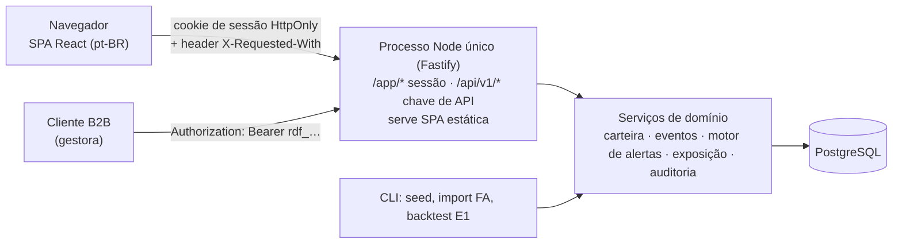
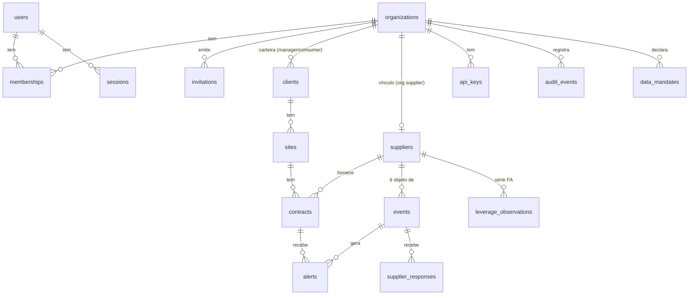

# 09 — Arquitetura e segurança

> Protótipo de H5-G (`08`). Decisões arquiteturais em `ADR/`.

## 1. Visão geral

- **Monólito modular TypeScript** (ADR-0001), num processo só. Separação interna em `src/server/{http,domain,db}` e `src/web`.
- **Duas superfícies HTTP com autenticação separada** (PLANO §4.5):
  - `/app/*` é a API interna do portal, autenticada por cookie de sessão;
  - `/api/v1/*` é a API B2B, autenticada por chave com escopos.
  - As duas compartilham os serviços de domínio, mas **não** compartilham credenciais. Uma sessão não autentica `/api/v1` e uma chave não autentica `/app`.
- **Contrato primeiro:** os schemas Zod de `src/server/http/v1/schemas.ts` são o contrato. O arquivo `openapi/openapi.yaml` é gerado a partir deles e versionado. A CI falha se estiver desatualizado (ADR-0003).
- Sem filas, workers, cache distribuído ou microserviços. O motor de alertas roda **na mesma transação** que publica o evento.

## 2. Stack

| Camada | Escolha | Motivo (resumo; detalhes nas ADRs) |
|---|---|---|
| Linguagem | TypeScript `strict` | Uma linguagem no front e no back para 2 desenvolvedores |
| HTTP | Fastify 5 | OpenAPI e rate limit maduros; menos mágica que NestJS (ADR-0001) |
| Front | React + Vite (SPA) | O conteúdo é privado e autenticado, então não há ganho de SSR; build estático servido pelo próprio Fastify (ADR-0001) |
| Banco | PostgreSQL 16+ | Requisito do PLANO; `CHECK` e `UNIQUE` para regras de domínio |
| Acesso a dados | Drizzle ORM + drizzle-kit (migrations SQL versionadas) | Tipado, próximo do SQL, sem runtime pesado (ADR-0002) |
| Validação | Zod | Schemas compartilhados por validação e OpenAPI |
| Senhas | Argon2id (`@node-rs/argon2`, binário pré-compilado) | Algoritmo recomendado pela OWASP; biblioteca madura |
| Testes | Vitest (unitário + integração com Postgres real) e Playwright (E2E) | — |
| Rust/WASM | **Não usado** | Nenhum gargalo medido. O motor é O(contratos do fornecedor) por evento (PLANO §5.1) |

## 3. Modelo de dados

- **Tenant:** `clients`, `sites`, `contracts`, `alerts`, `api_keys`, `invitations` e `data_mandates` carregam `org_id`, e **toda consulta de domínio recebe o `org_id` do principal autenticado**, nunca do cliente.
- **Catálogo público:** `suppliers`, `events`, `leverage_observations` e `reference_prices` não são dados de tenant. São fatos públicos curados, legíveis por organizações aprovadas, mas **nunca** revelam quais carteiras contêm um fornecedor.
- **Timestamps** em `timestamptz` (UTC no banco). Datas civis (`event_date`, `start_date`, `end_date`) em `date`, interpretadas no fuso `America/Sao_Paulo` para calcular horas. A interface mostra sempre o fuso.
- **Unidades no nome da coluna:** `volume_mwm`, `price_brl_per_mwh`, `guarantee_brl`, `remaining_energy_mwh`, `replacement_cost_brl`. Restrições `CHECK`: volume > 0 e ≤ 1.000 MWm; preço entre 0 e 5.000 R$/MWh.
- **Exclusão lógica** via `deleted_at` em `clients`, `sites` e `contracts`.

## 4. Segurança

| Tema | Implementação no MVP |
|---|---|
| Senhas | Argon2id; mínimo de 10 caracteres; mensagem de erro de login genérica |
| Sessão | Token aleatório de 32 bytes; o banco guarda **só o hash SHA-256**; cookie `HttpOnly`, `SameSite=Lax`, `Secure` em produção, `Path=/`; expira em 12 h com renovação; logout revoga |
| CSRF | `SameSite=Lax` + exigência do header `X-Requested-With: radar` em todo método não-GET de `/app/*` (requisições cross-site simples não enviam header customizado) + checagem de `Origin` quando presente |
| Chaves de API | Formato `rdf_<prefixo 8>_<segredo 32 base62>`. O segredo é mostrado **uma única vez**; o banco guarda o prefixo e o SHA-256 do segredo, que é aleatório de alta entropia, então hash rápido é adequado. Também têm escopos, expiração opcional, revogação e `last_used_at` |
| Autorização | Função única `requireOrg(principal, {types, roles, approved})` em cada rota; consultas sempre filtradas por `org_id`; registro de outra organização → `404` (não vaza existência) |
| Rate limiting | `@fastify/rate-limit` em memória: login 10/min por IP; `/api/v1` 120/min por chave; resposta `429` com `Retry-After`. Em memória porque há uma instância só (documentado; trocar por Redis se escalar) |
| Upload | Limite de 1 MB e 5.000 linhas; parse CSV estrito; validação por linha; nada é executado; o conteúdo bruto não vai para log |
| Injeção | Só consultas parametrizadas (Drizzle); nenhuma concatenação de SQL |
| CORS | Desligado por padrão: a SPA tem a mesma origem. `/api/v1` é servidor-a-servidor, sem CORS |
| Cabeçalhos | `@fastify/helmet` (CSP restrita à própria origem) |
| Logs | Pino estruturado; redação de `authorization`, `cookie`, `password` e `token`; corpos de requisição não são logados |
| Auditoria | `audit_events` (ator, organização, ação, alvo, metadados mínimos, IP, horário) para login, convite, aprovação, CRUD de carteira, importação, publicação e retirada de evento, mudança de status de alerta, resposta de fornecedor, criação e revogação de chave, uso de chave (agregado por dia) |
| Segredos | Via variáveis de ambiente; `.env.example` sem valores reais; `.env` no `.gitignore` |

## 5. LGPD e retenção (não é parecer jurídico)

- **Dados pessoais:** nome e e-mail de usuários, IP em auditoria. Dados de contrato são, em regra, de **pessoas jurídicas**. O MVP não coleta dados de sócios pessoa física.
- **Base legal:** precisa ser avaliada por advogado (E3). O plano **não** assume que consentimento é a única base, e a execução de contrato com a gestora é candidata. Para dados de contratos dos clientes da gestora, ela declara o mandato (`data_mandates`).
- **Retenção proposta:**
  - carteira excluída logicamente é removida fisicamente após 90 dias;
  - auditoria fica 5 anos;
  - sessões expiradas são apagadas em 30 dias.
  - No MVP, a remoção física é um script manual (`npm run purge`), ainda não agendado.
- **Direitos do titular:** exportação e exclusão de conta pelo admin (procedimento manual documentado no README).
- **Dados de fornecedores:** só fatos públicos com fonte. Cada evento guarda URL, nome da fonte e data, e o direito de resposta fica disponível.

## 6. Operação

- `GET /health` verifica o banco e retorna `{status, db, version}`.
- Backup: `pg_dump` diário documentado. A restauração é testada pelo script `scripts/backup-restore-test.sh`.
- Migrações versionadas em `drizzle/`, aplicadas por `npm run db:migrate`. As migrações de esquema são aditivas sempre que possível.
- Deploy demonstrável: imagem única (`Containerfile`) + PostgreSQL gerenciado. Custo estimado em `05`: R$ 1,5 mil/mês de infraestrutura.
- Incidentes: em caso de vazamento entre tenants, revogar todas as sessões e chaves (`npm run revoke-all`), preservar logs e notificar os afetados. A notificação à ANPD é avaliada com advogado.
