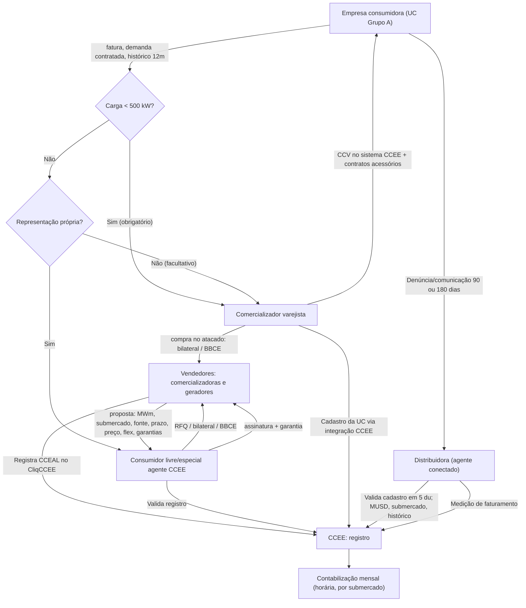
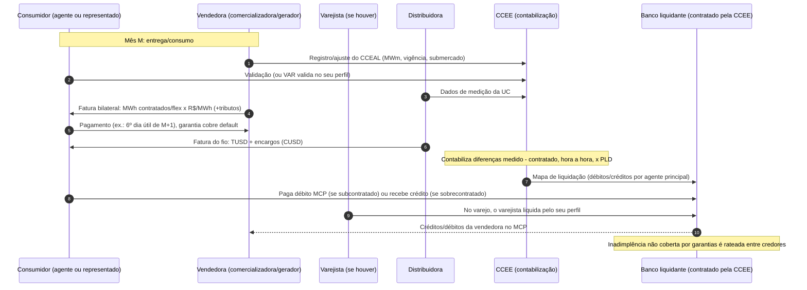

# Pesquisa 2.1-A — Compra e venda convencional de energia no ACL

> **Escopo:** seção 2.1-A do `PLANO.md`. Data de referência e de consulta de todas as fontes: **27/11/2026**.
> **Legenda de status:** `CONFIRMADO` (lido em fonte primária ou em texto normativo/documento oficial), `INFERÊNCIA` (dedução razoável a partir de fontes citadas, ou fonte secundária séria sem conferência no original), `HIPÓTESE` (suposição a validar), `NÃO VERIFICADO` (não foi possível checar; registrar impacto).
> **Limitações de acesso:** o portal `ccee.org.br` respondeu **403** a `curl` (ex.: InfoMercado mensal de abr/2026), mas alguns PDFs da CCEE puderam ser obtidos pela ferramenta de fetch e tiveram o texto extraído localmente (Regras "Contratos" v2026.5.1, Regras "Liquidação" v2026.1.0, PdC 1.8, documento de PL mínimo do varejista 2026). `bbce.com.br/mercado-livre/` respondeu 403, mas o PDF do Contrato Padrão BBCE v11 foi baixado. Números agregados de mercado (nº de consumidores, migrações) vieram de **notícias que citam a CCEE**, sem conferência no InfoMercado original, e por isso estão marcados como `INFERÊNCIA`.
> **Este documento não é parecer jurídico.**

---

## 0. Resumo executivo (10 linhas)

1. Hoje (27/11/2026), **todo consumidor do Grupo A** (média/alta tensão) pode comprar no ACL. Isso vale desde 01/01/2024 (Portaria MME 50/2022). Quem tem carga **< 500 kW** precisa ser **representado por agente varejista** na CCEE. `CONFIRMADO`
2. A **baixa tensão (< 2,3 kV)** já tem base legal (Lei 15.269/2025) e datas no Decreto 13.097/2026: **25/11/2027** para industriais e comerciais e **25/11/2028** para os demais. Esses consumidores serão representados por varejista. A ANEEL ainda não regulamentou o Grupo B. `CONFIRMADO`
3. Os contratos (CCEAL/CCEI) são negociados livremente, sem interferência da CCEE. Todos têm de ser **registrados na CCEE**, em **MW médio por vigência**, com sazonalização e modulação. Sem modulação validada no prazo, o sistema modula de forma *flat*. `CONFIRMADO`
4. O **dinheiro do contrato** vai direto do comprador ao vendedor, por fatura bilateral (no contrato padrão BBCE, vencimento no 6º dia útil do mês seguinte). Pela CCEE passam só **as diferenças** entre o que foi contratado e o que foi medido, valoradas a **PLD**, por meio de um banco liquidante. `CONFIRMADO`
5. Limites do PLD em 2026: mínimo R$ 57,31/MWh, máximo estrutural R$ 785,27/MWh e máximo horário R$ 1.611,04/MWh (DSP ANEEL 3.850/2025) [R20]. `INFERÊNCIA` (fonte secundária que cita a CCEE)
6. Mercado: cerca de **85 mil** unidades/participantes no ACL e cerca de **43%** do consumo nacional. Foram **~21,7 mil migrações em 2025** (81% via varejista; 93% com carga ≤ 0,5 MW). Em 2026 as migrações **desaceleraram** (1T26: 4.827, −36,5% a/a). `INFERÊNCIA`
7. **Crise de crédito:** pelo menos 6 comercializadoras pediram recuperação judicial em 2026. A CCEE aplica "operação balanceada" e prepara um **monitoramento prudencial**. Risco de contraparte e garantias são centrais em qualquer intermediação. `INFERÊNCIA`
8. **Fim do desconto na TUSD/TUST** (parcela consumo) para quem migrar a partir da Lei 15.269/2025. A ANEEL abriu consulta (29/10 a 14/12/2026). A atratividade do "consumidor especial/incentivado" cai para novos entrantes. `CONFIRMADO` (lei) / `INFERÊNCIA` (efeito)
9. Dados para cotar: **fatura + demanda contratada + 12 meses de consumo** bastam para uma cotação indicativa. Curva horária e dados da CCEE exigem **titular/representante legal**. A CCEE já entrega 12 meses de medição a quem o titular indicar, em até 5 dias úteis (PdC 1.8). `CONFIRMADO`
10. **REN 1.174/2026** (migração em 90 dias para AS/A4 no modelo simplificado, salvaguardas contra distribuidora coligada) e **REN 1.175/2026** (Open Energy: comparador da CCEE em 12 meses, APIs com consentimento em 24 meses) mudam o espaço para RFQ e comparadores privados. `CONFIRMADO` (ANEEL) / `INFERÊNCIA` (números das RENs)

---

## 1. Quem pode comprar e vender no ACL (regras vigentes em 27/11/2026)

### 1.1 Base legal e quem participa

| Item | Regra vigente | Fonte | Status |
|---|---|---|---|
| Quem opera no ACL | Concessionários, permissionários e autorizados de geração, comercializadores, importadores e **consumidores livres ou especiais**. Os contratos são livremente negociados (CCEAL; quando a fonte é incentivada, CCEI). | CCEE, Regras de Comercialização "Contratos" v2026.5.1 [R1] | CONFIRMADO |
| Registro obrigatório | "Todos os contratos celebrados no ACL devem ser registrados na CCEE" (art. 56 do Decreto 5.163/2004 e Convenção de Comercialização). | [R1] | CONFIRMADO |
| CCEE | Pessoa jurídica de direito privado, sem fins lucrativos, sob regulação e fiscalização da ANEEL. Os membros incluem os consumidores dos arts. 15 e 16 da Lei 9.074/1995. Pode desligar membros, e o desligamento de um consumidor suspende o fornecimento a todas as suas unidades modeladas. A Lei 15.269/2025 a renomeou para "Câmara de Comercialização de **Energia**". | Lei 10.848/2004, art. 4º e 4º-D [R2] | CONFIRMADO |
| Comercialização varejista | Autorizada no art. 4º-A da Lei 10.848/2004: agentes da CCEE representam consumidores que não precisam aderir à CCEE, conforme regulação da ANEEL. Se a representação termina e não há suprimento alternativo, todas as unidades podem ter o fornecimento suspenso. | [R2] | CONFIRMADO |

### 1.2 Consumidores do Grupo A (média/alta tensão)

- **Desde 01/01/2024**, todo consumidor do Grupo A "poderá optar pela compra de energia elétrica a qualquer concessionário, permissionário ou autorizado" do SIN. Os de **carga individual inferior a 500 kW** "serão representados por agente varejista perante a CCEE". Portaria Normativa 50/GM/MME, de 27/09/2022 (DOU 28/09/2022) [R3]. `CONFIRMADO` (texto extraído do PDF oficial do MME).
- Para esse público, segundo a Procuradoria Federal junto à ANEEL, "a comercialização varejista não é uma alternativa entre outras, mas a única via de acesso ao mercado livre" (Parecer 218/2026/PFANEEL, 03/09/2026) [R4]. `CONFIRMADO`
- Consumidor **≥ 500 kW**: pode virar agente da CCEE (consumidor livre ou especial, com representação própria, a chamada modelagem "não varejista") **ou** usar um varejista. O modelo simplificado é **facultativo** para quem não é obrigado à representação varejista (PdC 1.8, premissa 3.1.1) [R5]. `CONFIRMADO`
- **Livre vs especial (distinção histórica):** o "especial" (≥ 500 kW pelos critérios da Lei 9.427/1996, art. 26 §5º) comprava energia de fonte incentivada e recebia desconto na TUSD/TUST. Com a Portaria 50/2022, qualquer consumidor do Grupo A pode comprar energia convencional. `INFERÊNCIA`: definições vistas em glossários ANEEL/CCEE nos resultados de busca, mas o texto consolidado da Portaria MME 465/2019 não foi relido.
- **Fim do desconto "no fio" para novos migrantes:** a Lei 15.269/2025 incluiu o §14 no art. 26 da Lei 9.427/1996. Ele veda a redução tarifária (§§1º, 1º-A, 1º-B) "com incidência na parcela consumo" para quem **exercer a opção** de migrar a partir da vigência da lei, ou pedir **ampliação** do montante de uso (nesse caso, o desconto fica preservado sobre o montante já contratado) [R6]. `CONFIRMADO` (texto legal). A ANEEL aprovou em 27/10/2026 uma consulta pública para regulamentar o tema (contribuições de 29/10 a 14/12/2026). O "marco temporal" ainda está em discussão [R7]. `INFERÊNCIA` (Agência iNFRA). **Impacto:** a vantagem econômica da energia incentivada para novos consumidores especiais diminui. O desenho de produto e a cotação precisam tratar o desconto como **legado**, não como regra geral.

### 1.3 Baixa tensão (Grupo B): o que está em vigor hoje

| Marco | Conteúdo | Fonte | Status |
|---|---|---|---|
| Lei 15.269, de 24/11/2025 (DOU 25/11/2025) | Inclui o §17 no art. 15 da Lei 9.074/1995: abertura para < 2,3 kV em **até 24 meses** (industriais e comerciais) e **até 36 meses** (demais). Depende de requisitos prévios: plano de comunicação, regulação do **Supridor de Última Instância (SUI)** e outros. Cria o art. 15-C (SUI autorizado e fiscalizado pela ANEEL, com déficit involuntário rateado no ACL por encargo). | Planalto [R6] | CONFIRMADO |
| Decreto 13.097, de 12/08/2026 (DOU 13/08/2026) | Livre escolha a partir de **25/11/2027** (industriais e comerciais < 2,3 kV) e **25/11/2028** (demais, inclusive residenciais). Representação **obrigatória por agente varejista**, com um único varejista por UC. Aviso de migração à distribuidora com **90 dias** (a ANEEL pode criar rito simplificado mais curto). Retorno ao ACR com **1 ano** de aviso. A troca de medidor **não** é condição para migrar. SUI exclusivo das distribuidoras até 31/12/2030. Plataforma de comparação de ofertas pela CCEE (art. 10). Benefícios do ACR (TSEE etc.) não se aplicam no ACL. | Planalto [R8] | CONFIRMADO |
| Decisão ANEEL de 27/10/2026 | Aperfeiçoa as regras do **Grupo A** e institui o Open Energy. O **Grupo B** fica para "processo específico da Agenda Regulatória 2026-2027". | ANEEL [R9] | CONFIRMADO |

**Conclusão de vigência:** em 27/11/2026, **nenhum consumidor de baixa tensão pode migrar ainda**. A data mais próxima é 25/11/2027, e ela depende de regulamentação da ANEEL que ainda está pendente. `CONFIRMADO` (datas) / `INFERÊNCIA` (dependência regulatória ainda não resolvida, porque não foi encontrada resolução da ANEEL para o Grupo B).

### 1.4 Regras de migração do Grupo A após 27/10/2026

Fonte: ANEEL, notícia de 27/10/2026 [R9] (`CONFIRMADO`); REN 1.174/2026, assinada em 27/10/2026 e publicada no DOU em 04/11/2026, segundo a Atlas Público [R10] (`INFERÊNCIA` quanto ao número e às datas).

- A migração pode começar por **manifestação formal à distribuidora**, sem encerrar antes o contrato regulado. No **modelo simplificado**, também pode começar pela contratação do **varejista**, que comunica a distribuidora **pelo sistema da CCEE**.
- Prazo: cai de **180 para 90 dias** para a maior parte das unidades AS e A4 no modelo simplificado. As demais continuam com 180 dias.
- A distribuidora tem 5 dias úteis para analisar o pedido. A recusa por inviabilidade técnica exige visita e relatório. Exigências técnicas não emergenciais não podem travar o processo [R10].
- **Separação entre distribuidora e comercializadora do mesmo grupo:** ficam vedados publicidade conjunta, uso da imagem da distribuidora e compartilhamento de infraestrutura e pessoal. As regras de marca valem em 180 dias. A vedação a novos compartilhamentos vale imediatamente [R9].
- Há previsão de sandbox para **fatura unificada emitida pelo comercializador** [R10]. `INFERÊNCIA`

### 1.5 Quem pode vender: comercializadoras, atacado e varejo

| Tipo | O que faz | Requisitos encontrados | Status |
|---|---|---|---|
| **Comercializador (atacado)** | Autorizado pela ANEEL (REN 1.011/2022). É agente da CCEE, compra e vende CCEAL com geradores, outras comercializadoras e consumidores agentes. | Capital social integralizado mínimo de **R$ 2 milhões** (data-base mai/2022, corrigido pelo IPCA; R$ 2.028.578 em 2023, segundo a Abraceel). Prova na obtenção e anualmente [R11]. **Classificação (REN 1.014/2022):** o *Tipo 1* tem PL acima do mínimo e não tem limite de registro; o *Tipo 2* fica limitado a **30 MWm/mês** de registro e não pode atuar no varejo. Em 2026 eram **317** do Tipo 1 (contra 290) e **121** do Tipo 2 com demonstrações entregues [R12]. | INFERÊNCIA (fontes secundárias: Abraceel/Lefosse/Cenário Energia) |
| **Comercializador (ou gerador) varejista** | Habilitado pela CCEE como varejista (PdC 1.6). **Representa** o consumidor perante a CCEE: assume a modelagem, a contabilização e a liquidação em nome do consumidor, que **não acessa** o sistema da CCEE no modelo simplificado [R5]. | **PL mínimo de R$ 11.598.664,00 em 2026** (atualizado em jan/2026 pelo IPCA), além do limite operacional mínimo e de outros requisitos do PdC 1.6 e da REN 1.011/2022 [R13]. Contrato padronizado: **CCV** (Contrato para Comercialização Varejista), gerado e assinado eletronicamente no sistema da CCEE [R5]. Novo **Capítulo IV-A da REN 1.011/2022**: solução de controvérsias em 3 etapas (representante, Consumidor.gov.br, ANEEL/agência estadual) e **adesão obrigatória ao Consumidor.gov.br** [R4]. | CONFIRMADO (PL e CCV) / INFERÊNCIA (Cap. IV-A aprovado na decisão de 27/10/2026; o texto final não foi lido) |

- **Número total de comercializadoras e varejistas habilitados:** `NÃO VERIFICADO`. A lista oficial fica no site da CCEE, que estava inacessível. A soma de Tipo 1 e Tipo 2 com demonstrações (438) é **INFERÊNCIA**, não um censo. **Impacto:** para dimensionar o lado vendedor de um marketplace, é preciso baixar a lista de agentes e de varejistas no portal da CCEE (manualmente ou por outro canal).
- A CCEE tem **16.120 agentes associados** (todas as categorias), segundo o Relatório de Sustentabilidade 2025 citado pela Cenário Energia (22/05/2026) [R14]. `INFERÊNCIA`

---

## 2. Como se formam propostas e cotações

| Canal | Descrição | Evidência | Status |
|---|---|---|---|
| **Bilateral direto** | Negociação entre comprador (consumidor agente ou varejista) e vendedor (gerador ou comercializadora). Preço, prazo, volume e garantias são livres. | [R1] ("livre negociação entre os agentes… sem a interferência da CCEE") | CONFIRMADO |
| **Representação varejista** | O consumidor < 500 kW (e, a partir de 2027/2028, o de BT) assina o CCV com o varejista. O "produto" é a representação mais o fornecimento, em geral com preço por MWh e sem que o consumidor gerencie a CCEE. | [R3], [R5] | CONFIRMADO |
| **Balcão/plataforma BBCE** | Negociação "em tela" (EHUB) com produtos padronizados (sazonalização, modulação e flexibilidade *flat*) ou por "BBCE Boleta Eletrônica" (termos ajustáveis). Usa o **Contrato Padrão BBCE v11** e tem serviço opcional de **liquidação financeira** com instituição parceira. | Contrato Padrão BBCE v11 [R15] | CONFIRMADO |
| Volumes BBCE 2026 | Fev/2026: R$ 6,5 bi e ~19,5 TWh. Out/2026: R$ 5,8 bi (as matérias dizem "29 GWh", provável erro de unidade para TWh). O estoque de derivativos chegou a R$ 10 bi e 56 TWh (até ago/2026). | Cenário Energia [R16][R17] | INFERÊNCIA (a unidade de out/2026 é inconsistente; não usar sem conferir na BBCE) |
| **RFQ, brokers, telefone, leilões privados** | Prática de mercado amplamente relatada: consumidor ou gestora faz "tomada de preços" com várias comercializadoras, e há corretoras e leilões de compra promovidos por grandes consumidores. | **Nenhuma fonte primária encontrada** sobre formato, comissões ou participação de mercado | NÃO VERIFICADO / HIPÓTESE. **Impacto:** a hipótese H1 depende disso. Validar em entrevistas (gestoras, comercializadoras, compradores industriais) antes de modelar receita. |
| **Relacionamento, limite de crédito e garantias** | A vendedora só registra a energia mediante a garantia pactuada (fiança corporativa ou bancária, seguro garantia, "registro contra pagamento" ou outras). O contrato prevê *cross default*. | [R15] cláusula 15 e condições comerciais | CONFIRMADO (formato contratual); INFERÊNCIA (que limites de crédito por contraparte condicionam quem recebe cotação) |

**Contexto de 2026 (crise de comercializadoras):** pelo menos seis comercializadoras pediram recuperação judicial (citadas: Tradener, Electra, Elétron Energy, IBS Energy, 2W Ecobank). A Gold Energia teve contratos rescindidos. As causas apontadas são PLD elevado, baixa liquidez de longo prazo e alavancagem. A CCEE aplica o "regime de operação balanceada" (verificação prévia de registros) e pode desligar agentes. Eixos, 09/07/2026 [R18]. `INFERÊNCIA`. Em 19/05/2026, a ANEEL **isentou consumidores < 9 MWm** do monitoramento prudencial até a conclusão da CP 33/2025 [R19]. `INFERÊNCIA`. **Impacto para H1/H4:** a qualidade de crédito da contraparte é um atributo de produto tão importante quanto o preço. Uma plataforma que mostre só o preço é incompleta.

---

## 3. Produtos contratados

### 3.1 Atributos (com fontes)

| Atributo | Definição e prática | Fonte | Status |
|---|---|---|---|
| **Quantidade** | Registrada na CCEE em **MW médio (MWm) por vigência**. A contabilização é mensal e o período de comercialização é horário. Energia (MWh) = MWm × horas do período. | [R1] | CONFIRMADO |
| **Sazonalização** | Distribuição do volume anual pelos meses. No ACL, é feita pelo próprio agente conforme o acordado. Na BBCE: limites inferior e superior em %. Se a compradora não informar, vale a sazonalização *flat*. | [R1], [R15] cl. 4.1 | CONFIRMADO |
| **Modulação** | Distribuição do volume mensal pelas horas. Se não for feita ou validada no prazo, a CCEE modula *flat* (volume ÷ horas). Há **modulação vinculada** à medição de carga, de geração ou ao perfil do MRE. | [R1] | CONFIRMADO |
| **Flexibilidade** | Banda de variação do volume mensal em relação ao consumo (limites % no contrato). O contrato BBCE prevê "Flexibilidade *flat*" se a compradora não informar a medição. Faixas "típicas" (ex.: ±10%): fonte secundária apenas. | [R15] cl. 4.3; Canal Solar (sem data clara) | CONFIRMADO (cláusula) / NÃO VERIFICADO (faixas típicas) |
| **Submercado / ponto de entrega** | Entrega no centro de gravidade do submercado (SE/CO, S, NE, N). Se a energia for consumida em outro submercado, a diferença de preço entre submercados fica com a compradora (no contrato BBCE). | [R15] cl. 3.6 e 3.8.2 | CONFIRMADO |
| **Fonte / tipo de energia** | Convencional ou incentivada (CCEI). No contrato BBCE há campo de **% de desconto na TUSD/TUST**. Fontes incentivadas, segundo a CCEE: renováveis ≤ 30 MW, PCHs e CGHs. | [R1], [R15] | CONFIRMADO |
| **Prazo** | Do curto prazo (mês seguinte, trimestre) a vários anos. Na BBCE há produtos mensais, trimestrais e anuais. | [R16][R17] | CONFIRMADO (existência de produtos) |
| **Preço** | Fixo em R$/MWh ou **"PLD + spread"** (média do PLD do mês mais ágio, positivo ou negativo). | [R15] cl. 5.1.2 | CONFIRMADO |
| **Reajuste** | IPCA ou IGP-M, mês cheio ou *pro rata die*, com data-base definida, ou sem reajuste. | [R15] | CONFIRMADO |
| **Tributos** | O contrato BBCE v11 prevê preços **líquidos de tributos** para suprimento a partir de 2027, com IBS/CBS acrescidos conforme a transição da reforma tributária (EC 132/2023, LC 214/2025). | [R15] cl. 5.1.4 e 5.3 | CONFIRMADO (cláusula); efeitos fiscais a validar com especialista |
| **Garantias** | Fiança corporativa ou bancária, seguro garantia, "registro contra pagamento" (sem garantia: a energia só é registrada após o pagamento) e outras. | [R15] | CONFIRMADO |
| **Encargos** | Até o centro de gravidade, riscos e encargos (inclusive EER, ESS e contribuição associativa liquidados na CCEE) são da vendedora; depois dele, da compradora. | [R15] cl. 3.6 | CONFIRMADO (no contrato padrão BBCE; outros contratos podem divergir) |
| **Pagamento** | Fatura mensal por MWh. Na tela EHUB, vencimento no **6º dia útil do mês seguinte** à entrega (MS), com fatura enviada pelo menos 3 dias úteis antes. Pagamento direto ou via liquidação BBCE. | [R15] cl. 5.2 e 5.8 | CONFIRMADO |

### 3.2 Preços de referência (somente com fonte; não são cotação)

| Referência | Valor | Fonte | Status |
|---|---|---|---|
| Longo prazo (4 anos seguintes), convencional | R$ 147/MWh (jan/2024) → **R$ 233/MWh (mar/2026)** | Abraceel via Eixos, 01/04/2026 [R21] | INFERÊNCIA |
| Trimestral | R$ 317/MWh (2026) | idem | INFERÊNCIA |
| BBCE, convencional SE: dez/2026 e 4T26 | R$ 132,21/MWh e R$ 112,48/MWh (out/2026) | Cenário Energia, 11/11/2026 [R17] | INFERÊNCIA |
| BBCE anual 2027 | ~R$ 247,72/MWh (semana de meados de 2026; data exata não confirmada) | Canal Solar via busca | NÃO VERIFICADO (data) |
| PLD médio | R$ 129/MWh (2024) → R$ 236/MWh (2026), segundo a Abraceel | Eixos, 09/07/2026 [R18] | INFERÊNCIA |
| **Margens e *spreads* de comercializadoras/varejistas; comissões de brokers** | — | **Nenhuma fonte encontrada** | NÃO VERIFICADO. **Impacto:** não é possível estimar *take rate* de H1 nem disposição a pagar com base documental. Precisa de entrevistas. |

---

## 4. Do fechamento à liquidação

### 4.1 Passo a passo

1. **Qualificação e cotação:** dados da UC, perfil de consumo, crédito e garantias (ver §6). `INFERÊNCIA`
2. **Fechamento e assinatura:** o contrato bilateral (ou o Contrato Padrão BBCE, ou o CCV no varejo) é assinado eletronicamente. A data de celebração é a da última assinatura [R15]. No varejo, o CCV é gerado no sistema da CCEE e assinado com assinatura eletrônica avançada pelo varejista e pelo representante legal da UC [R5]. `CONFIRMADO`
3. **Migração da UC (se ainda for cativa):** denúncia ou comunicação à distribuidora, com 90 ou 180 dias de antecedência. A distribuidora valida o cadastro (submercado, MUSD, histórico de consumo em MWm dos últimos 12 meses, eventual pagamento por encerramento antecipado do CCER) em **até 5 dias úteis**. A aprovação dá eficácia ao CCV. Processos validados até **M−12du** valem para o mês M [R5][R10]. `CONFIRMADO`
4. **Modelagem na CCEE:** um consumidor agente (não varejista) adere à CCEE e tem a medição modelada. No varejo, a UC entra no **perfil do varejista**, que indica se o perfil é incentivado [R5]. `CONFIRMADO` (varejo); `INFERÊNCIA` (detalhes da adesão própria, como taxa associativa e SMF, não verificados nos PdCs desta vez)
5. **Registro do CCEAL:** a **vendedora registra** no sistema da CCEE (CliqCCEE), com tipo, partes, vigência, submercado e montantes em MWm. A **compradora valida**. Depois a CCEE confere as informações. Pode haver **ajuste** e **validação do ajuste** (por exemplo, para a flexibilidade apurada após a medição) [R1][R15][R22]. `CONFIRMADO`
6. **Medição:** a medição de faturamento da UC (pela distribuidora ou pelo agente de medição) é enviada à CCEE. No modelo simplificado, os dados são trocados por **integração sistêmica** com a CCEE [R5]. `CONFIRMADO` (integração); `INFERÊNCIA` (responsáveis exatos por tipo de UC)
7. **Contabilização (mensal):** a CCEE confronta, **hora a hora e por submercado**, os contratos registrados com a medição (consumo mais perdas alocadas) e calcula a posição de cada perfil de agente no **MCP**, valorada ao **PLD**. Na mesma etapa entram encargos (ESS, EER) e penalidades por insuficiência de lastro ou de cobertura do consumo [R1][R23]. `CONFIRMADO` (princípio); `INFERÊNCIA` (lista exaustiva de componentes)
8. **Liquidação financeira (MCP):** os resultados por perfil viram o valor a liquidar do **agente principal** (com ajustes judiciais), pago e recebido via **instituição bancária contratada pela CCEE**. Uma inadimplência não coberta por garantias é **rateada entre os credores**, na proporção dos créditos líquidos [R23]. O intervalo entre a medição e a liquidação pode chegar a **~60 dias**. ANEEL e CCEE estudam contabilização diária e **liquidação semanal** (proposta técnica da CCEE até dez/2026 e CP da ANEEL em 2027) [R24]. `CONFIRMADO` (regra) / `INFERÊNCIA` (prazos)
9. **Penalidades e lastro:** a CCEE apura penalidades por insuficiência de lastro de venda e de cobertura contratual do consumo, com base nos 12 meses anteriores (manual de penalidades de 2025). Não foi confirmado se o critério de 100% em 12 meses se aplica de forma idêntica ao consumo. `INFERÊNCIA` / `NÃO VERIFICADO` (forma exata para consumidores)

### 4.2 Faturamento bilateral × liquidação CCEE

| Aspecto | Faturamento contratual bilateral | Liquidação na CCEE (MCP) |
|---|---|---|
| Quem paga a quem | Compradora → vendedora, direto (ou via serviço BBCE) | Agentes devedores → banco liquidante → agentes credores |
| Base | Volume contratado ou flexibilizado (MWh) × preço do contrato (R$/MWh) mais tributos | **Diferenças** (MWh) entre o registrado e o medido, por hora e submercado, × **PLD**, mais encargos e penalidades |
| Preço | Livre (fixo ou PLD + spread) | PLD regulado: piso, teto estrutural e teto horário definidos pela ANEEL; cálculo pela CCEE |
| Periodicidade | Mensal (ex.: vencimento no 6º dia útil do MS) | Mensal, com dezenas de dias de defasagem; reforma para ciclo semanal em estudo |
| Risco de crédito | Bilateral, mitigado por garantias contratuais | Mutualizado: garantias aportadas na CCEE e rateio da inadimplência entre credores |
| Consumidor representado por varejista | Paga o varejista conforme o CCV e os contratos acessórios | Não participa diretamente: o varejista responde no seu perfil |
| Distribuidora | Fatura separada: TUSD (uso do fio, CUSD) e encargos; a energia sai da fatura dela | Não liquida a energia do consumidor livre (no ACR é agente com contratos próprios) |

Fontes: [R1][R15][R23][R24][R25]. Status: `CONFIRMADO` para as regras e cláusulas citadas. A linha "Distribuidora" é `INFERÊNCIA` (estrutura de faturas não conferida em norma nesta rodada; ver o sandbox de fatura unificada em [R10]).

### 4.3 Diagrama do fluxo comercial

### 4.4 Diagrama do fluxo financeiro e da liquidação

---

## 5. Papéis institucionais (sem tratar ANEEL ou ONS como compradores)

| Instituição | Papel no ACL | Não faz | Fonte | Status |
|---|---|---|---|---|
| **MME** | Política e poder concedente. Define por portaria o limite de carga para a opção (Portaria 50/2022) e é a referência dos decretos de abertura. | Não negocia energia nem liquida | [R3], [R8] | CONFIRMADO |
| **ANEEL** | Regula e fiscaliza a comercialização (Lei 9.427/1996, art. 2º e 3º, XVII). Autoriza comercializadoras (REN 1.011/2022). Regula o varejo (Lei 10.848, art. 4º-A). Aprova as Regras e os PdCs. Fixa os limites do PLD. Pode impor salvaguardas concorrenciais. | **Não é contraparte** de contratos bilaterais e não "negocia" com comercializadoras | [R4], [R2], [R22] | CONFIRMADO |
| **CCEE** | Registra contratos, faz a contabilização e a liquidação do MCP, calcula o PLD, administra garantias, penalidades e monitoramento, habilita varejistas, opera o modelo simplificado e terá o comparador e o diretório do Open Energy. | Não define preços bilaterais ("sem a interferência da CCEE") | [R1], [R2], [R5], [R26] | CONFIRMADO |
| **ONS** | Operação física e despacho do SIN. Fornece insumos de operação usados na formação de preço. | **Não compra nem vende** energia no ACL; o fornecimento físico não é objeto dos contratos | [R15] cl. 3.7 (o fornecimento físico depende de determinações do ONS e de outros órgãos) | CONFIRMADO (cláusula) / INFERÊNCIA (detalhe dos insumos ao PLD) |
| **EPE** | Planejamento energético e estudos (PDE, projeções), que servem de referência de mercado. | Sem papel transacional | — (não consultado nesta rodada) | INFERÊNCIA |
| **Distribuidora** | Dona da rede: cobra TUSD do consumidor livre (CUSD), recebe a denúncia e valida a migração, informa medição, MUSD e histórico. Será SUI exclusivo até 2030 na baixa tensão. A coligada comercializadora sofre restrições de marca e compartilhamento. | Não vende a energia do consumidor livre (o ACR é outro ambiente) | [R5], [R8], [R9], [R10] | CONFIRMADO |
| **BBCE** | Plataforma privada de negociação e registro de transações (EHUB/Boleta), contrato padrão e serviço opcional de liquidação financeira bilateral. | Não substitui o registro na CCEE: a vendedora registra no CliqCCEE | [R15] | CONFIRMADO |

---

## 6. Dados de consumo: o que basta para cotar e o que exige titularidade

| Nível de dado | Conteúdo | Para que serve | Quem pode obter | Status |
|---|---|---|---|---|
| **N0: fatura da distribuidora** (PDF enviado pelo cliente) | Subgrupo (A4, AS…), modalidade tarifária, **demanda contratada (kW)**, consumo (kWh) na ponta e fora da ponta, histórico de 12 meses impresso, distribuidora (que define o submercado) | **Cotação indicativa:** converter em MWm, estimar fator de carga, sazonalidade e elegibilidade (< ou ≥ 500 kW) | Qualquer pessoa que receba a fatura **voluntariamente do cliente** (exige base legal LGPD e consentimento para tratar) | INFERÊNCIA (campos usuais; conferir com amostras reais) |
| **N1: dados cadastrais padronizados para migração** | Submercado, MUSD, **histórico de consumo em MWm (12 meses)**, eventual encerramento antecipado do CCER | Viabilizar a migração no modelo simplificado | A distribuidora informa ao **varejista** no sistema da CCEE | CONFIRMADO [R5] |
| **N2: dados padronizados na CCEE** | (i) Medição dos últimos 12 meses, (ii) histórico de representação varejista, (iii) histórico de suspensões | Cotação firme, análise de risco e *due diligence* | Pedido do **representante legal da UC**, que pode indicar terceiros (agentes ou não). A CCEE entrega em **até 5 dias úteis** | CONFIRMADO [R5] premissa 3.8 |
| **N3: curva de carga horária ou de 15 min** | Memória de massa do medidor | Modulação e precificação fina (perfil × PLD horário), flexibilidade | Titular da UC via distribuidora ou CCEE (se já for modelada), ou medição própria. Exige **autorização do titular** | INFERÊNCIA |
| **N4: Open Energy** (REN 1.175/2026) | Cadastro, histórico de faturamento e pagamentos e produtos contratados, de varejistas e distribuidoras. Consumo e medição **não** aparecem na lista padronizada lida. Consentimento só eletrônico, com prazos de 30d/90d/180d/1a/indeterminado, revogável. Proibido em contrato de adesão ou com aceite pré-marcado | Integração programática futura | Instituições **receptoras registradas e homologadas na CCEE**. Acesso padronizado do consumidor em 12 meses e **APIs em 24 meses** | INFERÊNCIA [R26] (lex.com.br). ANEEL confirma 12 e 24 meses [R9] (CONFIRMADO) |

**Regra prática:** a cotação **indicativa** se faz com N0 (dados do próprio cliente). A cotação **firme** e o fechamento exigem N1 a N3, e esses dependem de **titular ou representante legal** (procuração/representação) ou de o vendedor ser o varejista contratado. Uma plataforma que não seja agente da CCEE só acessa N2 se o titular a **indicar** no pedido à CCEE. `INFERÊNCIA` baseada em [R5].

---

## 7. Tamanho do mercado

| Indicador | Valor | Data-base | Fonte | Status |
|---|---|---|---|---|
| Participantes/UCs no ACL | **~85 mil** (85.450 consumidores registrados em dez/2025, segundo a Canal Solar citando a CCEE). Abraceel: 83.425 | dez/2025 | Agência Gov/MME, 19/01/2026 [R27]; Canal Solar, 17/02/2026 [R28]; TAGD, 2026 [R29] | INFERÊNCIA (divergência entre CCEE e Abraceel) |
| Participação no consumo nacional | **~43%** | nov/2025 | Agência Gov [R27] | INFERÊNCIA |
| Consumo do ACL (consumidores) | 28.476 MWm (dez/2025) | dez/2025 | Canal Solar [R28] | INFERÊNCIA |
| Migrações em 2024 | **26.834** | 2024 | Agência iNFRA, 19/02/2026 [R30] | INFERÊNCIA |
| Migrações em 2025 | **21.707** (CCEE). Abraceel: 18.928 | 2025 | [R30], [R28], [R29] | INFERÊNCIA (divergência) |
| Migrações via varejista em 2025 | **81%** (17.495). **93%** das migrações com carga ≤ 0,5 MW | 2025 | [R28] | INFERÊNCIA |
| Migrações no 1T26 | **4.827** (−36,5% a/a), mais de 70% via modelo simplificado | 1T26 | TAGD/MegaWhat [R29] | INFERÊNCIA |
| Migrações em ago/2026 | **811** (492 via varejista, 470 no modelo simplificado) | ago/2026 | Agência iNFRA, 05/10/2026 [R31] | INFERÊNCIA |
| Projeção para 2026 | ~10 mil novas UCs (ANEEL, segundo a busca) | 2026 | sem fonte primária lida | NÃO VERIFICADO |
| Consumidores livres vs especiais (contagem separada) | — | — | não encontrado | NÃO VERIFICADO. **Impacto:** não dá para separar o mercado "incentivado legado" do convencional. Pedir InfoMercado (planilha) |
| Nº de comercializadoras | 317 do Tipo 1 + 121 do Tipo 2 com demonstrações (2026) | 2026 | Cenário Energia [R12] | INFERÊNCIA (não é censo) |
| Nº de varejistas habilitados | — | — | lista na CCEE inacessível | NÃO VERIFICADO |
| Liquidação MCP em 2025 | > R$ 25 bi; média de 117 mil contratos registrados por mês | 2025 | Cenário Energia [R14] | INFERÊNCIA |
| Liquidação MCP fev/2026 | R$ 4,49 bi (adimplência de 92,8%) | fev/2026 | Cenário Energia (busca) | INFERÊNCIA |

**Leitura:** o crescimento recente está concentrado em **UCs pequenas (≤ 0,5 MW) via varejista e modelo simplificado**. Esse segmento tem ticket baixo e é justamente o alvo do comparador oficial. Em 2026, a entrada de novos consumidores caiu com a alta de preços e a crise das comercializadoras. `INFERÊNCIA`

---

## 8. Exemplo numérico completo (ilustrativo, rotulado)

> **Todas as entradas de preço e PLD são HIPÓTESES ilustrativas**, ancoradas apenas na ordem de grandeza das referências do §3.2. Não são cotações. Tributos, perdas de rede alocadas, encargos (ESS/EER) e TUSD estão excluídos, salvo menção.

**Caso:** indústria em São Paulo (submercado SE/CO), subgrupo A4, **demanda contratada de 3.000 kW** (potência), consumo médio de **2,0 MWm** (energia), ou seja, fator de carga ≈ 2,0 / 3,0 = **0,67**. Como a carga é ≥ 500 kW, a representação varejista não é obrigatória: a indústria pode ser agente da CCEE (consumidor livre) ou usar um varejista. Ela fecha com uma comercializadora:

| Parâmetro | Valor | Rótulo |
|---|---|---|
| Montante | 2,0 MWm, *flat*, jan a dez/2027 | HIPÓTESE |
| Preço | R$ 250,00/MWh, energia convencional, SE/CO, reajuste anual pelo IPCA | HIPÓTESE (perto da faixa R$ 233 a 248/MWh de [R21]/BBCE) |
| Flexibilidade mensal | −10% / +10% sobre o volume sazonalizado | HIPÓTESE |
| Garantia | Fiança bancária de 3 meses de faturamento | HIPÓTESE |
| PLD médio do mês (SE/CO) | R$ 200,00/MWh | HIPÓTESE (dentro dos limites de 2026: R$ 57,31 a 785,27/MWh) |

**Passo 1: volume contratado de um mês de 30 dias (720 h)**
- Energia contratada = 2,0 MW médios × 720 h = **1.440 MWh**
- Banda de flexibilidade = 1.440 × 0,90 = **1.296 MWh** até 1.440 × 1,10 = **1.584 MWh**

**Passo 2, Cenário A: consumo medido de 1.500 MWh (dentro da banda)**
- A vendedora **ajusta** o registro para 1.500 MWh, e a compradora valida o ajuste.
- Fatura bilateral = 1.500 MWh × R$ 250/MWh = **R$ 375.000,00** (sem tributos)
- Exposição no MCP ≈ **0 MWh**, numa simplificação mensal. Na prática a contabilização é **horária**: se a modulação for *flat* e o consumo não for, sobram diferenças horárias liquidadas a PLD horário, mesmo com o total mensal igual. Por isso a modulação "conforme carga" tem valor.

**Passo 3, Cenário B: consumo medido de 1.650 MWh (acima da banda)**
- Registro limitado ao teto: 1.584 MWh, e fatura bilateral = 1.584 × 250 = **R$ 396.000,00**
- Déficit = 1.650 − 1.584 = **66 MWh**, contabilizado como débito no MCP a PLD: 66 × R$ 200 = **R$ 13.200,00**, pagos pela indústria à CCEE/banco liquidante se ela for agente (ou pelo varejista, se representada).
- Custo total de energia do mês = R$ 409.200,00 → **R$ 248,00/MWh** médio. Neste mês o PLD ficou **abaixo** do preço do contrato; se o PLD estivesse no teto estrutural (R$ 785,27/MWh), o débito seria 66 × 785,27 = R$ 51.827,82.
- Exposição repetida também pode gerar **penalidade por insuficiência de cobertura**, apurada sobre janela móvel de 12 meses (forma exata NÃO VERIFICADA, §4.1).

**Passo 4, Cenário C: consumo medido de 1.200 MWh (abaixo da banda)**
- A indústria paga o piso da banda: 1.296 × 250 = **R$ 324.000,00**
- Sobra = 1.296 − 1.200 = **96 MWh**, liquidada como **crédito** no MCP: 96 × R$ 200 = R$ 19.200,00. O custo líquido de energia fica em R$ 304.800,00.

**Passo 5: valor anual do contrato (para dimensionar garantia e comissão)**
- Energia anual = 2,0 MW × 8.760 h = **17.520 MWh**. Valor nominal = 17.520 × 250 = **R$ 4.380.000,00/ano**.
- Garantia de 3 meses ≈ 3 × 1.440 × 250 = **R$ 1.080.000,00** (meses de 30 dias, aproximado).
- *Sensibilidade de intermediação (HIPÓTESE, sem fonte de mercado):* uma comissão de R$ 1,00/MWh renderia R$ 17.520/ano neste contrato. R$ 0,50/MWh renderia R$ 8.760/ano. Para UCs varejistas de ~0,1 MWm, a receita seria ~20× menor (876 MWh/ano). **Comissões reais: NÃO VERIFICADO.**

**Passo 6: o que não entra na fatura da comercializadora**
- A fatura da distribuidora (TUSD sobre a demanda contratada de 3.000 kW e sobre a energia, mais encargos) continua separada. O desconto de TUSD de fonte incentivada **não** se aplica à parcela consumo para quem migrar após a Lei 15.269/2025 (§1.2).

---

## 9. Implicações preliminares para H1 e H4 (insumo, não decisão)

- **H1 (marketplace/RFQ):** a BBCE já cobre negociação padronizada, contrato padrão, boleta e liquidação bilateral entre agentes. Um RFQ só agrega valor **antes** dessa etapa: na qualificação do consumidor final (dados N0 a N2), na comparação de propostas não padronizadas (flexibilidade, modulação, garantia, crédito da contraparte) e na migração. O consumidor < 500 kW e o de BT (a partir de 2027/2028) **só** compram via varejista, então o RFQ para esses públicos é uma disputa entre varejistas, e esse é o espaço que o **comparador oficial da CCEE** vai ocupar (prazo de 12 meses). `INFERÊNCIA`
- **H4 (ferramenta de cotação para empresas):** o PdC 1.8 (premissa 3.8) já permite ao titular indicar terceiros para receber 12 meses de medição da CCEE. O Open Energy trará APIs em ~24 meses. As salvaguardas contra a distribuidora coligada criam demanda por canais independentes. Em contrapartida, as migrações caíram em 2026 e o ticket do segmento que cresce é pequeno. `INFERÊNCIA`

---

## 10. Glossário

- **ACL:** Ambiente de Contratação Livre; contratos bilaterais livremente negociados e registrados na CCEE.
- **ACR:** Ambiente de Contratação Regulada; distribuidoras compram em leilões (CCEAR) e o consumidor cativo paga tarifa.
- **Agente varejista (comercializador/gerador varejista):** agente da CCEE habilitado a **representar** consumidores perante a CCEE (Lei 10.848, art. 4º-A; PdC 1.6/1.8).
- **BBCE / EHUB / Boleta:** plataforma privada de negociação de energia; "tela" (produto padronizado) e "boleta eletrônica" (termos ajustáveis).
- **CCEAL / CCEI:** contrato de comercialização no ACL / contrato de energia incentivada.
- **CCER:** contrato de compra de energia regulada do consumidor cativo com a distribuidora.
- **CCV:** Contrato para Comercialização Varejista (adesão, gerado no sistema da CCEE).
- **CliqCCEE:** sistema da CCEE onde contratos são registrados e validados.
- **Consumidor livre / especial:** consumidor que exerceu a opção dos arts. 15/16 da Lei 9.074/1995 / consumidor que comprava energia incentivada pelo art. 26 §5º da Lei 9.427/1996 (critério histórico de ≥ 500 kW).
- **Contabilização:** cálculo, pela CCEE, das posições de cada agente (contratos × medição) no MCP.
- **CUSD / MUSD / TUSD:** contrato, montante (kW) e tarifa de uso do sistema de distribuição.
- **Flexibilidade:** banda percentual em que o volume faturado acompanha o consumo medido.
- **kW/MW vs kWh/MWh vs MWm:** potência / energia / energia média por hora no período (1 MWm em 720 h = 720 MWh).
- **Liquidação financeira:** pagamentos e recebimentos dos resultados da contabilização, via banco contratado pela CCEE.
- **MCP:** Mercado de Curto Prazo, onde se liquidam as diferenças a PLD.
- **Modulação / Sazonalização:** distribuição do volume mensal pelas horas / do volume anual pelos meses.
- **Modelo simplificado (varejo):** rito de migração e representação em que varejista e distribuidora interagem por integração com a CCEE, e a UC não acessa o sistema.
- **Open Energy:** regime da ANEEL (REN 1.175/2026, segundo fonte secundária) de compartilhamento padronizado de dados do consumidor com consentimento.
- **PLD:** Preço de Liquidação das Diferenças; horário, por submercado, entre piso e tetos definidos pela ANEEL.
- **Registro contra pagamento:** modalidade sem garantia em que a vendedora só registra a energia após o pagamento.
- **SUI:** Supridor de Última Instância (Lei 15.269/2025; Decreto 13.097/2026).
- **Submercado:** divisão SE/CO, S, NE, N para contabilização e preço.

---

## 11. Lacunas e pendências

| # | Pendência | Impacto | Próximo passo |
|---|---|---|---|
| L1 | InfoMercado oficial (planilhas) não acessado por 403: números de consumidores livres/especiais, varejistas e comercializadoras vêm de imprensa e divergem entre CCEE e Abraceel | Dimensionamento de TAM/SAM e do lado vendedor de H1 é impreciso | Baixar manualmente no navegador as planilhas do InfoMercado e a lista de agentes e varejistas habilitados |
| L2 | Texto integral das REN 1.174/2026 e 1.175/2026 não lido no DOU/ANEEL (números vieram de Atlas Público e lex.com.br) | Prazos exatos do comparador e das APIs, e escopo de dados (consumo/medição no Open Energy?) | Ler as RENs no portal de legislação da ANEEL/DOU |
| L3 | Prática real de RFQ, brokers e leilões privados; comissões, spreads e margens | **Sem isso, a receita de H1/H4 é especulativa** | Entrevistas com 5 a 10 compradores, gestoras e comercializadoras |
| L4 | Calendário vigente de registro, ajuste, contabilização e liquidação (MS+x du) e regras de garantias e penalidade de consumo | Precisão do fluxo financeiro e da UX de alertas | Ler PdCs de Contratos, Contabilização, Garantias e Penalidades (versões 2026) |
| L5 | Resultado da CP de fim dos descontos TUSD/TUST (prazo até 14/12/2026) e da CP 33/2025 (monitoramento prudencial) | Regras de elegibilidade e de crédito ainda podem mudar | Acompanhar decisões da ANEEL em dez/2026 e 2027 |
| L6 | Regulamentação ANEEL do Grupo B (Agenda 2026-2027), do SUI e da relação do varejista com a BT | Momento e tamanho da janela de BT em 2027/2028 | Acompanhar a Agenda Regulatória |
| L7 | Faixas "típicas" de flexibilidade e sazonalização e prazos médios de contrato | Parametrização de comparação de propostas | Coletar propostas reais (com consentimento) e o InfoMercado (prazos médios de CCEAL) |
| L8 | Papéis de ONS e EPE descritos por conhecimento consolidado, sem releitura das leis (Lei 9.648/1998; Lei 10.847/2004) | Baixo (não altera a conclusão de que não são contrapartes) | Conferir no Planalto se for citar literalmente |
| L9 | Regras de adesão do consumidor "não varejista" à CCEE (custos, SMF, garantias) | Custo de entrada que o cliente avalia, e argumento para o varejo | Ler PdC 1.1/1.2 e a página de adesão da CCEE |

---

## 12. Referências

| # | URL | Órgão/autor | Data publicação | Data consulta | Status |
|---|---|---|---|---|---|
| R1 | https://www.ccee.org.br/documents/80415/31259220/05%20-%20Contratos_2026.5.1_MAI.pdf/e5d55e8a-f760-236f-b1e1-ee4eea31b9ef | CCEE: Regras de Comercialização "Contratos" v2026.5.1 | mai/2026 (versão) | 27/11/2026 | CONFIRMADO |
| R2 | https://www.planalto.gov.br/ccivil_03/_ato2004-2006/2004/lei/l10.848.htm | Presidência: Lei 10.848/2004 (compilada) | 15/03/2004 (com alterações até a Lei 15.269/2025) | 27/11/2026 | CONFIRMADO |
| R3 | https://www.gov.br/mme/pt-br/acesso-a-informacao/legislacao/portarias/2022/portaria-normativa-n-50-gm-mme-2022.pdf | MME: Portaria Normativa 50/GM/MME | 27/09/2022 (DOU 28/09/2022) | 27/11/2026 | CONFIRMADO |
| R4 | https://agenciainfra.com/blog/wp-content/uploads/2026/09/Parecer_218_2026_CID_DIR__03_09_2026.pdf | AGU/PF-ANEEL: Parecer 218/2026 (CP 7/2025) | 03/09/2026 | 27/11/2026 | CONFIRMADO (documento oficial hospedado por terceiro) |
| R5 | https://ccee.org.br/documents/80415/29097227/1.8%20-%20Comercializa%C3%A7%C3%A3o%20varejista%20-%20modelo%20simplificado_v1.0.pdf/933cc7c8-8332-9a0e-fa76-cf903e5db422 | CCEE: PdC Submódulo 1.8, Comercialização varejista, modelo simplificado, rev. 1.0 (REN 1.110/2024) | vigência 01/07/2025 | 27/11/2026 | CONFIRMADO |
| R6 | https://www.planalto.gov.br/ccivil_03/_ato2023-2026/2025/lei/l15269.htm | Presidência: Lei 15.269/2025 | 24/11/2025 (DOU 25/11/2025) | 27/11/2026 | CONFIRMADO |
| R7 | https://agenciainfra.com/blog/?p=49456 | Agência iNFRA: "ANEEL abre consulta sobre fim de descontos no mercado livre" | 28/10/2026 | 27/11/2026 | INFERÊNCIA |
| R8 | https://planalto.gov.br/ccivil_03/_ato2023-2026/2026/decreto/d13097.htm | Presidência: Decreto 13.097/2026 | 12/08/2026 (DOU 13/08/2026) | 27/11/2026 | CONFIRMADO |
| R9 | https://www.gov.br/aneel/pt-br/assuntos/noticias/2026/aneel-avanca-com-abertura-do-mercado-e-institui-open-energy | ANEEL: notícia oficial | 27/10/2026 | 27/11/2026 | CONFIRMADO |
| R10 | https://atlaspublico.com.br/noticias/aneel-fixa-novas-regras-de-migracao-ao-mercado-livre-para-97907 | Atlas Público: REN 1.174/2026 | ~04/11/2026 | 27/11/2026 | INFERÊNCIA |
| R11 | https://abraceel.com.br/wp-content/uploads/post/2022/04/ren20221014.pdf (REN 1.014/2022) e resumos Abraceel/Lefosse via busca | ANEEL (texto hospedado pela Abraceel); Abraceel; Lefosse | 12/04/2022 | 27/11/2026 | INFERÊNCIA (PDF não lido integralmente) |
| R12 | https://cenarioenergia.com.br/2026/06/11/ccee-registra-queda-de-39-na-inadimplencia-documental-e-prepara-transicao-para-modelo-prudencial-no-mercado-livre/ | Cenário Energia (dados da CCEE) | 11/06/2026 | 27/11/2026 | INFERÊNCIA |
| R13 | https://www.ccee.org.br/documents/80415/29314541/Doc_de_Apoio_PL_e_Limite_Operacional_Minimos_varejista_2026.pdf/54e3333a-e23a-0042-21c1-41668929fd34 | CCEE: documento de apoio, PL mínimo do varejista 2026 | 13/01/2026 | 27/11/2026 | CONFIRMADO |
| R14 | https://cenarioenergia.com.br/2026/05/22/ccee-acelera-modernizacao-do-mercado-livre-e-movimenta-r-25-bilhoes-em-liquidacoes-em-2025/ | Cenário Energia (Relatório de Sustentabilidade CCEE 2025) | 22/05/2026 | 27/11/2026 | INFERÊNCIA |
| R15 | https://www.bbce.com.br/wp-content/uploads/2025/09/BBCE-Contrato-Padrao-%E2%80%93-Mercado-Fisico-ACL-v-11.pdf | BBCE: Contrato Padrão de Compra e Venda, Mercado Físico ACL v11 | set/2025 (upload) | 27/11/2026 | CONFIRMADO (documento do próprio emissor) |
| R16 | https://cenarioenergia.com.br/2026/03/12/negociacoes-de-energia-somam-r-65-bilhoes-na-bbce-em-fevereiro-em-meio-a-forte-volatilidade-de-precos/ | Cenário Energia | 12/03/2026 | 27/11/2026 | INFERÊNCIA (dado via busca) |
| R17 | https://cenarioenergia.com.br/2026/11/11/bbce-movimenta-r-58-bi-em-outubro-mas-energia-no-sudeste-cai-ate-332/ | Cenário Energia (BBCE) | 11/11/2026 | 27/11/2026 | INFERÊNCIA (unidade de volume inconsistente) |
| R18 | https://eixos.com.br/energia-eletrica/quais-serao-as-consequencias-da-crise-das-comercializadoras-de-energia-entenda/ | eixos | 09/07/2026 | 27/11/2026 | INFERÊNCIA |
| R19 | https://cenarioenergia.com.br/2026/05/19/aneel-flexibiliza-monitoramento-prudencial-no-mercado-livre-e-isenta-consumidores-abaixo-de-9-mwm/ | Cenário Energia | 19/05/2026 | 27/11/2026 | INFERÊNCIA |
| R20 | https://canalsolar.com.br/aneel-define-limite-pld-2026/ | Canal Solar (DSP ANEEL 3.850/2025) | dez/2025 | 27/11/2026 | INFERÊNCIA (DSP não lido no DOU) |
| R21 | https://eixos.com.br/energia-eletrica/preco-da-energia-no-mercado-livre-dispara-em-dois-anos-aponta-abraceel/ | eixos (dados Abraceel) | 01/04/2026 | 27/11/2026 | INFERÊNCIA |
| R22 | https://ccee.org.br/o/ccee/documentos/CCEE_062281 | CCEE: procedimento de registro, ajuste e validação de CCEAL (vigência 01/04/2022, segundo a busca) | 2022 | 27/11/2026 | INFERÊNCIA (conteúdo visto via busca) |
| R23 | https://www.ccee.org.br/documents/80415/31001809/11%20-%20Liquida%C3%A7%C3%A3o_2026.1.0_JAN.pdf/e035cb44-547b-ecb4-7a20-b2150e32cf8a | CCEE: Regras de Comercialização "Liquidação" v2026.1.0 | jan/2026 | 27/11/2026 | CONFIRMADO |
| R24 | https://cenarioenergia.com.br/2026/10/22/aneel-e-ccee-estudam-liquidacao-semanal-no-mercado-de-curto-prazo-de-energia/ | Cenário Energia | 22/10/2026 | 27/11/2026 | INFERÊNCIA |
| R25 | https://www.ccee.org.br/pt/web/guest/mercado/contratos | CCEE: página "Contratos" | sem data | 27/11/2026 | CONFIRMADO (definição de CCEAL) |
| R26 | https://www.lex.com.br/resolucao-normativa-aneel-no-1-175-de-27-de-outubro-de-2026/ | Lex (texto da REN ANEEL 1.175/2026) | 04/11/2026 (página) | 27/11/2026 | INFERÊNCIA (reprodução não oficial) |
| R27 | https://agenciagov.ebc.com.br/noticias/202601/mercado-livre-de-energia-avanca-e-amplia-liberdade-de-escolha-para-o-consumidor-brasileiro | Agência Gov/EBC (via MME; dados CCEE) | 19/01/2026 | 27/11/2026 | INFERÊNCIA (fonte governamental secundária) |
| R28 | https://canalsolar.com.br/mercado-livre-soma-migracoes-2025/ | Canal Solar (balanço CCEE) | 17/02/2026 | 27/11/2026 | INFERÊNCIA |
| R29 | https://tagdlaw.com.br/entrada-de-consumidores-no-mercado-livre-recua-365-no-inicio-de-2026/ | TAGD (via MegaWhat/CCEE; Abraceel) | 2026 (sem data exata) | 27/11/2026 | INFERÊNCIA |
| R30 | https://agenciainfra.com/blog/ccee-registra-217-mil-migracoes-ao-mercado-livre-em-2025/ | Agência iNFRA (estudo CCEE) | 19/02/2026 | 27/11/2026 | INFERÊNCIA |
| R31 | https://agenciainfra.com/blog/?p=48464 | Agência iNFRA (CCEE, ago/2026) | 05/10/2026 | 27/11/2026 | INFERÊNCIA |
| R32 | https://www.ccee.org.br/documents/80415/31298403/InfoMercado-mensal_abr_26_226.pdf/2fe2e198-0ad0-de20-9cc0-cf93d408d511 | CCEE: InfoMercado mensal abr/2026 | 2026 | 27/11/2026 | NÃO VERIFICADO (HTTP 403) |
| R33 | https://www.bbce.com.br/mercado-livre/ | BBCE | — | 27/11/2026 | NÃO VERIFICADO (HTTP 403) |
