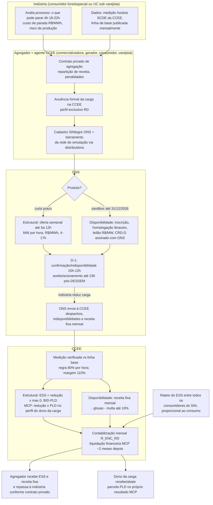

# Pesquisa 2.1-B — Resposta da Demanda (RD) e agregação de flexibilidade industrial

> Data de referência e de consulta de todas as fontes: **27/11/2026**.
> Escopo: somente a seção 2.1-B do `PLANO.md`. Toda afirmação material traz uma referência `[Rn]` (tabela no fim) e um status: **CONFIRMADO** (lido na fonte primária ou em documento oficial), **INFERÊNCIA** (dedução minha a partir de dados confirmados), **HIPÓTESE** (suposição a validar), **NÃO VERIFICADO** (fonte secundária única, fonte inacessível ou conflito entre fontes).
> Unidades: MW = potência; MWh = energia; R$/MWh = preço de energia (programa estrutural); R$/MW = preço de disponibilidade **para todo o período contratado** (produto Disponibilidade). Os dois preços não são comparáveis sem conversão explícita.

---

## 0. Resumo executivo

1. **Existem hoje dois produtos de RD, e só eles.** (a) O **Programa Estrutural** (REN ANEEL 1.040/2022, que alterou a REN 1.030/2022). É permanente. O agente faz ofertas semanais de redução (mínimo de 5 MW por hora, de 4 a 17 h, preço em R$/MWh) e o ONS aceita ou não em D-1. Paga-se apenas por acionamento entregue. (b) O **Produto Disponibilidade**, em *sandbox* regulatório (REA 12.600/2022, prorrogada pela REA 15.457/2024 **até 31/12/2026**). É contratado em leilão do ONS (pay-as-bid, R$/MW para o período) e paga receita fixa mensal mais uma parcela variável ao PLD. **CONFIRMADO** [R1][R2][R5][R7][R8].
2. **Volumes reais são pequenos.** No Produto Disponibilidade foram contratados **93 MW (2024)**, **229 MW (2025)** e **344 MW (2026, set–dez)**, todos com receita fixa. No 1º mecanismo, a receita original foi de R$ 5,72 mi e o valor **liquidado** foi de R$ 5,04 mi após R$ 0,68 mi de penalidades. No estrutural, entre nov/2023 e ago/2025, foram **734 ofertas aprovadas** de 2.493, de **cerca de 62 empresas**, a preços de 99 a 2.000 R$/MWh. Em 2024 o montante acionado foi de 42.325 MWh. **CONFIRMADO** [R5][R24]. A EPE estima que a capacidade contratada equivale a ~0,3% do pico [R12].
3. **Quem paga:** consumidores do SIN, via **Encargos de Serviços do Sistema (ESS)**, rateados pelo consumo. No estrutural, o ESS paga apenas **max(0; preço ofertado − PLD) × redução**. A parcela "PLD × redução" só se realiza se o dono da carga tiver sobra contratual liquidada no MCP. **CONFIRMADO** [R7][R8]. A Lei 15.269/2025 criou a base para um **novo mecanismo competitivo custeado pelo ERCAP** (art. 3º-E da Lei 10.848/2004). A regulamentação ANEEL ainda não existe, e a alocação do ERCAP está em consulta no MME (Portaria MME 931/2026). **CONFIRMADO** (lei e consulta) [R21][R22]; regulamentação **NÃO VERIFICADO** (não encontrada).
4. **Quem pode agregar:** apenas um **agente da CCEE** (consumidor, comercializador, gerador ou varejista), adimplente, com perfil de agregador e anuência formal das cargas. Cargas de varejo no modelo simplificado participam **obrigatoriamente via o próprio varejista, sem possibilidade de troca**. **CONFIRMADO** [R7][R3]. Uma startup que não seja agente da CCEE **não pode ofertar nem agregar**.
5. **Não há mercado bilateral líquido de "flexibilidade" fora da RD regulada.** Não encontrei base legal específica, produto padronizado, plataforma nem dados de liquidez. O que existe é: (i) RD implícita via PLD horário, para quem tem contrato e reduz consumo; (ii) cláusulas de flexibilidade de volume nos contratos ACL; (iii) sinais tarifários de ponta da distribuidora. **INFERÊNCIA** a partir de busca negativa e da estrutura de liquidação [R7].
6. **Incerteza regulatória alta para 2027.** O sandbox expira em 31/12/2026. A MME lista como "prevista" a "definição sobre regulação definitiva" [R23]. Em 02/09/2026, o CMSE determinou aprimoramentos "já para 2027" [R19]. A EPE propôs em set/2026 nova linha de base ("maior 5 de 10" com ajuste), remuneração em duas partes com CVU declarado e contratos de 3 meses a 5 anos ou mais [R12][R14]. Em 22/09/2026 a ANEEL **não aprovou** a inclusão da RD nos modelos de preço e deu 90 dias para ONS/CCEE melhorarem a transparência (Despacho 3.695/2026) [R20]. **Não encontrei CP aberta da ANEEL específica de RD em 2026** (NÃO VERIFICADO).
7. **Implicação para o negócio:** o mercado pagante total (receita bruta de **todos** os participantes) é da ordem de **R$ 10–50 milhões/ano** (INFERÊNCIA, §8). Os compradores (ONS, e indiretamente os consumidores via ESS) são únicos e regulados. O número de agregadores ativos é de um dígito pelo que encontrei. A AXIA oferece sua plataforma de agregação **gratuita por 12 meses** [R28]. Para H2 e H3, isso define um teto de receita muito baixo (ver resposta final).

---

## 1. Linha do tempo regulatória (o que valeu e o que vale)

| Período | Instrumento | Situação em 27/11/2026 | Status |
|---|---|---|---|
| nov/2017–set/2022 | Programa Piloto, REN 792/2017. Ampliado pela REN 911/2020 (todos os submercados, agregador permitido). Portaria MME 460/2020 isentou a RD do rateio de inadimplência | Encerrado | CONFIRMADO [R2][R6] |
| set/2021–abr/2022 | RVD, Portaria MME 22/2021 (crise hídrica) | Encerrado | CONFIRMADO [R2][R6] |
| 26/07/2022 | REN 1.030/2022 (consolidação). Revogou a REN 792 | Vigente (base) | CONFIRMADO [R5] |
| 30/08/2022 | **REN 1.040/2022**: cria o Título do **Programa Estrutural** a partir de 01/10/2022 e prevê ARR após 2 anos | **Vigente** | CONFIRMADO [R8][R5] |
| 30/08/2022 | **REA 12.600/2022**: sandbox do Produto Disponibilidade, inicialmente até 30/09/2024 | **Vigente até 31/12/2026** | CONFIRMADO [R5] |
| out/2022–dez/2023 | Programa estrutural "provisório". Regras de Comercialização definitivas desde jan/2024 | — | CONFIRMADO [R2] |
| CP ANEEL 36/2023 (21/09–06/11/2023) | Representar a RD na cadeia de modelos (DESSEM) a partir de 2024 | **Não implementado.** Em 22/09/2026 a ANEEL decidiu não aprovar "por ora" (Despacho 3.695/2026, DOU 24/09/2026) | CONFIRMADO (decisão) [R20]; CP 36/2023 via fonte secundária [R36] |
| 10/09/2024 | REA 15.457/2024: prorroga o sandbox até 31/12/2026 | Vigente | CONFIRMADO [R5] |
| 15/10/2024 | 1º mecanismo: 93 MW, nov/24–jan/25 | Liquidado | CONFIRMADO [R5] |
| 15–16/07/2025 | 2º mecanismo: 229 MW, set/25–jan/26 | Executado; liquidação total **não verificada** | CONFIRMADO (contratação) [R5] |
| 24/11/2025 | **Lei 15.269/2025**, art. 9º: insere o art. 3º-E na Lei 10.848/2004 (mecanismo competitivo para "resposta do consumo" custeado pelo ERCAP; excedente acima do PLD pago pelo encargo) | Lei vigente; **regulamentação ANEEL não localizada** | CONFIRMADO (texto) [R21] |
| jan/2026 | Regras de Comercialização CCEE, Módulo 25 RD, v2026.1.0 | Vigente | CONFIRMADO [R7] |
| 28/04/2026 | Procedimento de Comercialização Submódulo 9.1 RD, rev. 1.0 (adequação à REN 1.080/2023, Despacho 1.432/2026) | Vigente, segundo snippet | NÃO VERIFICADO (snippet de busca; PDF CCEE bloqueado) |
| 2026 | Regras que permitem agregar consumidores **abaixo de 500 kW de um varejista** ("finalizada") | Vigente | CONFIRMADO (relatório MME) [R23] |
| 15/07/2026 | 3º mecanismo: 344 MW, set–dez/2026 | Em execução | CONFIRMADO [R1][R4][R16][R17] |
| 24/08/2026 | MME abre consulta (Portaria MME 931/2026) sobre o rateio do ERCAP. Inclui cobrir via ERCAP "mecanismos competitivos estruturados pela ANEEL" de resposta do consumo | Em consulta; não vigente | CONFIRMADO (notícia MME) [R22] |
| 02/09/2026 | CMSE (323ª reunião): continuidade e aprimoramento da RD para 2027. ANEEL deve apresentar cronograma | Determinação | CONFIRMADO via imprensa [R19] (ata oficial não lida) |
| 18/09/2026 | EPE, NT EPE-DEA-DEE-SEE-SGR-NT-01-2026: potencial de 8,8 GW e recomendações | Estudo (não normativo) | CONFIRMADO [R12][R13] |
| 22/09/2026 | ANEEL, Despacho 3.695/2026: não inclui a RD nos modelos por ora; 90 dias para ONS/CCEE ampliarem a transparência (vence ~21/12/2026) | Vigente | CONFIRMADO via imprensa [R20] |
| 31/12/2026 | **Fim do sandbox do Produto Disponibilidade** | Sucessor **não identificado** | CONFIRMADO (prazo) [R5][R23]; sucessão NÃO VERIFICADO |

---

## 2. Produto 1: Programa Estrutural (curto prazo, D-1). Vigente

| Parâmetro | Regra vigente | Fonte / status |
|---|---|---|
| Elegíveis | Consumidores livres, parcialmente livres (até a parcela livre), especiais, autoprodutores e consumidores do art. 5º da Lei 13.182/2015. Devem estar conectados à rede de supervisão do ONS ou fornecer dados de monitoramento. Também cargas modeladas sob varejista | CONFIRMADO [R7][R8] |
| Pré-requisitos | Cadastro habilitado na CCEE, **adimplência com CCEE e ONS** e cadastro no SINtegre (ONS) | CONFIRMADO [R1][R6] |
| Oferta mínima | **5 MW em cada hora** do produto, constante, com granularidade de 1 MW. Agregados podem somar frações (ex.: 2,5 + 2,5 MW) | CONFIRMADO [R6][R7][R8] |
| Duração | **4 a 17 horas** contínuas, dentro da grade horária mensal do ONS por submercado | CONFIRMADO [R6][R7] |
| Periodicidade | Ofertas **semanais**, até quinta-feira 12h, para a semana operativa seguinte (sábado a sexta). Várias ofertas por dia são permitidas, sem sobreposição de horas para a mesma UC | CONFIRMADO [R6][R5] |
| Antecedência | Confirmação do agente em D-1 até 12h. Aceite do ONS em D-1 até 23h (programação diária, etapa pós-DESSEM). O "aceite automático, com recusa só se necessário" foi aceito pelo ONS e estava "em implementação" em 2025 | CONFIRMADO [R6][R5]; implementação NÃO VERIFICADO |
| Critério de despacho | O ONS avalia volume, localização (barramento da rede de simulação) e condições eletroenergéticas, e minimiza o custo total da operação considerando os preços das ofertas. A RD **não entra** no DESSEM/formação de preço (Despacho 3.695/2026) | CONFIRMADO [R6][R8][R20] |
| Preço | Livre, em **R$/MWh**. Faixa observada entre 99 e 2.000 R$/MWh (nov/2023–ago/2025) | CONFIRMADO [R5] |
| Remuneração | **Só por acionamento entregue.** ESS = Σ_h redução_h × **max(0; BID − PLD_h)**. A parcela redução × PLD é "liquidada no MCP" e **depende da posição do dono da carga no MCP** (sobra contratual) | CONFIRMADO [R7] (fórmulas 13.2 e 14) |
| Deslocamento | Permitido fora da grade de redução, em horas divulgadas pelo ONS. Consumo acima da **margem superior de 110% da linha base** em horas proibidas é abatido da redução, de forma *flat* | CONFIRMADO [R7][R4] |
| Linha de base | Média horária simples dos dias úteis do último mês completo (sábados: dois últimos meses). Exclui feriados e dias com oferta. É publicada mensalmente pela CCEE e vale para o mês seguinte, com **defasagem de até ~2 meses**. Agregador: soma das linhas de base individuais | CONFIRMADO [R7][R5][R4] |
| Tolerância de entrega | Em cada hora, redução < **80%** do despachado = não atendimento: sem remuneração naquela hora e conta para suspensão | CONFIRMADO [R7] |
| Suspensão | **7 ou mais** descumprimentos no mês levam a **3 meses** de suspensão (página ONS; o número máximo está nos Procedimentos de Rede). Há também suspensão automática por inadimplência | CONFIRMADO [R1][R2][R7] |
| Penalidade financeira | Não há multa. A perda é a remuneração da hora não entregue | CONFIRMADO [R1][R8] |

**Volumes do estrutural (liquidação ou acionamento real, não anúncio):**

| Indicador | Valor | Tipo | Fonte |
|---|---|---|---|
| Ofertas aprovadas / analisadas (nov/2023–18/08/2025) | 734 / 2.493 | Acionamento ONS | CONFIRMADO [R5] |
| Empresas ofertantes (mesmo período) | ~62 | — | CONFIRMADO [R5] |
| Tamanho das ofertas aceitas | 5 a 120 MW | — | CONFIRMADO [R5] |
| Setores | Metalurgia 58,2%; minerais não metálicos 17,5%; químicos 16,0%; madeira, papel e celulose 7,1% | — | CONFIRMADO [R5] |
| Montante acionado em 2024 | **42.325 MWh** ("62 MWm") | Apresentação CCEE ao CMSE | CONFIRMADO [R24] |
| Redução média em 2024 (até a contabilização de ago/24) | "237 MW médios"; 69 dias com acionamento | Notícia CCEE. **Conflita** com o "62 MWm" do CMSE (métricas diferentes) | NÃO VERIFICADO (conflito) [R25] |
| Recorde horário (estrutural + disponibilidade) | 295 MW em 12/11/2024 | Despacho | CONFIRMADO [R5] |
| Set/2024 | 55 MWm a R$ 922/MWh médio, R$ 4,24 mi via ESS | Contabilização | NÃO VERIFICADO (snippet de busca da ata CMSE) |
| Jan/2025 | 126 MWm a R$ 788/MWh médio, R$ 2,08 mi via ESS, 4 UCs, 2 dias | Dados preliminares CCEE | CONFIRMADO [R24] |
| Jun/2025 e Set/2025 | R$ 0 via encargos RD | Contabilizado | NÃO VERIFICADO (snippet; páginas CCEE sem o número) |
| Nov/2025 | **R$ 900,95** (sic) via encargos RD | Cálculo CCEE | CONFIRMADO [R26] |

INFERÊNCIA: o estrutural depende muito da conjuntura. Em meses de PLD alto ou de ponta apertada, paga alguns milhões de reais; em meses folgados, ~zero. Não encontrei total anual oficial liquidado de 2024 ou 2025 (lacuna L1).

---

## 3. Produto 2: Disponibilidade (sandbox, mecanismo competitivo). Vigente até 31/12/2026

### 3.1 Regras do 3º mecanismo (Edital RD-D/001/2026)

| Parâmetro | Regra | Status |
|---|---|---|
| Comprador / contraparte | **ONS**, único comprador. Contrato padrão CRD-D, sem negociação de cláusulas | CONFIRMADO [R3] |
| Vigência | 01/09/2026 a 31/12/2026 (**83 dias úteis**) | CONFIRMADO [R3][R4] |
| Produto | Dias úteis, **18h–22h (4 h)**, todos os subsistemas, **2 acionamentos/mês** (mínimo = máximo), 8 no total. Os acionamentos são **obrigatoriamente usados** | CONFIRMADO [R3][R4][R5] |
| Lote | **5 a 100 MW** inteiros, por oferta. Uma oferta por UC por mecanismo. As UCs ficam fixas durante a vigência | CONFIRMADO [R3][R4] |
| Preço | **R$/MW para todo o período**. Receita total = MW × R$/MW, rateada por mês proporcionalmente aos dias úteis | CONFIRMADO [R4] |
| Preço-teto | **R$ 55.000/MW** (2024: R$ 70.000/MW; 2025: R$ 200.000/MW para 6 acion./mês e R$ 160.000/MW para 4 acion./mês, ambos para 5 meses) | CONFIRMADO [R3][R4][R5] |
| Formato | Leilão de compra, fase aberta + fase fechada, pay-as-bid, preço de reserva oculto. Sem montantes parciais da oferta marginal. Desempate favorece recursos não fósseis | CONFIRMADO [R3] |
| Antecedência | Declaração de indisponibilidade em D-1 até 10h. Acionamento pelo ONS em D-1 até 23h | CONFIRMADO [R4][R5] |
| Prioridade | A Disponibilidade é despachada antes do estrutural. Esgotados os acionamentos do mês, a carga pode ofertar no estrutural | CONFIRMADO [R5][R4] |
| Remuneração | **Receita fixa** (lance) + **parcela variável ao PLD**, que depende de a carga ter contratos ou garantia física sobrando no MCP e **não é objeto do CRD-D** | CONFIRMADO [R3] |
| Penalidades | Indisponibilidade declarada: fator exponencial sobre a receita mensal (ex.: 6 h de 114 h, penalidade de 5,4%). Não entrega: redução proporcional, horária, **sem tolerância**. Multa além da glosa **limitada a 10% da receita fixa mensal** no sandbox. Inadimplência conta como indisponibilidade | CONFIRMADO [R4][R5] |
| Suspensão | Fica fora do mecanismo seguinte quem não entregou **nenhuma** hora dos acionamentos | CONFIRMADO [R3][R4] |
| Habilitação extra | Homologação de conformidade legal e financeira pelo **Ibracem**, representante do ONS (taxa de R$ 100, até 5 dias úteis), e certificado ICP-Brasil para assinar | CONFIRMADO [R3][R4] |
| Pagamento | Contabilização e liquidação mensal na CCEE, como **ESS** rateado entre todos os agentes com consumo no SIN. Sujeito ao rateio de inadimplência do MCP | CONFIRMADO [R5] |

### 3.2 Resultados reais por mecanismo

| Mecanismo | MW | Vencedores | Preços (R$/MW, período) | Dias úteis | Receita (R$) | Status financeiro |
|---|---|---|---|---|---|---|
| 1º (15/10/2024), nov/24–jan/25, 4 acion./mês | **93** | 4 (Gerdau Aços Longos 40; Rima 25; Gerdau Ouro Branco 20; Maringá Ferro Liga 8), todos SE-CO, metalurgia | 59.904 a 64.296; média 61.522,37 (≈ R$ 992,30/MW·dia útil) | 62 | Original **5.721.611**; penalidades 684.888 (11,97%); **líquida 5.036.723** | **Liquidado.** 4,65 GWh reduzidos; 91,26% do contratado (limitado ao contrato). CONFIRMADO [R5] |
| 2º (15–16/07/2025), set/25–jan/26, 4 ou 6 acion./mês | **229** | 6 (Ferbasa 100 NE; Liasa 75; Gerdau OB 20; Serena Geração 16 NE; Fiven 10; Maringá 8) | 124.890 a 150.000 (≈ R$ 1.300/MW·dia útil) | 107 | Soma MW × preço ≈ **31,86 mi** (bruta, antes de penalidades) | Contratação CONFIRMADO [R5]. Receita = INFERÊNCIA (soma da tabela). Liquidação final NÃO VERIFICADO. Estimativas CCEE de ESS da disponibilidade de ~R$ 5,6 mi (nov/25) e ~R$ 6,25 mi (dez/25) NÃO VERIFICADO (snippet InfoPLD) |
| 3º (15/07/2026), set–dez/26, 2 acion./mês | **344** (12 ofertas) | Maiores, segundo a imprensa: Ferbasa/"Febrasa" 100 (NE), Minasligas 56, Gerdau Aços Longos 40. Metalurgia ~86%. Associadas da Abrace ~70% | **23.375 a 39.000**; deságio médio 49,23% sobre R$ 55.000 | 83 | Se o deságio médio for simples: ~27.900 R$/MW × 344 ≈ **R$ 9,6 mi** | Contratação CONFIRMADO [R1][R16][R17]. Lista e preços por agente: fonte secundária única, NÃO VERIFICADO. Receita = INFERÊNCIA. Divisão regional diverge (61/35/4 vs 67/29/4) |

Observação: um artigo de opinião [R32] cita "R$ 70.000/MW-mês" e "Liasa 175 MW". Ambos **contradizem** o relatório oficial (R$ 70.000/MW para os 3 meses inteiros; Liasa 75 MW). É exemplo de por que fontes secundárias foram rebaixadas.

### 3.3 Conversão para comparar (INFERÊNCIA, cálculo meu)

| Mecanismo | R$/MW·mês | Horas máximas acionáveis | R$ por MWh efetivamente reduzido (só a receita fixa) |
|---|---|---|---|
| 1º | 61.522 / 3 ≈ **20.500** | 12 × 4 h = 48 h | 61.522 / 48 ≈ **1.282** (se 100% entregue) |
| 2º (6 acion.) | ~140.000 / 5 ≈ **28.000** | 30 × 4 h = 120 h | ≈ **1.170** |
| 3º | ~27.900 / 4 ≈ **7.000** | 8 × 4 h = 32 h | ≈ **870** |

A remuneração por disponibilidade, convertida, fica na mesma ordem dos lances do estrutural (R$ 800–1.000/MWh). A diferença é a **previsibilidade**: a receita fixa é garantida mesmo que o sistema "não precise", porque os acionamentos são obrigatórios.

---

## 4. Agregação: quem pode, como e com quais restrições

| Tema | Regra | Status |
|---|---|---|
| Quem pode ser agregador | **Agente da CCEE** nas categorias consumidor, comercializador ou gerador, inclusive varejista, **adimplente**. Cria um **perfil exclusivo de RD** na CCEE | CONFIRMADO [R7][R8][R3] |
| Consentimento | Comprovação de **anuência** dos detentores das cargas, formalizada na CCEE (Procedimento de Comercialização). A CCEE informa os agregadores ao ONS semanalmente, às quintas | CONFIRMADO [R7][R4][R6] |
| Autorrepresentado com várias UCs (matriz e filiais) | Também precisa criar perfil de agregador. Uma única UC autorrepresentada está dispensada | CONFIRMADO [R1][R3] |
| Responsabilidade | O agregador responde pelas consequências financeiras **das ofertas**. Sua representação vale só para a RD, sem afetar a comercialização da carga | CONFIRMADO [R7] |
| Fluxo de dinheiro | O **ESS vai para o perfil do agregador**. A parcela MCP (redução × PLD) é **zero no perfil do agregador** e fica no perfil do **dono da carga**, proporcionalmente (PART_C_AGR_RD) | CONFIRMADO [R7] |
| Suspensão | Atinge o agregador inteiro, independentemente de qual carga falhou | CONFIRMADO [R7] |
| Troca de cargas | Na Disponibilidade é **vedado** alterar UCs após o prazo do edital. A saída de uma UC agregada pode fazer o agregador perder a receita fixa | CONFIRMADO [R3] |
| Varejo (modelo simplificado) | Participação **"necessariamente via Varejista"**, que vira o "agregador natural", **sem possibilidade de troca**. As UCs formam uma carga virtual por distribuidora | CONFIRMADO [R7] |
| Pequenas cargas | Desde 2026 as regras permitem agregar consumidores **< 500 kW** de um varejista | CONFIRMADO [R23] |
| Mínimo de 5 MW | Mantido pelo ONS (natureza atacadista). Pleitos de 1 MW (2024) e de flexibilização pela Abraceel (20/05/2026) não foram acatados no 3º edital | CONFIRMADO [R5][R31][R3] |
| Agregadores ativos | AXIA: "três ofertas agregadas até agora", uma de 15 MW no estrutural, até R$ 991/MWh. Primeira agregada: 80 MW de uma UC da Anglo American. A AXIA oferece plataforma "a partir de 1 MW", **grátis por 12 meses**. A Enel Comercializadora se apresenta como agregadora (página sem conteúdo legível). **Não existe contagem oficial de agregadores** | CONFIRMADO (AXIA) [R28][R29][R30]; contagem: lacuna L3 |

INFERÊNCIA: a "1 MW" da AXIA quer dizer que a AXIA, como agregadora, junta cargas pequenas até chegar a 5 MW por oferta. O mínimo do ONS continua sendo 5 MW.

---

## 5. Fluxo completo indústria → agregador → ONS → CCEE → pagamento

Os detalhes do diagrama estão nas fontes [R3][R4][R6][R7]. O "contrato privado de agregação" e o "repasse" **não têm modelo regulado**: são bilaterais (INFERÊNCIA; não encontrei minuta padrão nem regra sobre repartição, lacuna L4). A defasagem até o pagamento resulta da contabilização mensal da CCEE mais o ciclo de liquidação do MCP: INFERÊNCIA a partir de [R7] e dos comunicados "MS+12du / MS+21du" [R27].

---

## 6. Exemplos numéricos (rotulados)

### Exemplo A: Disponibilidade, 3º mecanismo (HIPÓTESE de lance; regras CONFIRMADAS)
- Carga: **20 MW** de redução, SE-CO, lance de **R$ 30.000/MW** (dentro da faixa vencedora de 23.375–39.000 [R17]; teto de 55.000 [R3]).
- Receita total = 20 MW × R$ 30.000/MW = **R$ 600.000** para 01/09–31/12/2026 (83 dias úteis) [fórmula R4].
- Receita mensal, por exemplo em outubro com ~21 dias úteis (HIPÓTESE de calendário): 600.000 × 21/83 ≈ **R$ 151.800**.
- Energia a reduzir: 8 acionamentos × 4 h × 20 MW = **640 MWh** no período, o que dá R$ 600.000 / 640 MWh ≈ **R$ 937/MWh** equivalente.
- Risco: entregar 80% numa hora não gera margem de tolerância. A redução da receita é proporcional e horária, e há multa de até 10% da receita mensal [R4]. No 1º mecanismo, a perda média foi de **11,97%** [R5].
- Parcela variável: +640 MWh × PLD **somente** se a indústria tiver energia contratada sobrando no MCP. Com PLD de R$ 300/MWh (HIPÓTESE), seriam ~R$ 192 mil, que **ficam no perfil do dono da carga**, não no do agregador [R7].

### Exemplo B: Estrutural, um acionamento (HIPÓTESE de preço e PLD)
- Oferta: 10 MW × 4 h = **40 MWh**, BID de **R$ 900/MWh** (faixa observada 99–2.000 [R5]); PLD horário de R$ 300/MWh (HIPÓTESE; em 2026 o PLD varia entre R$ 57,31 e R$ 1.611,04/MWh no teto horário [R33], NÃO VERIFICADO na fonte ANEEL).
- ESS = 40 × max(0; 900 − 300) = **R$ 24.000** [fórmula R7].
- MCP = 40 × 300 = **R$ 12.000**, se houver sobra contratual. Total econômico: R$ 36.000 = R$ 900/MWh.
- Se o PLD subir para R$ 900, o ESS vale **zero** e todo o valor vem do MCP. Para um agregador remunerado só pelo ESS, a receita pode desaparecer justamente quando o sistema está apertado (INFERÊNCIA a partir de [R7]).
- Anualização (HIPÓTESE): 15 acionamentos/ano dão ~R$ 360 mil de ESS + R$ 180 mil de MCP por 10 MW.

---

## 7. Disponibilidade vs. acionamento, e riscos de não entrega

| Dimensão | Estrutural (por acionamento) | Disponibilidade (receita fixa) |
|---|---|---|
| Previsibilidade da receita | Baixa: depende de o ONS aceitar e do PLD | Alta no período, mas só existe com leilão anual, e o sandbox acaba em 31/12/2026 |
| Custo de oportunidade | Escolhido semana a semana | Compromisso firme por 4–5 meses, com acionamentos obrigatórios em dias consecutivos possíveis |
| Penalidade | Só perde a hora; suspensão por 3 meses com ≥ 7 falhas | Glosa exponencial + multa até 10% da receita mensal; exclusão do próximo mecanismo se falhar tudo |
| Risco de linha de base | Linha de base com 2 meses de defasagem; quem tem consumo sazonal é penalizado ou favorecido | O mesmo problema, agravado porque o lance é dado sem conhecer a linha de base dos meses de entrega (ABRACE) [R5] |
| Risco de crédito | Inadimplência na CCEE ou ONS suspende o agente | Inadimplência = dias de indisponibilidade |
| Risco de liquidação | Recebe dentro do MCP, sujeito ao rateio de inadimplência | Igual [R5] |
| Risco de agregador | Falha de uma carga suspende o portfólio inteiro | Não pode trocar cargas; saída de UC pode zerar a receita fixa |

Fontes: [R1][R3][R4][R5][R7]; a síntese é minha (INFERÊNCIA).

---

## 8. Tamanho real do mercado pagante (INFERÊNCIA, com fórmulas)

- **Disponibilidade:** R$ 5,0 mi (2024/25, liquidado) + ~R$ 31,9 mi (2025/26, bruto) + ~R$ 9,6 mi (2026, bruto), cerca de **R$ 46 mi em ~3 anos**, ou ~R$ 15 mi/ano em média, muito volátil (o preço-teto caiu de 200k para 55k R$/MW).
- **Estrutural:** 42.325 MWh acionados em 2024 [R24] × preço médio ~R$ 800–900/MWh [R24] ≈ **R$ 34–38 mi de valor econômico bruto** (ESS + MCP). A parcela ESS é menor, porque desconta o PLD. Os meses mostram de R$ 0 a ~R$ 4 mi. **Total oficial não localizado** (L1).
- **Total de receita para participantes:** **R$ 10–50 mi/ano**. Uma fatia de intermediação de 10–20% (HIPÓTESE: margem típica de agregador, não verificada) daria **R$ 1–10 mi/ano para todos os intermediários juntos**.
- **Receita por MW** para a indústria: ~R$ 7.000/MW·mês (2026) a R$ 28.000/MW·mês (2025) na Disponibilidade, só durante a vigência. No estrutural, ~R$ 3.600 por MW por acionamento de 4 h a R$ 900/MWh.
- **Potencial vs. real:** EPE, 8,8 GW (faixa de 5,9 a 13,1 GW), contra 344 MW contratados, cerca de 26 vezes menos. A própria EPE diz que o potencial "não representa capacidade imediatamente disponível" [R12][R14].

---

## 9. Negociação bilateral de "flexibilidade" fora da RD regulada

| Pergunta | Achado | Status |
|---|---|---|
| Há base legal específica para vender "redução de carga" bilateralmente a uma comercializadora? | Não encontrei. A Lei 15.269/2025 fala em contratar reserva "na forma de potência **ou de flexibilidade**" e em mecanismo competitivo da ANEEL. Ambos são mecanismos **centralizados**, não bilaterais [R21] | INFERÊNCIA (busca negativa) |
| Há plataforma ou bolsa com produto padronizado de flexibilidade? | Não encontrei | NÃO VERIFICADO (ausência de evidência) |
| O que existe na prática | (i) **RD implícita**: com PLD horário, o consumidor com contrato que reduz consumo liquida a sobra ao PLD no MCP, sem precisar do ONS. É legal e já embutido na liquidação [R7]. (ii) **Cláusulas de flexibilidade** de volume e sazonalização nos contratos ACL, que são parte do contrato de energia e não um produto de RD. (iii) **Sinal tarifário** de ponta da distribuidora (TUSD/demanda), regime distinto | INFERÊNCIA |
| Compradores, liquidez | Nenhum comprador identificado fora do ONS | NÃO VERIFICADO |
| Conclusão | **Não presumir** um mercado de ofertas de flexibilidade que se possa casar automaticamente | — |

---

## 10. Aprimoramentos propostos e o que está em consulta

**EPE (NT-01-2026, set/2026) [R12][R13][R14][R15]**, status CONFIRMADO via página EPE e imprensa; PDF não lido diretamente:
- Linha de base **"maior 5 de 10"**, com ajuste aditivo pelo consumo do dia (limite de ±20%), janela de 2 h antes do evento e cálculo **individual por instalação** antes de somar no agregador. Para cogeração, duas medições separadas.
- Remuneração em **duas partes**: fixa por disponibilidade + variável por acionamento, com **CVU declarado** pelo participante. A RD entraria na ordem de mérito e no CMO.
- Contratos de **~3 meses** (sazonais, como bagaço) e de **5 anos ou mais** (para financiar investimentos em flexibilidade), estes contando na necessidade de potência dos LRCAP.
- Produtos de 1–4 h, 2–20 acionamentos/mês, aviso de 15 min a 24 h, recuperação mínima de até 15 h, rampas de até 3 h. Ajuste do preço-teto.

**ONS/CCEE (relatório do sandbox) [R5]:** produto com 1 acionamento semanal; nova linha de base com histórico recente (debatida em CP da ANEEL); remuneração fixa para um número mínimo de acionamentos + adicional incremental; participação de armazenamento autônomo (SAE); APIs e dados abertos, inclusive para varejistas; liquidação da RD separada do MCP (competência do MME); "triagem prévia de elegibilidade com base no histórico de consumo".

**Em consulta ou deliberação (2025–2026):**
- **MME, Portaria 931/2026 (24/08/2026):** rateio do ERCAP pelo consumo na janela de maior demanda líquida (até 4 h em dias úteis) e cobertura, via ERCAP, de mecanismos competitivos de RD da ANEEL. CONFIRMADO [R22]. Prazo e número da CP: fontes divergem (NÃO VERIFICADO).
- **ANEEL, Despacho 3.695/2026 (22/09/2026):** nega por ora a inclusão nos modelos, pede cronograma e dá 90 dias para transparência. CONFIRMADO [R20].
- **CMSE (02/09/2026):** ANEEL deve apresentar cronograma para revisar linha de base, produtos, prazos, remuneração e acompanhamento. CONFIRMADO via imprensa [R19].
- **ANEEL, CP específica de RD em 2025–2026:** **não localizada**. A CP 33/2025 aparece em busca sem tema confirmado, e a CP 9/2025 trata de Regras de Comercialização do Título II-A da REN 1.030, com conteúdo de RD não confirmado. NÃO VERIFICADO (L5).

---

## 11. Lacunas e impacto

| # | Lacuna | Impacto na decisão | Como fechar |
|---|---|---|---|
| L1 | Total anual oficial liquidado (R$) e MWh do estrutural em 2024, 2025 e 2026 | O TAM fica com incerteza de ±50% | Dados Abertos CCEE (datasets de encargos RD, ms+21du). O portal bloqueia acesso automatizado (403) |
| L2 | Liquidação final do 2º mecanismo (penalidades) e lista oficial ONS do 3º | Erro em R$/MW realizado | Relatório semestral ONS/CCEE à ANEEL; página de resultados do ONS |
| L3 | Número de agregadores com perfil na CCEE e quantos ofertaram | Define quantos compradores H3 teria | Pedido à CCEE (LAI) ou entrevista com ONS/ABRACEEL |
| L4 | Termos reais de repartição agregador↔indústria (%, garantias) | Define a receita por MW de um intermediário | Entrevistas com AXIA, Enel, comercializadoras e indústrias Abrace |
| L5 | Existência de CP ANEEL 2026 sobre RD ou ARR da REN 1.040 | Regras de 2027 desconhecidas | Portal de participação da ANEEL, pauta da Diretoria |
| L6 | Sucessor do sandbox após 31/12/2026 (nova REA, ou mecanismo ERCAP do art. 3º-E) | **Crítico**: o produto com receita fixa pode não existir em 2027 | Acompanhar o cronograma ANEEL exigido pelo CMSE |
| L7 | Texto integral da REN 1.040 e da REA 12.600 no cedoc (403) | Baixo: os conteúdos foram confirmados por fontes oficiais derivadas (ONS/CCEE) e pelo lex.com.br | Baixar manualmente |
| L8 | PDF da NT EPE 01-2026 não lido diretamente | Médio: detalhes de produto vieram da imprensa | Ler o PDF |
| L9 | Limites de PLD 2026 só por imprensa | Baixo | REH ANEEL de dez/2025 |

---

## 12. Referências

| ID | Título / descrição | URL | Órgão / autor | Data publicação | Data consulta | Status |
|---|---|---|---|---|---|---|
| R1 | Página Resposta da Demanda | https://www.ons.org.br/paginas/energia-amanha/resposta-da-demanda | ONS | n/d (itens até 06/08/2026) | 27/11/2026 | CONFIRMADO |
| R2 | Página Resposta da Demanda | https://www.ccee.org.br/pt/web/guest/resposta-demanda | CCEE | n/d | 27/11/2026 | CONFIRMADO |
| R3 | Edital Mecanismo Competitivo RD-D/001/2026 | https://www.ons.org.br/AcervoDigitalDocumentosEPublicacoes/Edital%20do%20Mecanismo%20competitivo%20RD-Disponibilidade%202026%20-%20vers%C3%A3o%20final%20-%2026%20de%20maio.pdf | ONS | 26/05/2026 | 27/11/2026 | CONFIRMADO |
| R4 | Workshop ONS/CCEE Sandbox RD 2026 | https://www.ons.org.br/AcervoDigitalDocumentosEPublicacoes/Workshop%20ONS_CCEE_Sandbox%20RD_25_05_2026.pdf | ONS/CCEE | 25/05/2026 | 27/11/2026 | CONFIRMADO |
| R5 | Relatório conjunto de avaliação do Sandbox de RD (REA 12.600/2022) | https://www.ons.org.br/AcervoDigitalDocumentosEPublicacoes/Relat%C3%B3rio%20de%20Avalia%C3%A7%C3%A3o%20ONS_CCEE_do%20Sandbox%20Regulat%C3%B3rio%20de%20RD%20para%20ANEEL.pdf | ONS/CCEE | dados até 18/08/2025; listado como atualizado em 04/02/2026 | 27/11/2026 | CONFIRMADO |
| R6 | Perguntas e respostas: RD | https://www.ons.org.br/AcervoDigitalDocumentosEPublicacoes/Perguntas%20e%20respostas%20-%20Resposta%20da%20Demanda.pdf | ONS | n/d (pós-2022) | 27/11/2026 | CONFIRMADO |
| R7 | Regras de Comercialização, Módulo 25 RD, v2026.1.0 | https://www.ccee.org.br/documents/80415/31001809/25%20-%20Resposta%20da%20Demanda_2026.1.0-JAN.pdf/2f02301d-018c-1c74-e1ae-8eea47a12eac | CCEE | jan/2026 | 27/11/2026 | CONFIRMADO |
| R8 | REN ANEEL 1.040/2022 (texto) | https://www.lex.com.br/resolucao-normativa-aneel-no-1-040-de-30-de-agosto-de-2022/ (original: https://www2.aneel.gov.br/cedoc/ren20221040.pdf, 403) | ANEEL (via Lex) | 30/08/2022 | 27/11/2026 | CONFIRMADO (cópia) |
| R9 | REA ANEEL 12.600/2022 | https://www2.aneel.gov.br/cedoc/rea202212600.pdf | ANEEL | 30/08/2022 | 27/11/2026 | CONFIRMADO indiretamente via R3/R5 (403 no fetch) |
| R10 | REA ANEEL 15.457/2024 (prorrogação até 31/12/2026) | citada em R5 | ANEEL | 10/09/2024 | 27/11/2026 | CONFIRMADO via R5 |
| R11 | ANEEL aprova operacionalização do sandbox de RD | https://www.gov.br/aneel/pt-br/assuntos/noticias/2024/aneel-aprova-operacionalizacao-do-sandbox-regulatorio-do-programa-de-resposta-da-demanda | ANEEL | set/2024 | 27/11/2026 | NÃO VERIFICADO (só snippet) |
| R12 | EPE estima potencial de 8,8 GW de RD | https://epe.gov.br/pt/imprensa/noticias/epe-estima-potencial-de-8-8-gw-de-resposta-da-demanda-no-brasil-e-propoe-aprimoramentos-para-o-mercado | EPE | 18/09/2026 | 27/11/2026 | CONFIRMADO |
| R13 | NT EPE-DEA-DEE-SEE-SGR-NT-01-2026 (página e PDF) | https://www.epe.gov.br/pt/publicacoes-dados-abertos/publicacoes/nota-tecnica-resposta-da-demanda-diagnostico-do-potencial-e-recomendacoes-para-desenvolvimento-do-mercado | EPE | set/2026 | 27/11/2026 | CONFIRMADO (página); PDF não lido |
| R14 | EPE propõe novas regras para ampliar RD | https://simpleenergy.com.br/epe-propoe-novas-regras-para-ampliar-resposta-da-demanda/ | Simple Energy (imprensa) | 22/09/2026 | 27/11/2026 | NÃO VERIFICADO (secundária) |
| R15 | EPE estima potencial de 8,8 GW | https://agenciainfra.com/blog/epe-estima-potencial-de-88-gw-para-resposta-da-demanda-no-brasil/ | Agência iNFRA | 21/09/2026 | 27/11/2026 | CONFIRMADO (coerente com R12) |
| R16 | ONS negocia 344 MW em leilão de RD | https://agenciainfra.com/blog/ons-negocia-344-mw-em-leilao-de-resposta-da-demanda/ | Agência iNFRA | 15/07/2026 | 27/11/2026 | CONFIRMADO (volume, coerente com R1) |
| R17 | ONS contrata 344 MW em novo mecanismo | https://cenarioenergia.com.br/2026/08/06/ons-resposta-da-demanda-344-mw-leilao-sandbox/ | Cenário Energia | 06/08/2026 | 27/11/2026 | NÃO VERIFICADO (preços e agentes de fonte única) |
| R18 | Associadas da Abrace respondem por 70% da RD | https://agenciainfra.com/blog/associadas-da-abrace-respondem-por-70-da-resposta-da-demanda/ | Agência iNFRA | 06/08/2026 | 27/11/2026 | NÃO VERIFICADO (snippet) |
| R19 | CMSE determina aprimoramento da RD para 2027 | https://cenarioenergia.com.br/2026/09/03/cmse-aprimoramento-resposta-demanda-gt-mmgd-operacao-sin-2027/ | Cenário Energia (sobre o CMSE/MME) | 03/09/2026 | 27/11/2026 | CONFIRMADO via imprensa (ata não lida) |
| R20 | ANEEL não aprova, por ora, a RD nos modelos (Despacho 3.695/2026) | https://atlaspublico.com.br/noticias/aneel-nao-aprova-por-ora-representacao-da-resposta-da-88983 ; https://www.paranoaenergia.com.br/noticias/2026/09/22/aneel-pressiona-ons-e-ccee-para-que-sejam-mais-transparentes-na-resposta-da-demanda/ | Atlas Público (DOU) / Paranoá Energia | 22–24/09/2026 | 27/11/2026 | CONFIRMADO (duas fontes coincidentes) |
| R21 | Lei 15.269/2025 (art. 9º, art. 3º-E da Lei 10.848) | https://www.planalto.gov.br/ccivil_03/_ato2023-2026/2025/lei/l15269.htm | Presidência da República | 24/11/2025 | 27/11/2026 | CONFIRMADO |
| R22 | MME abre consulta sobre alocação do ERCAP | https://www.gov.br/mme/pt-br/assuntos/noticias/julho-26/mme-abre-consulta-publica-para-alocacao-do-ercap-para-incentivar-o-consumo-de-energia-fora-do-horario-de-pico-do-sistema | MME | 24/08/2026 (atualizado em 26/10/2026) | 27/11/2026 | CONFIRMADO |
| R23 | Relatório de Monitoramento da Agenda Estratégica Eletroenergética 2026, 2º trimestre | https://www.gov.br/mme/pt-br/assuntos/secretarias/secretaria-nacional-energia-eletrica/agenda-estrategica-eletroenergetica-2026/RELATRIODEMONITORAMENTO_AGENDA__2TRIM_MINv310826vf2.pdf | MME/SNEE | ~31/08/2026 | 27/11/2026 | CONFIRMADO |
| R24 | Ata da 301ª reunião do CMSE | https://www.gov.br/mme/pt-br/assuntos/conselhos-e-comites/cmse/atas/2025/ata-da-301a-reuniao-ordinaria-cmse_vf.pdf | MME/CMSE | reunião de 05/02/2025 | 27/11/2026 | CONFIRMADO |
| R25 | Com Resposta da Demanda, CCEE ajuda a reduzir custos | https://www.ccee.org.br/en/web/guest/-/com-resposta-da-demanda-ccee-ajuda-a-reduzir-custos-na-gestao-da-oferta-e-do-consumo-de-energia-eletrica-no-brasil | CCEE | 01/11/2024 | 27/11/2026 | CONFIRMADO (texto); métrica em conflito com R24 |
| R26 | CO: resultados dos efeitos da RD para encargos, nov/2025 | https://www.ccee.org.br/pt/web/guest/-/co-ccee-disponibiliza-resultados-de-calculos-dos-efeitos-do-mecanismo-de-resposta-da-demanda-rd-para-encargos-nov-2025 | CCEE | 16/12/2025 | 27/11/2026 | CONFIRMADO |
| R27 | CO: resultados contabilizados da RD, set/2025 | https://www.ccee.org.br/en/web/guest/-/co-ccee-disponibiliza-resultados-contabilizados-dos-efeitos-do-mecanismo-de-resposta-da-demanda-para-encargos-set-2025 | CCEE | 29/10/2025 | 27/11/2026 | CONFIRMADO (sem valores na página) |
| R28 | Eficiência que gera valor: Resposta da Demanda | https://axia.com.br/en/w/resposta-da-demanda | AXIA Energia | 30/01/2026 (atualizado em 29/05/2026) | 27/11/2026 | CONFIRMADO (autodeclaração comercial) |
| R29 | Primeira oferta agregada de RD do Brasil | https://axia.com.br/en/w/axia-inova-com-a-primeira-oferta-agregada-de-resposta-da-demanda-do-brasil | AXIA Energia | 24/10/2025 | 27/11/2026 | CONFIRMADO (autodeclaração) |
| R30 | Axia viabiliza ofertas agregadas no programa de RD | https://agenciainfra.com/blog/axia-viabiliza-ofertas-agregadas-no-programa-de-resposta-da-demanda/ | Agência iNFRA | 26/10/2026 | 27/11/2026 | CONFIRMADO (imprensa) |
| R31 | Abraceel envia contribuição ao ONS sobre RD | https://abraceel.com.br/blog/2026/05/abraceel-envia-contribuicao-ao-ons-sobre-resposta-da-demanda/ | Abraceel | 20/05/2026 | 27/11/2026 | CONFIRMADO |
| R32 | Resposta da demanda avançando (opinião) | https://eixos.com.br/energia-eletrica/resposta-da-demanda-avancando-uma-alternativa-estrategica-frente-ao-deficit-de-potencia/ | eixos (Pedro Bittencourt, GreenAnt) | 19/08/2025 | 27/11/2026 | NÃO VERIFICADO (contém erros vs. R5) |
| R33 | ANEEL define limites do PLD 2026 | https://canalsolar.com.br/aneel-define-limite-pld-2026/ | Canal Solar | dez/2025 | 27/11/2026 | NÃO VERIFICADO (sem REH) |
| R34 | InfoPLD nº 741 (estimativa ESS RD disponibilidade) | https://www.ccee.org.br/documents/80415/30980462/741%20-%20InfoPLD_2025_12_sem2.pdf/5808836e-8207-2681-2c63-0cc8d4e3919a | CCEE | dez/2025 | 27/11/2026 | NÃO VERIFICADO (snippet) |
| R35 | ONS contrata 229 MW em RD | https://cenarioenergia.com.br/2025/08/01/ons-contrata-229-mw-em-resposta-da-demanda-com-desagio-medio-de-28-em-relacao-ao-preco-teto/ | Cenário Energia | 01/08/2025 | 27/11/2026 | CONFIRMADO (coerente com R5) |
| R36 | ANEEL autoriza CP para aprimorar regras da RD (CP 36/2023) | https://regulacaoemnumeros-direitorio.fgv.br/post/aneel-autoriza-consulta-publica-para-aprimorar-regras-do-programa-resposta-da-demanda | FGV Direito Rio | 2023 | 27/11/2026 | NÃO VERIFICADO (secundária) |
